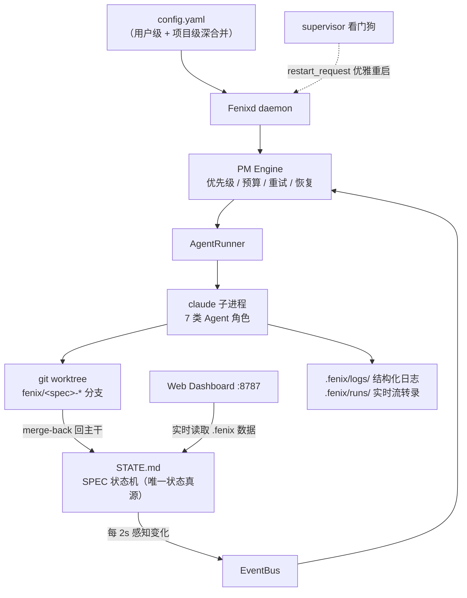
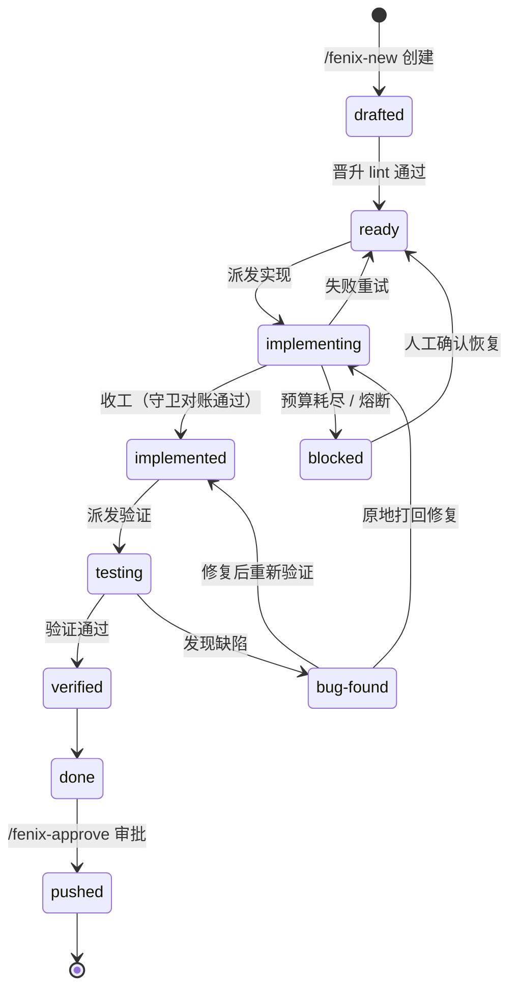
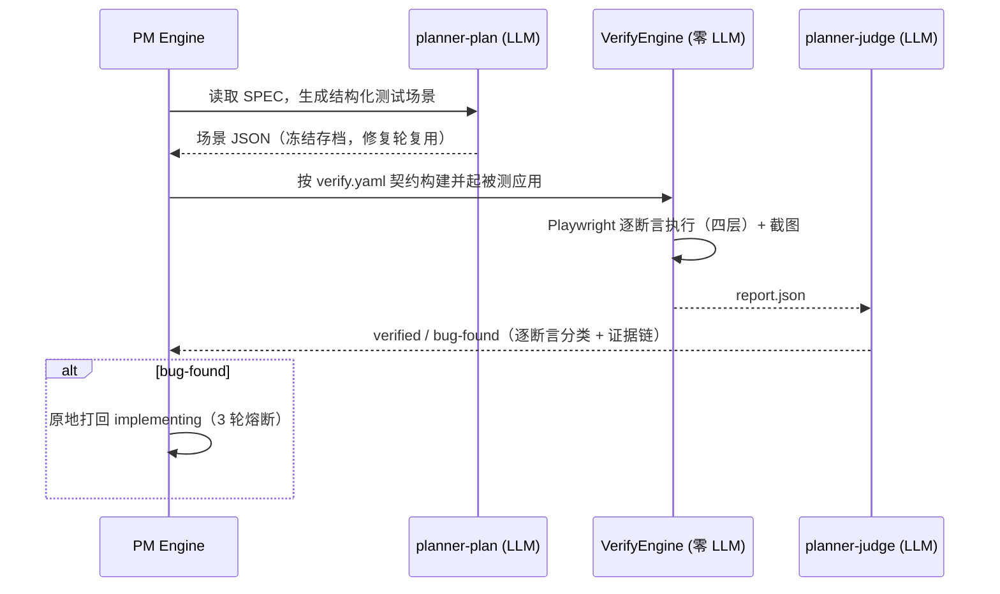

# Fenixd — Fenix Loop Engineering Framework

> 基于 Claude Code 的自动化软件开发循环框架。将自然语言需求自动转化为「已实现、已验证、可推送」的代码，全程无需人工介入。

Fenixd 建立在两个核心理念之上。其一是 **SDD（Spec-Driven Development，规格驱动开发）**：在让 AI 动手写代码之前，先把模糊的需求意图沉淀为一份结构化的 **SPEC**（规格说明，含提案、设计、需求规格与任务清单）——它是整个框架的通用语言，需求的澄清、实现的范围、验证的验收标准全部锚定在这份规格上，人与 AI 之间不再是「口头转述 + 事后返工」。其二是**循环工程（Loop Engineering）**：承认 LLM 单次生成并不可靠，把「实现 → 独立验证 → 打回修复」组织成一个受控闭环，用真实浏览器级测试代替主观自评，并用预算与熔断规则约束循环次数——质量由循环收敛保证，而不是押注某一次生成的运气。

Fenixd 正是这两种理念的工程化落地。Fenixd 自身的演进也由 Fenixd 驱动，本仓库已全自动推进上百个 SPEC（实现 → 验证 → 打回修复 → 推送），是这套框架最直接的实战验证。

## 使用文档

完整的用户帮助文档在 [`docs/help/`](docs/help/README.md)（11 篇，与 Dashboard 侧边栏「帮助」菜单内容一致），包括：

| 文档 | 内容 |
|------|------|
| [快速上手](docs/help/01-quick-start.md) | 安装、初始化、启动、提需求、审批推送的完整流程 |
| [核心概念与架构](docs/help/02-concepts.md) | 闭环原理、七类 Agent 角色、worktree 隔离、术语表 |
| [SPEC 生命周期与状态机](docs/help/03-lifecycle.md) | 10 个状态全景、打回与修复循环、冻结与恢复 |
| [CLI 操作手册](docs/help/04-cli.md) | 7 个 `/fenix-*` skill 逐个详解、执行模式选择 |
| [验证体系详解](docs/help/05-verification.md) | 三步验证流水线、verify.yaml 契约、verdict 分类 |
| [调度与治理规则](docs/help/06-governance.md) | 预算熔断、重试退避、告警分级——那些"看不见的手" |
| [Dashboard 使用指南](docs/help/07-dashboard.md) | 概览/项目/设置/运维四页逐面板讲解 |
| [配置参考](docs/help/08-config.md) | config.yaml 全键说明、分级合并与热更新 |
| [文件与数据地图](docs/help/09-artifacts.md) | STATE.md、runs、验证产物——出问题去哪查 |
| [FAQ 与故障排查](docs/help/10-faq.md) | 常见现象 → 根因 → 处置 |

## 作用

Fenixd 是一个**后台守护进程（daemon）**，它把「写软件」这个高度依赖人工的过程，编排成一个可自动推进的闭环：

1. **需求（`/fenix-new`）**：用户用一句话描述想法，需求 Agent 澄清并生成完整 SPEC（proposal + design + specs + tasks），并按复杂度建议执行模式——简单需求走 **fast-track**（单 Agent 一次完成实现与验证），复杂需求走 **full**（多 Agent 分段实现 + 独立验证）。
2. **实现（Implementer / fast-track）**：实现 Agent 在隔离的 git worktree 中按 tasks.md 逐条实现并自测，收工受交付物守卫对账。
3. **验证（三步流水线）**：规划器生成测试场景 → 零 LLM 的验证引擎用 Playwright 逐断言执行 → 裁决器给出带证据的 verdict，绝不信任实现 Agent。
4. **调度（PM Engine）**：按优先级、依赖与并发上限调度上述 Agent；预算、退避、自动恢复等治理规则兜底，检测到无法自愈的困境时升级人工。

最终产物经验证通过后停在 `done`，等待人工审批推送（**唯一的人工门禁**，`gates.approve_mode: auto` 时可自动推送）。

## 原理

### 架构

Fenixd 的架构刻意做得「薄」：一个单进程 daemon 负责编排，没有数据库、没有常驻服务集群，全部状态都落在仓库里的普通文件上——`STATE.md` 是唯一状态真源，`.fenix/` 下存放配置、日志与每次 Agent 运行的实时流转录。daemon 内部是一条事件驱动的流水线：EventBus 每 2 秒感知 `STATE.md` 的变化，PM Engine 据此做出调度决策（按优先级与预算选择下一个动作），AgentRunner 把对应角色的 Agent 以 `claude` 子进程方式拉起，在隔离的 git worktree 中工作，收工后 merge-back 回主干并驱动状态机前进。外围还有两件套：supervisor 看门狗负责崩溃自动重启，Web Dashboard 负责把这一切实时可视化。这种「文件即状态」的设计换来两个性质：各环节之间零耦合（读懂文件就读懂了系统），以及天然可恢复——daemon 无论崩溃还是重启，读一遍文件就能重建全部现场，从上次中断处继续。



- **StateMachine**：解析/维护 `STATE.md`，管理每个 SPEC 的状态与合法转换，文件锁 + 原子写。
- **EventBus**：轮询感知 `STATE.md` 变化（周期全量扫描兜底），把状态事件分发给 PM Engine。
- **PM Engine**（`core/pm_engine/`）：优先级调度、依赖检查、预算闸门、失败重试、自动恢复、fix 循环与日报。
- **AgentRunner**（`core/agent_runner/`）：以子进程方式调用 `claude -p`，按角色分配模型/Provider 候选链，超时活性监督。
- **WorktreeManager**：为每次实现创建隔离 worktree 与分支，收工 merge-back 回主干（冲突自愈 / 修复通道 / 熔断）。
- **VerifyEngine**：确定性（零 LLM）验证执行引擎，驱动 Playwright 做四层 DOM 断言与截图对比。
- **Administrator**：轻量监视器检测困境信号才唤起的运维 Agent，处置不了再升级人工告警（Dashboard 横幅）。

### SPEC 生命周期

每个需求在 Fenixd 中以一个 SPEC 的形式存在，其从创建到推送的全过程由一台显式状态机管理：状态写在项目根的 `STATE.md` 里（唯一状态真源），每一次转移都必须符合预定义的合法转移表，非法转移直接被拒绝。这样做的意义在于：任何时刻打开 Dashboard 或 `STATE.md`，都能精确回答「这个需求现在走到哪一步、为什么卡住、下一步谁来做什么」；多 Agent 之间也凭这同一个状态真源协作，而不是各自记忆。更重要的是，所有「不顺利」的情形，如验证不过、预算耗尽、merge 冲突、运行中断，等等。都被建模为图中的正常路径（打回、停靠、恢复），而不是显性异常，框架不会半路丢弃一个 SPEC，要么它能够被 AI 所完成，框架把它推进到终点；要么给出明确证据，说明超越了 AI 的能力（譬如模型的额度用完了、又譬如与基本的实时逻辑相互冲突，是不可能实现的需求），让明确停靠在 `blocked` 等人来裁决。



- 验证未通过时**原地打回**：状态回 `implementing`，tasks.md 注入「验证修复」段（自动携带上轮结论）；连续 3 轮未过则 `blocked` 转人工裁决。
- 预算耗尽、merge 反复冲突、fix 族谱越界等无法自愈的情况一律 `blocked` + 告警停靠，等待人工，绝不无限烧钱。
- daemon 重启时 `implementing/testing` 视为中断态自动恢复，人工冻结（`frozen`）的 SPEC 全链路跳过。

### 验证流水线（三步）

实现 Agent 声称「做完了」不等于真的做对了——LLM 的自我汇报天然存在过度自信倾向，这是自动编码循环里最不可信的一环。fenixd 的对策是把验证做成一条独立流水线：先由规划 Agent 把 SPEC 的验收标准翻译成结构化测试场景（存档冻结，防止修复轮偷偷降低标准），再由一个**零 LLM** 的确定性引擎驱动真实浏览器逐断言执行，最后由裁决 Agent 基于执行报告给出带证据链的结论（每个失败都必须归因分类：产品缺陷、测试缺陷、环境抖动或环境不可用）。三层各司其职——理解与判断交给规划与裁决这两个 LLM 角色，客观事实的采集交给确定性引擎——「绝不信任实现 Agent」由此成为结构保证，而非一句口号。



被测应用如何构建、如何被服务、何时算就绪，由项目根的 `.fenix/verify.yaml` 三段式契约（prepare / serve / ready）声明式描述；场景 URL 由框架注入（BASE_URL 铁律），保证「场景永远打新鲜实现」。

## 依赖

| 依赖 | 版本要求 | 用途 | 必需 |
|------|---------|------|------|
| Python | 3.10+ | 运行 Fenixd 守护进程与全部核心模块 | ✅ |
| PyYAML | 任意 | 解析 `config.yaml` | ✅ |
| git | 任意 | worktree 隔离与分支管理 | ✅ |
| tmux | 任意 | 守护会话托管（配合 supervisor 看门狗自动重启） | ✅ |
| Claude Code CLI (`claude`) | 任意 | 实现/验证 Agent 的执行载体 | ✅ |
| Node.js | 18+ | Dashboard 前端构建；扩展集成验证脚本 | ⚠️ 按需 |
| Playwright（Python + Node） | 任意 | 浏览器驱动的验证测试 | ⚠️ 仅 web 类项目 |

> ⚠️ 表示按需依赖：仅当项目类型为 `web` 且需要浏览器级验证时才必需；`cli`/`library`/`api` 项目可不安装。

安装 PyYAML：

```bash
pip3 install pyyaml
```

> SPEC 生成已原生集成进 fenix：`/fenix-new` 使用内置生成器
> （`core/spec_gen.py` + `bin/fenix_spec.py`，数据 vendored 于 `schemas/spec-driven/`），
> 不再需要独立安装 openspec CLI 或 openspec skills。

## 安装

```bash
cd /path/to/Fenixd
bash install.sh
```

`install.sh` 会：

1. 检查并提示安装缺失依赖（缺 PyYAML 时自动安装）；
2. 把 `skills/fenix-*` 软链到 `~/.claude/skills/`（供 Claude Code 的 `/fenix-*` 命令使用）；
3. 把 `fenix-init` 软链到 PATH（`~/.local/bin` 或 `/usr/local/bin`）。

> 框架代码**只保留一份**（本仓库）。项目通过软链接引用它，升级框架时只需更新本仓库，所有项目自动生效。

## 使用方法

### 1. 初始化项目

进入（或创建）你的项目目录，运行：

```bash
fenix-init [DIR] [--name 项目名] [--type web|cli|library|api]
```

生成工程骨架：`.fenix/`（配置 + 框架软链接 + 运行时目录）、`STATE.md`、`PROJECT_LOG.md`、`openspec/`、`.claude/agents/`、`.claude/worktrees/`，并追加 `.gitignore` 条目。

### 2. 启动框架

在项目目录内执行：

```
/fenix-setup
```

它会在 tmux 会话中启动守护进程（session 名由项目根路径派生，同机多项目互不干扰），并由 supervisor 看门狗守护。异常退出或收到 `restart_request` 时自动拉起。

### 3. 创建需求

```
/fenix-new "添加用户登录功能"
```

需求 Agent 会澄清需求、评估复杂度并建议执行模式（fast-track / full），生成完整 SPEC 注册到 `STATE.md`。fenixd 随后**全自动**完成实现与验证。

### 4. 监控进度

```
/fenix-status          # 总览：所有 SPEC 状态、守护进程健康、阻塞检测
/fenix-process <name>  # 查看某个 SPEC 的详细进展
/fenix-dashboard       # 浏览器实时监控（多项目聚合，默认 :8787）
```

### 5. 审批推送（唯一人工门禁）

```
/fenix-approve
```

审查 `done` 状态的 SPEC，确认后推送到远程分支。

### 6. 归档

```
/fenix-archive
```

把已完成 change 归档到 `openspec/changes/archive/`（也可在 Dashboard 对终态 SPEC 直接归档；超过阈值自动归档）。

### 常用命令速查

| 命令 | 作用 |
|------|------|
| `/fenix-setup` | 初始化 / 重启 Fenixd |
| `/fenix-new "需求详情"` | 创建新需求（含 fast-track/full 模式建议） |
| `/fenix-status` | 查看框架状态 |
| `/fenix-process <spec_name>` | 查看指定 SPEC 进展 |
| `/fenix-approve <spec_name>` | 审批并推送完成的工作（唯一人工门禁） |
| `/fenix-archive <spec_name>` | 归档已完成的 change |
| `/fenix-dashboard` | 启动 / 打开 Web Dashboard |

## 项目结构

```
Fenixd/
├── README.md               # 本文档
├── docs/help/              # 用户帮助文档（11 篇，Dashboard「帮助」菜单同源）
├── install.sh              # 安装程序
├── fenix-init              # 项目初始化命令
├── Fenixd.py               # 守护进程主入口
├── config.template.yaml    # 项目配置模板（fenix-init 渲染用）
├── core/                   # 核心模块
│   ├── state_machine.py    # 状态机（STATE.md 读写与合法转移）
│   ├── event_bus.py        # 事件总线
│   ├── pm_engine/          # 调度引擎（budget/dispatch/engine/family/recovery/…）
│   ├── agent_runner/       # Agent 执行器（runner/prompt_builder/liveness/token_budget/…）
│   ├── worktree_manager.py # worktree 管理与 merge-back
│   ├── verify_engine/      # 确定性验证引擎（Playwright 四层断言）
│   ├── verify_contract.py  # verify.yaml 三段式验证契约
│   ├── deliverables.py     # 交付物守卫（Deliverables 声明对账）
│   ├── admin_monitor.py    # Administrator 监视器与告警
│   ├── self_review.py      # 每日自省（todo.md）
│   ├── config.py           # 分级配置加载与校验
│   ├── logger.py           # 结构化日志
│   ├── spec_gen.py         # 原生 SPEC 生成器（new/status/instructions）
│   └── dashboard/          # Web Dashboard（server.py + Ant Design Pro 前端）
├── schemas/spec-driven/    # vendored spec-driven schema（模板与指令）
├── bin/                    # 辅助脚本（fenix_dashboard/fenix_process/fenix_spec/fenix_archive/…）
├── skills/                 # Claude Code skills（/fenix-* 命令）
├── agents/                 # 7 类 Agent 角色定义（prompt 模板）
├── templates/              # 工程骨架模板
└── tests/                  # 单元测试
```

## 配置说明

Fenixd 采用**分级配置**：用户级 `~/.fenix/config.yaml` 与项目级 `<项目根>/.fenix/config.yaml` 深度合并，**项目级覆盖用户级**。daemon 每 30 秒检测配置文件变化原地热更新（个别键需重启，详见文档）。

关键配置项（完整清单见 [配置参考](docs/help/08-config.md)）：

- `project.type`：项目类型（web / cli / library / api）
- `agents.max_concurrent` / `impl_run_budget` / `token_budget_millions`：Agent 并发、实现尝试预算与 token 预算（耗尽停靠等人工，绝不无限重试）
- `gates.approve_mode`：`manual`（默认）/ `auto`（done 后自动推送）
- `worktree.base_dir`：git worktree 存放目录
- `commands.test` / `build` / `start`：项目自身的测试、构建、启动命令

Dashboard「设置」页可对上述受管配置做可视化编辑（Provider、模型分配、预算、审批模式等）。

## 许可证

MIT
