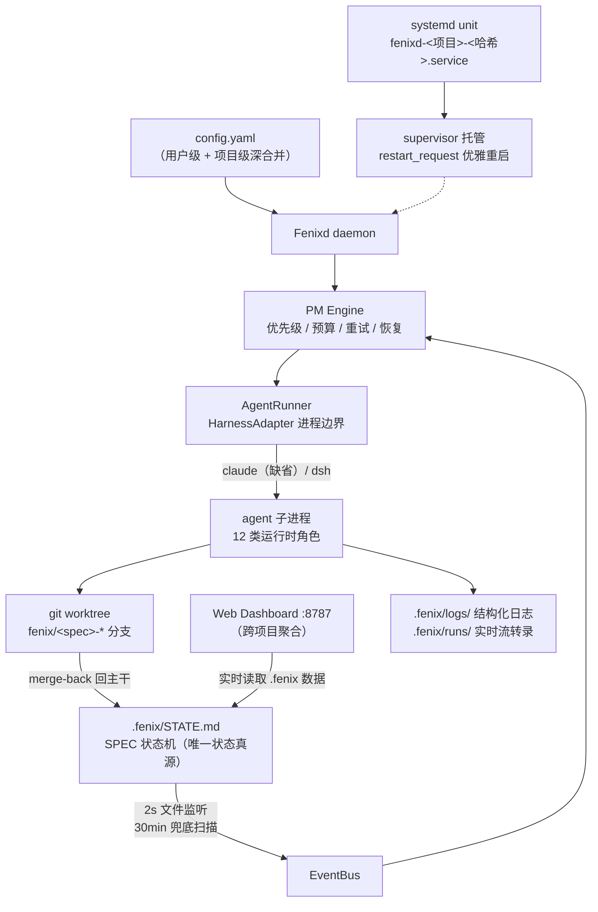
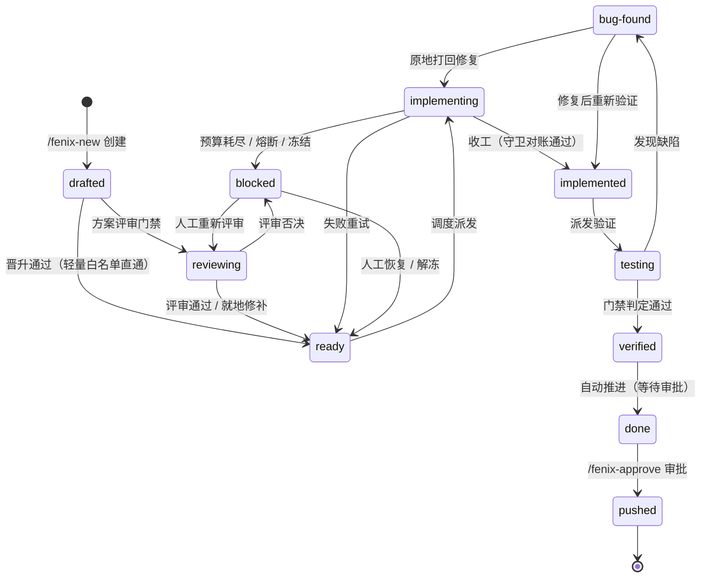
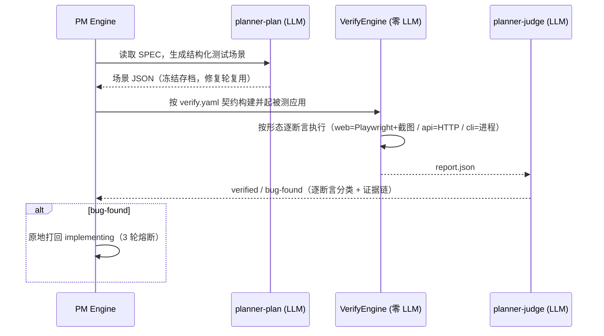

# Fenixd — Fenix Loop Engineering Framework

> 基于 Claude Code 的自动化软件开发循环框架。将自然语言需求自动转化为「已实现、已验证、可上线」的代码，全程无需人工介入。

Fenixd 建立在两个核心理念之上。其一是 **SDD（Spec-Driven Development，规格驱动开发）**：在让 AI 动手写代码之前，先把模糊的需求意图沉淀为一份结构化的 **SPEC**（规格说明，含提案、设计、需求规格与任务清单）。它是整个框架的通用语言，需求的澄清、实现的范围、验证的验收标准全部锚定在这份规格上，人与 AI 之间不再是「口头转述 + 事后返工」。其二是**循环工程（Loop Engineering）**：承认 LLM 单次生成并不可靠，把「实现 → 独立验证 → 打回修复」组织成一个受控闭环，用真实浏览器级测试代替主观自评，并用预算与熔断规则约束循环次数——质量由循环收敛保证，而不是押注某一次生成的运气。

Fenixd 正是这两种理念的工程化落地。Fenixd 自身的演进也由 Fenixd 驱动，本仓库已全自动推进五百余个 SPEC（实现 → 验证 → 打回修复 → 推送），是这套框架最直接的实战验证。

## 使用文档

完整用户帮助文档在 [`docs/help/`](docs/help/README.md)（12 篇专题 + 2 篇手册，与 Dashboard 侧边栏「帮助」菜单内容一致），包括：

| 文档 | 内容 |
|------|------|
| [快速上手](docs/help/01-quick-start.md) | 从零到交付的端到端流程 |
| [核心概念与架构](docs/help/02-concepts.md) | 闭环原理、12 类 Agent 角色、full/fast-track 执行模式 |
| [生命周期与状态机](docs/help/03-lifecycle.md) | 11 状态全景、方案评审门禁、打回修复循环、冻结与恢复 |
| [CLI 操作手册](docs/help/04-cli.md) | `/fenix-*` skill 逐个详解、`bin/` 辅助脚本 |
| [验证体系详解](docs/help/05-verification.md) | 三步验证流水线、verify.yaml 契约、web/cli/api 多形态场景 |
| [调度与治理规则](docs/help/06-governance.md) | 预算熔断、重试退避、告警分级——那些"看不见的手" |
| [保障机制](docs/help/07-safeguards.md) | 声明 lint、晋升门禁、产物硬门、收工守卫、自愈与告警分级 |
| [Dashboard 操作手册](docs/help/08-dashboard.md) | 五页面板逐面板讲解 |
| [配置参考](docs/help/09-config.md) | config.yaml 全键说明、分级合并与热更新 |
| [文件与数据地图](docs/help/10-artifacts.md) | STATE.md、runs、验证产物——出问题去哪查 |
| [日志体系](docs/help/11-logs.md) | 各日志的用途、格式、轮转与归档 |
| [FAQ 与故障排查](docs/help/12-faq.md) | 常见现象 → 根因 → 处置 |
| [知识真相源](docs/help/knowledge-atlas.md) | `spec/knowledge/` 目录契约与回填/体检车道 |
| [DSH 通道运行手册](docs/help/dsh-harness-runbook.md) | agent 执行通道 claude ↔ dsh 切换与回切 |
| [全新环境部署手册](docs/install.md) | 干净 Linux/Windows 机器从零装好 fenixd，覆盖 Claude Code 与 dsh web 双 harness（dsh 含插件全家桶） |

## 作用

Fenixd 是一个**后台守护进程（daemon）**，它把「写软件」这个高度依赖人工的过程，编排成一个可自动推进的闭环：

1. **需求（`/fenix-new`）**：用户用一句话描述想法，需求 Agent 澄清并生成完整 SPEC（proposal + design + specs + tasks），并按复杂度建议执行模式——简单需求走 **fast-track**（单 Agent 一次完成实现与验证），复杂需求走 **full**（多 Agent 分段实现 + 独立验证）。大范围界面改动可先经 `/fenix-prototype` 用「真组件、假数据」的高保真原型对齐视觉意图，批准后作为 SPEC 的 UI 真相源。
2. **方案评审（spec-review）**：SPEC 起草后经晋升链校验进入评审门，评审 Agent 从目的适配性、漏洞、回归风险三个维度做单轮只读评审——可行（含就地修补）放行实现，方向性风险 `blocked` 转人工（轻量 SPEC 命中白名单可直通，`gates.spec_review_mode: never` 可整体关闭）。
3. **实现（Implementer / fast-track）**：实现 Agent 在隔离的 git worktree 中按 tasks.md 逐条实现并自测，收工受交付物守卫对账。
4. **验证（三步流水线）**：规划器生成测试场景 → 零 LLM 的验证引擎按场景形态逐断言执行（web 用 Playwright 驱动真实浏览器，api 用 HTTP 请求，cli 用进程执行）→ 裁决器给出带证据的 verdict，绝不信任实现 Agent。
5. **调度（PM Engine）**：按优先级、依赖与并发上限调度上述 Agent；预算、退避、自动恢复等治理规则兜底，检测到无法自愈的困境时经 Administrator → Arbiter 升级链处置后告警人工。后台还常驻两条质量车道：**周期性代码审查（code-review）**把全仓代码质量问题沉淀为台账，**缺陷修复（code-fix）**按批修复台账条目、全量回归通过才合回主树。

最终产物经验证通过后自动推进到 `done`，等待人工审批推送（**唯一的人工门禁**，`gates.approve_mode: auto` 时可自动推送）。

## 原理

### 架构

Fenixd 的架构刻意做得「薄」：一个单进程 daemon 负责编排，没有数据库、没有常驻服务集群，全部状态都落在仓库里的普通文件上。`.fenix/STATE.md` 是唯一状态真源，`.fenix/` 下还存放配置、日志与每次 Agent 运行的实时流转录。daemon 内部是一条事件驱动的流水线，EventBus 以 2 秒文件监听感知 `STATE.md` 的变化（另有默认 30 分钟一次的兜底全量扫描），PM Engine 据此做出调度决策（按优先级与预算选择下一个动作），AgentRunner 经 HarnessAdapter 把对应角色的 Agent 以子进程方式拉起（执行通道默认 `claude`，可切 `dsh`，进程边界协议统一为 SpawnSpec 进、归一化事件出），在隔离的 Git Worktree 中工作，收工后 Merge-Back 回主干并驱动状态机前进。daemon 本身由 supervisor 托管、systemd unit 承载，外围还有 Supervisor 看门狗负责优雅重启、Fenix Dashboard 负责把这一切跨项目实时可视化。这种「文件即状态」的设计换来两个性质：各环节之间零耦合（读懂文件就读懂了系统），以及天然可恢复——daemon 无论崩溃还是重启，读一遍文件就能重建全部现场，从上次中断处继续。



- **StateMachine**：解析/维护 `.fenix/STATE.md`，管理每个 SPEC 的状态与合法转换，文件锁 + 原子写。
- **EventBus**：文件监听感知 `.fenix/STATE.md` 变化（周期全量扫描兜底），把状态事件分发给 PM Engine。
- **PM Engine**（`core/pm_engine/`）：优先级调度、依赖检查、预算闸门、失败重试、自动恢复、fix 循环与日报。
- **AgentRunner**（`core/agent_runner/`）：经 HarnessAdapter 以子进程方式拉起 agent（claude 字节级平移 / dsh 事件投影），按角色分配模型/Provider 候选链，超时活性监督。
- **WorktreeManager**：为每次实现创建隔离 worktree 与分支，收工 merge-back 回主干（冲突自愈 / 修复通道 / 熔断），已合并分支宽限期后自动回收。
- **VerifyEngine**：确定性（零 LLM）验证执行引擎，web/cli/api 三形态场景 runner（web 用 Playwright 浏览器断言与截图对比，api 用 HTTP 请求断言，cli 用进程输出断言）。
- **Administrator / Arbiter**：轻量监视器检测到困境信号才唤起的自愈链——Administrator 先自动处置（改环境、清 git 状态等），处置不了交 Arbiter 自主裁决车道，仍不行再升级人工告警（Dashboard 横幅）。

### SPEC 生命周期

每个需求在 Fenixd 中以一个 SPEC 的形式存在，其从创建到推送的全过程由一台显式状态机管理：状态写在项目的 `.fenix/STATE.md` 里（唯一状态真源），每一次转移都必须符合预定义的合法转移表，非法转移直接被拒绝。这样做的意义在于：任何时刻打开 Dashboard 或 `.fenix/STATE.md`，都能精确回答「这个需求现在走到哪一步、为什么卡住、下一步谁来做什么」；多 Agent 之间也凭这同一个状态真源协作，而不是各自记忆。更重要的是，所有「不顺利」的情形——验证不过、评审否决、预算耗尽、merge 冲突、运行中断，等等——都被建模为图中的正常路径（打回、停靠、恢复），而不是显性异常，框架不会半路丢弃一个 SPEC：要么它能够被 AI 完成，框架把它推进到终点；要么给出明确证据，说明超越了 AI 的能力（譬如模型的额度用完了、又譬如与基本的实时逻辑相互冲突，是不可能实现的需求），让它明确停靠在 `blocked` 等人来裁决。



- 验证未通过时**原地打回**：状态回 `implementing`，tasks.md 注入「验证修复」段（自动携带上轮结论）；连续 3 轮未过则 `blocked` 转人工裁决。`verified` 且错误标记为缺口任务（`task-gap:`）的 SPEC 可经 Dashboard 一键回炉 `ready` 重派实现。
- 评审否决、预算耗尽、merge 反复冲突、fix 族谱越界等无法自愈的情况一律 `blocked` + 告警停靠，等待人工，绝不无限烧钱。`blocked` 承载两种语义：冻结转人工（`frozen: true`）与阻塞待 Administrator 自愈，处置路径不同。
- daemon 重启时 `implementing/testing` 视为中断态自动恢复，人工冻结（`frozen`）的 SPEC 全链路跳过。

### 验证流水线（三步）

实现 Agent 声称「做完了」不等于真的做对了——LLM 的自我汇报天然存在过度自信倾向，这是自动编码循环里最不可信的一环。fenixd 的对策是把验证做成一条独立流水线：先由规划 Agent 把 SPEC 的验收标准翻译成结构化测试场景（存档冻结，防止修复轮偷偷降低标准），再由一个**零 LLM** 的确定性引擎按场景形态逐断言执行，最后由裁决 Agent 基于执行报告给出带证据链的结论（每个失败都必须归因分类：产品缺陷、测试缺陷、环境抖动或环境不可用）。三层各司其职——理解与判断交给规划与裁决这两个 LLM 角色，客观事实的采集交给确定性引擎——「绝不信任实现 Agent」由此成为结构保证，而非一句口号。



被测应用如何构建、如何被服务、何时算就绪，由项目根的 `.fenix/verify.yaml` 三段式契约（prepare / serve / ready）声明式描述（serve/ready 段是否必需由本轮场景集的形态组成反推）；场景 URL 由框架注入（BASE_URL 铁律），保证「场景永远打新鲜实现」。

## 依赖

| 依赖 | 版本要求 | 用途 | 必需 |
|------|---------|------|------|
| Python | 3.10+ | 运行 Fenixd 守护进程与全部核心模块 | ✅ |
| PyYAML | 任意 | 解析 `config.yaml` | ✅ |
| httpx | 任意 | api 形态验证场景的请求执行（ApiRunner 硬依赖） | ✅ |
| git | 任意 | worktree 隔离与分支管理 | ✅ |
| Claude Code CLI (`claude`) | 任意 | 实现/验证 Agent 的默认执行载体（切 `dsh` 通道时改用 DSH CLI，见 [DSH 通道运行手册](docs/help/dsh-harness-runbook.md)） | ✅ |
| systemd | Linux | daemon 托管承载（unit + `Restart=on-failure` 崩溃自动拉回） | ✅（Linux） |
| Node.js | 18+ | Dashboard 前端构建；扩展集成验证脚本 | ⚠️ 按需 |
| Playwright（Python + Node） | 任意 | web 形态场景的浏览器驱动验证 | ⚠️ 仅 web 类项目 |
| jsonschema | 任意 | api 场景 `json_schema` 断言（缺失仅该类断言验收期打回） | ⚠️ 可选 |

> ⚠️ 表示按需依赖：仅当对应项目类型/断言需要时才必需。
> 旧版 tmux 会话承载已退役为 systemd 托管（存量部署可用 `bin/migrate_to_systemd.py` 一次性搬迁；`install.sh` 仍保留 tmux 存在性检查作为兼容提示）。

安装 Python 依赖：

```bash
pip3 install pyyaml httpx
```

> SPEC 生成已原生集成进 fenix：`/fenix-new` 使用内置生成器
> （`core/spec_gen.py` + `bin/fenix_spec.py`，数据 vendored 于 `schemas/spec-driven/`），
> SPEC 生成与归档为内置能力，无需独立安装外部工具。

## 安装

```bash
cd /path/to/fenixd
bash install.sh
```

`install.sh` 会：

1. 检查并提示安装缺失依赖（缺 PyYAML / httpx 时自动安装，jsonschema 可选安装）；
2. 把 `skills/fenix-*` 软链到 `~/.claude/skills/`（供 Claude Code 的 `/fenix-*` 命令使用）；
3. 把 `fenix-init` 软链到 PATH（`~/.local/bin` 或 `/usr/local/bin`）。

> 源码使用者首次安装后需构建 Dashboard 前端：`cd core/dashboard/static && npm install && npm run build`（dist 不入 git，release 包内置预构建版）。
> 框架代码**只保留一份**（本仓库）。项目通过软链接引用它，升级框架时只需更新本仓库，所有项目自动生效。

## 使用方法

### 1. 初始化并启动

进入（或创建）你的项目目录，执行：

```
/fenix-setup
```

首次运行会自动完成工程骨架初始化（等价于 `fenix-init`）：`.fenix/`（配置 + 状态文件 + 框架软链接 + 运行时目录）、`spec/`、`.claude/agents/`、`.claude/worktrees/`，并追加 `.gitignore` 条目；随后安装并启动 systemd 托管链——`systemctl enable --now` 拉起 systemd unit（`fenixd-<项目名>-<哈希>.service`，`Restart=on-failure` 崩溃自动拉回、开机自启），unit 内拉起 `fenixd_supervisor.py`，daemon 作为 supervisor 的子进程运行；supervisor 检测 `.fenix/restart_request` 后 SIGTERM daemon 并自动拉起，承担唯一的重启职责。daemon 运行状态分托管态三态（`managed` / `unmanaged` / `stopped`），`unmanaged`（裸 daemon）项目经 Dashboard 项目页「安装托管」即可转入托管。看现场：`journalctl -u <unit>`，supervisor 日志另见 `.fenix/logs/supervisor.log`。

`fenix-init [DIR] [--name 项目名] [--type web|cli|library|api]` 仍可作为独立命令单独使用（不需要 Claude Code 会话时）。

### 2. 创建需求

```
/fenix-new "添加用户登录功能"
```

需求 Agent 会澄清需求、评估复杂度并建议执行模式（fast-track / full），生成完整 SPEC 注册到 `.fenix/STATE.md`。fenixd 随后**全自动**完成评审、实现与验证。界面大改的需求可先跑：

```
/fenix-prototype "登录页改版"
```

生成高保真单文件 HTML 原型，在浏览器里批注迭代至你认可后入库为 SPEC 的 UI 真相源。

### 3. 监控进度

```
/fenix-status          # 总览：所有 SPEC 状态、守护进程健康、阻塞检测
/fenix-process <name>  # 查看某个 SPEC 的详细进展
/fenix-dashboard       # 浏览器实时监控（跨项目聚合，默认 :8787）
```

### 4. 审批推送（唯一人工门禁）

```
/fenix-approve
```

审查 `done` 状态的 SPEC，确认后推送到远程分支。

### 5. 归档

```
/fenix-archive
```

把已完成 change 归档到 `spec/archive/`（也可在 Dashboard 对终态 SPEC 直接归档；超过阈值自动归档）。

### 常用命令速查

| 命令 | 作用 |
|------|------|
| `/fenix-setup` | 初始化 / 重启 Fenixd（未初始化项目自动生成工程骨架） |
| `/fenix-new "需求详情"` | 创建新需求（含 fast-track/full 模式建议） |
| `/fenix-prototype "界面描述"` | UI 原型确认环：高保真原型 → 浏览器批注 → 批准入库 |
| `/fenix-status` | 查看框架状态 |
| `/fenix-process <spec_name>` | 查看指定 SPEC 进展 |
| `/fenix-approve <spec_name>` | 审批并推送完成的工作（唯一人工门禁） |
| `/fenix-archive <spec_name>` | 归档已完成的 change |
| `/fenix-dashboard` | 启动 / 打开 Web Dashboard |

## 项目结构

```
fenixd/
├── README.md               # 本文档
├── DESIGN.md               # 界面设计宪法（Dashboard 视觉单一事实源）
├── docs/help/              # 用户帮助文档（12 篇专题 + 知识真相源 / DSH 通道运行手册）
├── install.sh              # 安装程序
├── fenix-init              # 项目初始化命令
├── fenixd.py               # 守护进程主入口
├── .fenix/                 # 运行时目录：config.yaml、STATE.md / PROJECT_LOG.md / verify.yaml 等
├── core/                   # 核心模块
│   ├── state_machine.py    # 状态机（STATE.md 读写与合法转移）
│   ├── event_bus.py        # 事件总线（2s 文件监听 + 周期兜底扫描）
│   ├── pm_engine/          # 调度引擎（budget/dispatch/engine/family/recovery/…）
│   ├── agent_runner/       # Agent 执行器（runner/prompt_builder/liveness/harness adapter/…）
│   ├── worktree_manager/   # worktree 管理与 merge-back
│   ├── verify_engine/      # 确定性验证引擎（web/cli/api 三形态 runner）
│   ├── verify_contract.py  # verify.yaml 三段式验证契约
│   ├── deliverables.py     # 交付物守卫（Deliverables 声明对账）
│   ├── code_review.py      # 周期性代码审查车道（台账沉淀）
│   ├── code_fix.py         # 缺陷修复车道（按批修复 + 回归门）
│   ├── systemd_hosting.py  # systemd 托管承载（unit 安装 / 启停）
│   ├── admin_monitor.py    # Administrator 监视器与告警（Admin→Arbiter→人工升级链）
│   ├── knowledge.py        # 知识真相源子系统（含 knowledge_audit/backfill 车道）
│   ├── self_review.py      # 每日自省（todo.md）
│   ├── evolution.py        # 自进化车道（自省报告 → evo-* SPEC）
│   ├── config.py           # 分级配置加载、校验与热更新
│   ├── logger.py           # 结构化日志
│   ├── spec_gen.py         # 原生 SPEC 生成器（new/status/instructions）
│   └── dashboard/          # Web Dashboard（server.py + React/antd 前端）
├── dsh-bundle/             # fenix-dsh Bundle（DSH harness 适配层与事件投影）
├── schemas/spec-driven/    # vendored spec-driven schema（模板与指令）
├── bin/                    # 辅助脚本（fenix_dashboard/fenixd_supervisor/fenix_spec/fenix_cli/migrate_to_systemd/…）
├── skills/                 # Claude Code skills（8 个 /fenix-* 命令）
├── agents/                 # Agent 角色定义（17 个 prompt 模板，12 类运行时角色 + arbiter/知识管线等离线角色）
├── templates/              # 工程骨架模板
├── scripts/                # 格式化 / 打包等辅助脚本
├── spec/                   # SPEC 工作区（changes / archive / knowledge）
└── tests/                  # 单元测试
```

## 配置说明

Fenixd 采用**分级配置**：用户级 `~/.fenix/config.yaml` 与项目级 `<项目根>/.fenix/config.yaml` 深度合并，**项目级覆盖用户级**。daemon 每 30 秒检测配置文件变化原地热更新（个别键需重启，详见文档）。

关键配置项（完整清单见 [配置参考](docs/help/09-config.md)）：

- `project.type`：项目类型（web / cli / library / api）
- `agent.harness`：agent 进程边界选型（`claude` 缺省 / `dsh`）
- `agents.max_concurrent` / `impl_run_budget` / `token_budget_millions`：Agent 并发、实现尝试预算与 token 预算（耗尽停靠等人工，绝不无限重试）
- `gates.approve_mode`：`manual`（默认）/ `auto`（done 后自动推送）；`gates.require_push_approval`：推送审批总开关
- `gates.spec_review_mode`：方案评审门禁（命中白名单的轻量 SPEC 直通，`never` 整体关闭）
- `worktree.base_dir`：git worktree 存放目录
- `commands.test` / `build` / `start`：项目自身的测试、构建、启动命令

Dashboard「设置」页可对上述受管配置做可视化编辑（Provider、模型分配、预算、审批模式等）。

## 许可证

MIT
