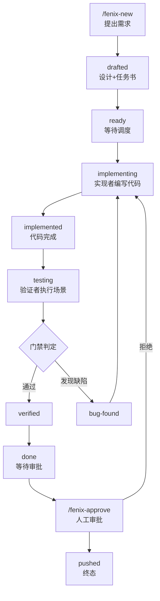

# 快速上手

本章带你用 5 分钟跑通 Fenix 从初始化到交付的完整流程。整个过程你只需要输入两条命令：一条创建需求，一条审批推送，中间的设计、实现与验证全部由 daemon 自动完成。

## 依赖清单

| 依赖 | 最低版本 | 用途 |
|------|---------|------|
| Python | 3.10+ | 框架运行时 |
| Git | 2.30+ | worktree 隔离、分支管理 |
| Node.js | 18+ | 前端构建（dashboard dist） |
| tmux | 任意 | Agent run 终端载体 |
| Claude Code | 最新 | Agent 运行时 |

## 步骤概览

### 1. 初始化（/fenix-setup）

```bash
/fenix-setup
```

这是使用 Fenix 的第一步。命令会先检查上表中的依赖是否就绪，随后创建 `.fenix/` 运行目录结构、生成项目配置 `.fenix/config.yaml`（项目尚未初始化时会自动运行 fenix-init 生成完整工程骨架，无需单独执行初始化命令），最后启动 fenixd daemon。daemon 启动后常驻后台，此后所有 SPEC 的调度与 Agent 运行都由它驱动。

### 2. 创建需求（/fenix-new）

```bash
/fenix-new 我要做一个用户认证功能
```

这条命令把一句自然语言想法转化成一份完整的 SPEC。框架会先与你澄清需求，再依次生成 proposal（需求背景）、design（详细设计）与 tasks.md（任务清单），写入 `spec/changes/<name>/` 目录，SPEC 状态同时进入 `drafted`。

### 3. 提交就绪

设计确认后，SPEC 自动流转至 `ready`，进入调度池等待派发。这段时间你可以随时打开 Dashboard 查看它的状态。

### 4. 自动循环

从这一步起不再需要人工参与。daemon 按优先级调度池中的 SPEC，依次派出三类 Agent：**implementer**（实现者）在独立 worktree 中编写代码；**verifier**（验证者）启动被测实例、执行验证场景并生成报告；**planner-judge**（门禁法官）依据报告判定验证通过与否，通过则推进，发现缺陷则自动打回修复。你可以在 Dashboard「概览」页实时查看进度，或用 `/fenix-status` 查看状态总览。

### 5. 审批推送（/fenix-approve）

SPEC 到达 `done` 状态后，就到了全流程中唯一的人工门禁点：

```bash
/fenix-approve
```

命令会展示实现差异供你审查，确认后推送至远程仓库，SPEC 进入终态 `pushed`，生命周期结束。

## 端到端流程图



## 验证进度查看

流程跑起来后，你有三个观察窗口，按信息详细程度递增：

- **状态总览**：`/fenix-status` 一句话总结 + 各 SPEC 状态表
- **SPEC 详情**：`/fenix-process <spec-name>` 查看 tasks.md 进度、运行记录、验证报告
- **Dashboard**：`http://localhost:8787` → 项目列表 → 点击 SPEC 名称查看详情

## 相关文档

- [核心概念与架构](02-concepts.md) — 理解闭环原理与 Agent 角色
- [SPEC 生命周期与状态机](03-lifecycle.md) — 10 状态全景
- [Dashboard 使用指南](08-dashboard.md) — 图形界面操作
