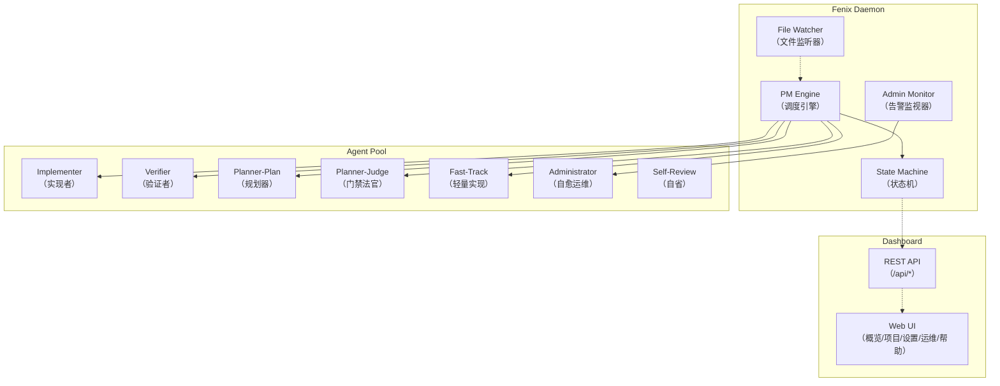
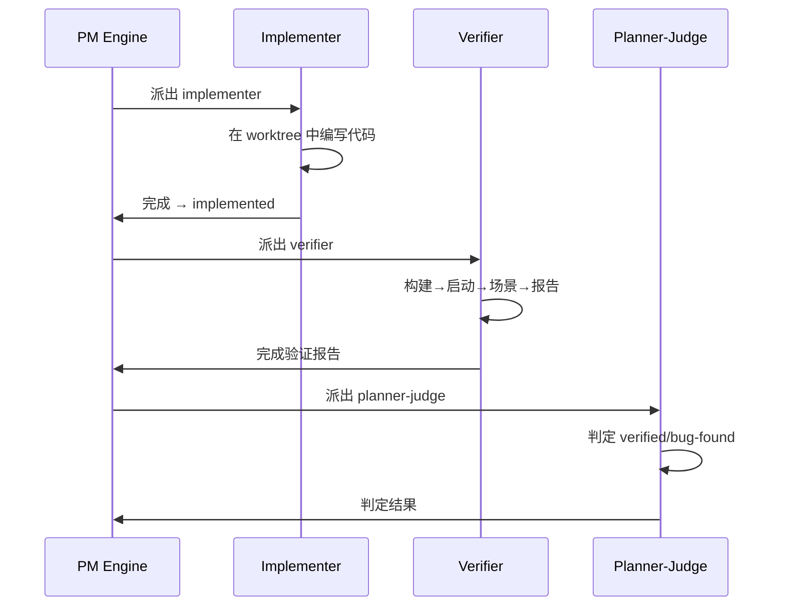

# 核心概念与架构

理解 Fenix 的闭环自动化原理、Agent 角色分工与执行模式。

## 闭环自动化

Fenix 是一个**闭环**开发框架：需求输入后，从设计、实现、验证到发布全程自动化，仅在最终推送时需要人工审批。核心思路是：

1. **SPEC 驱动**：一切工作围绕 SPEC（软件需求规格说明书）展开，每个 SPEC 对应一个 `openspec/changes/<name>/` 目录
2. **状态机管控**：SPEC 生命周期由有限状态机（10 个状态、明确转移规则）驱动，杜绝模糊中间态
3. **闭环验证**：实现后自动启动被测实例、执行场景、判定通过/失败，失败自动打回修复
4. **唯一人工门禁**：`/fenix-approve` 推送审批是全流程中唯一需要人工参与的环节

## 架构概览

## 七类 Agent 角色

| Agent 类型 | 职责 | 触发时机 |
|-----------|------|---------|
| **implementer**（实现者） | 在独立 worktree 中编写代码，实现 SPEC tasks | SPEC 状态 `ready` |
| **verifier**（验证者） | 启动被测实例、执行验证场景、生成验证报告 | SPEC 状态 `implemented` |
| **planner-plan**（规划器） | 生成验证场景与行动计划 | 验证流水线阶段 1 |
| **planner-judge**（门禁法官） | 判定验证是否通过，决定 verified/bug-found | 验证流水线阶段 3 |
| **fast-track**（轻量实现） | 合并 implementer + verifier 为单次调用，减少 token 消耗 | 满足 fast-track 条件时 |
| **administrator**（自愈运维） | 检测困境信号、诊断根因、尝试自动修复 | Admin Monitor 唤起 |
| **self-review**（自省） | 每日自动审查实现质量、配置一致性 | 定时触发 |

## full 模式 vs fast-track 模式

Fenix 有两种实现-验证路径：

### full 模式（标准闭环）

### fast-track 模式（轻量合并）

单次 Agent 调用同时完成实现与验证，减少 worktree 创建开销与 token 消耗。适用于：
- 影响面小（单文件改动）
- 模块数少（≤1 个模块）
- 无 UI 变动
- 场景数少（≤3 个验证场景）

> fast-track 失败后自动回退为 full 模式重试。

## Worktree 隔离

每个 implementer/verifier run 都在独立的 git worktree 中工作：
- 互不干扰：并行的多个 SPEC 实现不会交叉污染
- 自动清理：run 结束后 worktree 自动移除
- merge-back：完成后代码合并回主分支

## 多项目机制

Dashboard 支持同时监控多个 Fenixd 项目。每个项目通过 `.fenix/config.yaml` 独立配置，daemon 独立运行。Dashboard 统一聚合概览、跨项目状态一目了然。

## 术语表

| 术语 | 含义 |
|------|------|
| **SPEC** | 软件需求规格说明书，对应 `openspec/changes/<name>/` 目录 |
| **STATE.md** | 项目根目录下的状态文件，记录所有 SPEC 的当前状态与元数据 |
| **worktree** | Git 工作树，提供隔离的代码工作区 |
| **verify.yaml** | 项目级验证契约，声明构建、启动、就绪探针 |
| **门禁** | 验证后由 planner-judge 判定通过/失败的环节 |
| **熔断** | 预算耗尽或连续失败达到阈值后停止自动重派，升级人工 |
| **困境信号** | Admin Monitor 检测到的 SPEC 异常状态（卡住、抖动、合并反复失败等） |
| **BASE_URL 铁律** | 验证场景的 URL 永远改写为本次被测实例地址，确保测到最新代码 |

## 相关文档

- [快速上手](01-quick-start.md) — 端到端流程实操
- [SPEC 生命周期与状态机](03-lifecycle.md) — 10 状态详细转移规则
- [验证体系](05-verification.md) — 三步流水线与 verify.yaml 契约
- [调度与治理规则](06-governance.md) — 预算、熔断、告警分级
