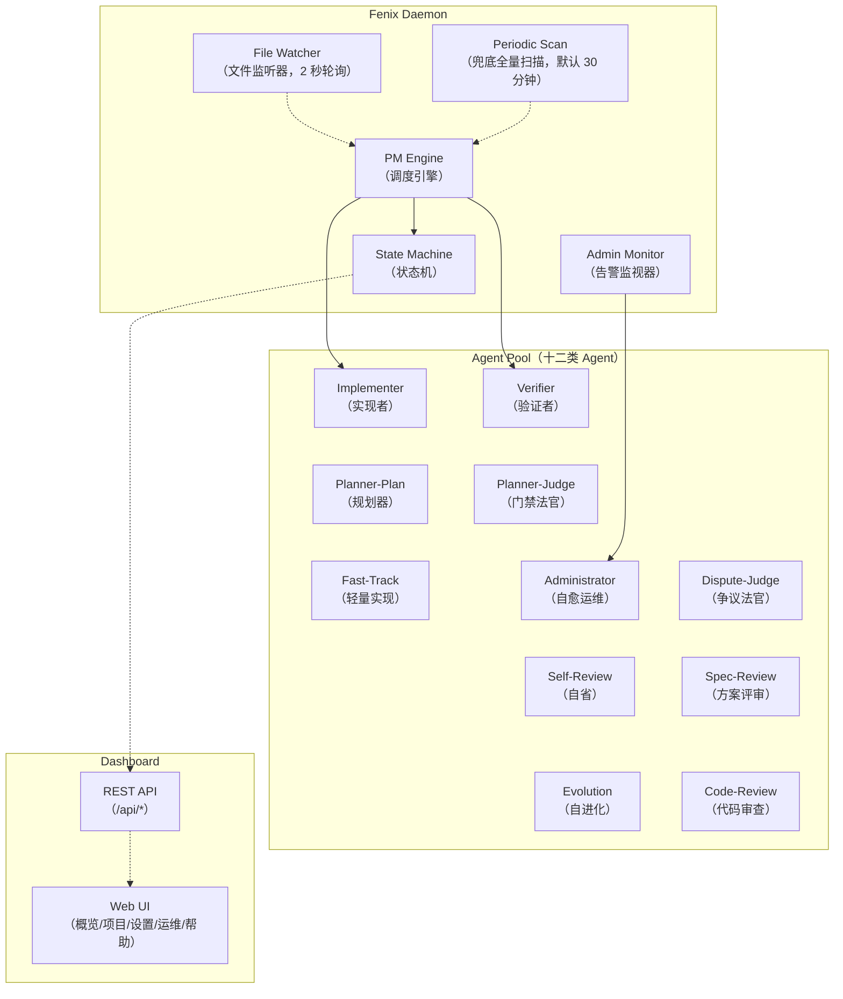
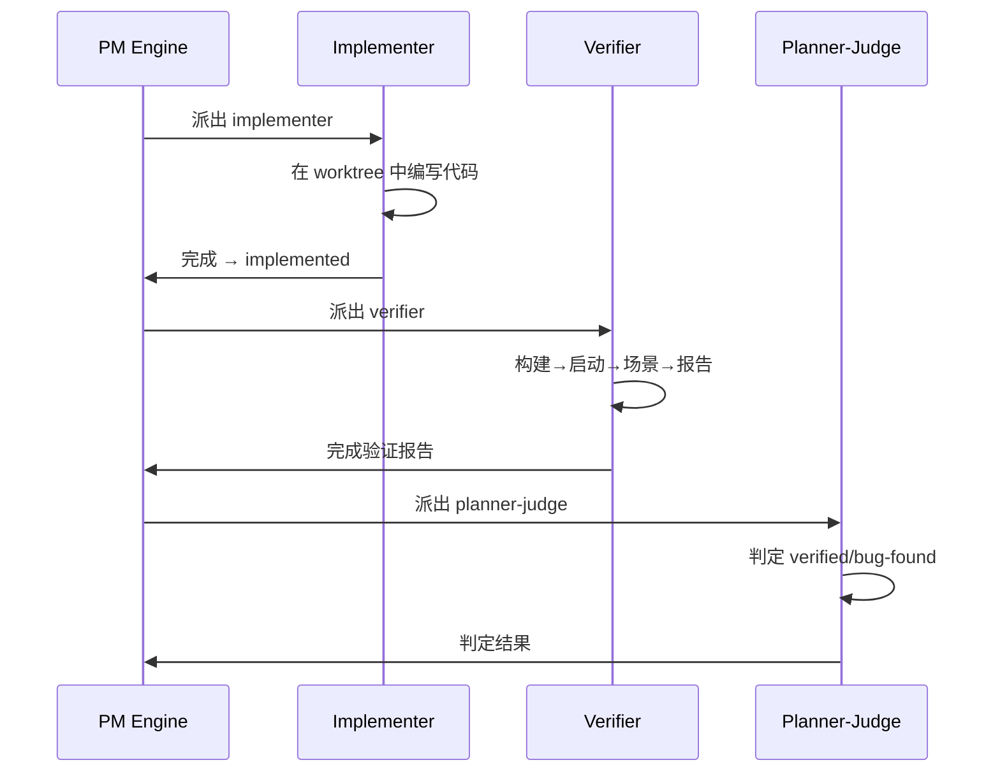

# 核心概念与架构

理解 Fenix 的闭环自动化原理、Agent 角色分工与执行模式。

## 闭环自动化

Fenix 是一个**闭环**开发框架：需求输入后，从设计、实现、验证到发布全程自动化，仅在最终推送时需要人工审批。支撑这个闭环的是四个核心设计：

1. **SPEC 驱动**：一切工作围绕 SPEC（软件需求规格说明书）展开，每个 SPEC 对应一个 `spec/changes/<name>/` 目录
2. **状态机管控**：SPEC 生命周期由有限状态机（11 个状态、明确转移规则）驱动，杜绝模糊中间态
3. **闭环验证**：实现后自动启动被测实例、执行场景、判定通过/失败，失败自动打回修复
4. **唯一人工门禁**：`/fenix-approve` 推送审批是全流程中唯一需要人工参与的环节

## 架构概览

从图上可以看出分工：PM Engine 是调度中枢，做派发决策并唤起 Agent Pool 中的各类 Agent；State Machine 维护 SPEC 的状态转移；Admin Monitor 监视困境信号，必要时唤起 Administrator 自愈；File Watcher 监听文件变化反馈给 PM Engine，Periodic Scan 则按固定间隔做兜底全量扫描，捞出监听器漏掉的事件与没有事件源的孤儿态。对外则由 REST API 把状态暴露给 Web UI 展示。

两条入边的分工是理解调度的关键：**正常唤醒靠文件监听（2 秒级），兜底扫描只是安全网**。各唤醒源的间隔、成本实测与已知盲区见[调度与治理规则](06-governance.md#调度节拍spec-何时被唤醒)。

## 十二类 Agent 角色

| Agent 类型 | 职责 | 触发时机 |
|-----------|------|---------|
| **implementer**（实现者） | 在独立 worktree 中编写代码，实现 SPEC tasks | SPEC 状态 `ready` |
| **verifier**（验证者） | 启动被测实例、执行验证场景、生成验证报告 | SPEC 状态 `implemented` |
| **planner-plan**（规划器） | 生成验证场景与行动计划 | 验证流水线阶段 1 |
| **planner-judge**（门禁法官） | 判定验证是否通过，决定 verified/bug-found | 验证流水线阶段 3 |
| **fast-track**（轻量实现） | 合并 implementer + verifier 为单次调用，减少 token 消耗 | 满足 fast-track 条件时 |
| **administrator**（自愈运维） | 检测困境信号、诊断根因、尝试自动修复 | Admin Monitor 唤起 |
| **self-review**（自省） | 每日自动审查实现质量、配置一致性 | 定时触发 |
| **dispute-judge**（争议法官） | 对实现者/验证者的声明争议做只读裁决 | 争议仲裁触发 |
| **evolution**（自进化） | 从自省报告提炼需求、批量产出 evo-* SPEC | 定时触发 |
| **spec-review**（方案评审） | 阅读 SPEC 三文档做方案级评审（goal-fit/hole/regression），结论 approved/repaired/rejected | `drafted → reviewing` 晋升门禁 |
| **code-review**（代码审查） | 周期性仓库级代码审查，问题沉淀为可追踪台账（`.fenix/code-review/items.jsonl`），供项目页「代码审查」分面消费并生成 fix-cr-* 修复 SPEC | 每日自省时点同步触发 / 项目页「代码审查」分面手动触发 |
| **code-fix**（代码修复） | 按批修复 code-review 台账的 `open` 条目：在独立 worktree 内修复并提交，全量回归通过才合回主树 | 审查收尾产生新 `open` 条目 / full scan 周期兜底 / 项目页「代码审查」分面手动触发 |

## full 模式 vs fast-track 模式

Fenix 有两种实现-验证路径，daemon 会按 SPEC 的特征自动选择。

### full 模式（标准闭环）

### fast-track 模式（轻量合并）

fast-track 把实现与验证合并为单次 Agent 调用，省去独立的 verifier 调用与部分 worktree 开销，token 消耗更低。适用条件是影响面小且验证简单：单文件改动、模块数不超过 1、无 UI 变动、验证场景不超过 3 个。不满足任一条件时自动走 full 模式；fast-track 失败后也会回退为 full 模式重试。

## Worktree 隔离

每个 implementer/verifier run 都在独立的 git worktree 中工作。隔离带来三层保障：并行的多个 SPEC 实现互不交叉污染；run 结束后 worktree 自动移除，不留垃圾目录；代码完成后经 merge-back 合并回主分支。

## LLM Provider 隔离

Agent 角色的模型通道由配置决定：`llm.providers` 注册 Provider，`agents.models` 按角色分配（键参考见[配置参考](09-config.md#llm)）。**配置了 Provider 分配的角色**，daemon 派发子进程时会注入该 Provider 的 `ANTHROPIC_BASE_URL / API_KEY / MODEL`，并把 `CLAUDE_CONFIG_DIR` 指向项目根（主树）`.fenix/agent-config/<provider>/` 的独立配置目录，分配谁就走谁，与用户会话完全隔离（不同账号、配额与故障域）。目录按 Provider 名区分、按需幂等生成，全部 worktree 的 run 共用同一份。

### 为什么必须换整个配置根目录

根因是 claude CLI 的优先级规则：**`~/.claude/settings.json` 中 `env` 块的优先级高于进程环境变量**。用户级 settings.json 若配置过网关地址（如 cc-switch 的 `ANTHROPIC_BASE_URL`），仅靠环境变量注入的 Provider 会被它静默覆盖，分配沦为死代码，所有 Agent 实际仍打到网关。实测 `--settings <file>` 也无法覆盖该 env 块，唯一有效手段是 `CLAUDE_CONFIG_DIR` 切换配置根目录，彻底绕开用户 settings.json。

### 隔离目录里什么共享、什么隔离

| 内容 | 处理方式 |
|------|---------|
| skills / plugins | **共享**：symlink 指向 `~/.claude/`，所有 Provider 同一份技能与插件 |
| settings.json | 按 Provider 重新生成：`enabledPlugins` 复制自 `~/.claude/settings.json`，hooks 复制自 `.fenix/agent-settings.json`；**不复制任何 `env`**：网关的模型映射类变量对直连 Provider 无用且有毒（陈旧映射会污染子代理模型解析） |
| 会话 transcript、任务数据、session-env、shell-snapshots、`.claude.json` | **按 Provider 隔离**（API Key 只经进程环境注入，不落盘） |

会话类数据跟随配置根目录被隔离，且这恰好是必要的语义，不是单纯副作用：

- **跨 Provider 不能续跑**。会话 transcript 存在于创建时的配置目录；切换 Provider 后携带旧 session id 去 `--resume` 必然「No conversation found」秒挂。框架的规则是**仅当 worktree 可复用且 Provider 未变时才续跑**，切换 Provider 即开新会话。
- **TaskCreate 等工具的可用性由网络路径决定**。部分代理网关不提供 Task 工具族、Provider 直连有，会话 init 时即定型，工具集本身就不是跨 Provider 通用的。

未配置 Provider 分配的角色零隔离：不设 `CLAUDE_CONFIG_DIR`，透传 `~/.claude/settings.json` 走默认网关（官方模型名，由网关自行映射）。

### 观测与注意

- 每个带 Provider 分配的 run 会在 run 产物写 provider_marker，SPEC 详情时间轴可见该次 run 实际驱动的 `model@provider`。
- 隔离目录的 `settings.json` 已存在则跳过重建：**修改 `~/.claude/settings.json` 的 enabledPlugins 或 `.fenix/agent-settings.json` 后，存量隔离目录不会自动刷新**，删除对应 `.fenix/agent-config/<provider>/`（或仅其 settings.json）即可按需重建。

## 多项目机制

Dashboard 支持同时监控多个 Fenixd 项目。每个项目拥有自己的 `.fenix/config.yaml` 与独立运行的 daemon，互不干扰；Dashboard 把它们聚合到同一个界面里，跨项目的状态、告警与进度一目了然。

## 术语表

| 术语 | 含义 |
|------|------|
| **SPEC** | 软件需求规格说明书，对应 `spec/changes/<name>/` 目录 |
| **STATE.md** | `.fenix/` 目录下的状态文件，记录所有 SPEC 的当前状态与元数据 |
| **worktree** | Git 工作树，提供隔离的代码工作区 |
| **verify.yaml** | 项目级验证契约，声明构建、启动、就绪探针（纯 CLI 交付可只声明 prepare） |
| **场景 kind** | 验证场景形态（web/cli/api）：页面→web、HTTP 端点→api、命令/落盘→cli；混合交付拆场景 + `depends_on` 串接 |
| **门禁** | 验证后由 planner-judge 判定通过/失败的环节 |
| **熔断** | 预算耗尽或连续失败达到阈值后停止自动重派，升级人工 |
| **Provider 隔离** | 按 Provider 名切分 `CLAUDE_CONFIG_DIR` 配置根，让 Agent 的模型通道绝对生效（见 [LLM Provider 隔离](#llm-provider-隔离)） |
| **困境信号** | Admin Monitor 检测到的 SPEC 异常状态（卡住、抖动、合并反复失败等） |
| **BASE_URL 铁律** | 验证场景的 URL 永远改写为本次被测实例地址，确保测到最新代码 |

## 相关文档

- [快速上手](01-quick-start.md) — 端到端流程实操
- [SPEC 生命周期与状态机](03-lifecycle.md) — 11 状态详细转移规则
- [验证体系](05-verification.md) — 三步流水线与 verify.yaml 契约
- [调度与治理规则](06-governance.md) — 预算、熔断、告警分级
