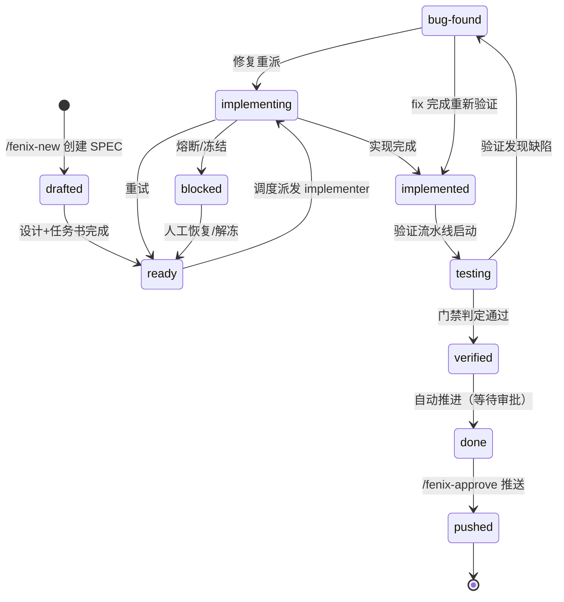

# SPEC 生命周期与状态机

Fenix 将 SPEC 从提出到发布的完整生命周期建模为**10 个状态**的有限状态机。本章覆盖全部状态、合法转移、打回与修复循环、冻结机制与门禁逃生门。

## 状态全景

## 各状态详解

### drafted（草稿）

`/fenix-new` 创建 SPEC 后即进入 `drafted`。此时 SPEC 还停留在设计阶段，proposal、design 与 tasks.md 正在生成或等待确认；一旦设计文档与任务书完成，SPEC 便转入 `ready`。

### ready（就绪）

设计完成后 SPEC 进入 `ready`，被熔断后经人工恢复也会回到这里。此状态的含义是「等待调度」：PM 引擎按优先级把它派发出去，SPEC 随之进入 `implementing`。

### implementing（实现中）

PM 派出 implementer 后 SPEC 进入 `implementing`，实现者此时正在 worktree 中编写代码。它有三种离开方式：实现完成转入 `implemented`；实现被工作流打回则回到 `ready` 重试；若达到 `impl_run_budget` 触发熔断、或被人工冻结，则进入 `blocked`。

### implemented（已实现）

实现完成后 SPEC 进入 `implemented`，此时代码已合并，等待验证流水线启动。流水线一旦启动，SPEC 即转入 `testing`。

### testing（验证中）

验证流水线启动后 SPEC 进入 `testing`，验证者正在构建、启动被测实例并执行场景。门禁判定通过则转入 `verified`，发现缺陷则转入 `bug-found`。

### verified（已验证）

planner-judge 门禁判定通过后 SPEC 进入 `verified`，随即自动推进到 `done`，无需任何人工操作。

> **门禁逃生门**：`verified → testing` 仅允许由门禁拦截触发的自动回退调用（`_on_spec_verified` 门禁发现应用不可达或证据不足时自动回退），人工路径无法直接执行该转移，无法绕过验证门禁。

### bug-found（发现缺陷）

验证发现缺陷且验证报告闸门放行后，SPEC 进入 `bug-found`，开始修复循环：修复重派时回到 `implementing`（走 fix 分支）；fix 完成后则直接回到 `implemented` 重新验证。

### blocked（阻塞）

三种情形会把 SPEC 送入 `blocked`：达到 `impl_run_budget` 实现尝试预算上限（熔断）、连续合并失败达到阈值、或人工冻结。进入此状态后自动链已停止，唯一出路是人工恢复/解冻，SPEC 回到 `ready` 重新排队。

### done（完成）

`verified` 自动推进后 SPEC 进入 `done`，验证已通过，只差最后一道审批。`/fenix-approve` 审批推送（`approve_mode: auto` 时则自动推送）把它送入 `pushed`。

### pushed（已推送）

审批通过并推送远程仓库后 SPEC 进入 `pushed`。这是终态：交付物已发布，SPEC 生命周期到此结束。

## 完整合法转移表

| 当前状态 | 可转移目标 |
|---------|-----------|
| drafted | ready |
| ready | implementing |
| implementing | implemented, ready（重试）, blocked（熔断） |
| implemented | testing |
| testing | verified, bug-found |
| bug-found | implementing（修复）, implemented（fix 后重验） |
| blocked | ready |
| verified | done |
| done | pushed |
| pushed | （无，终态） |

## 打回与修复循环

验证失败后 SPEC 进入 `bug-found`，开始修复循环：

1. 验证报告说明缺陷根因
2. 派发 fix 分支（`fix-<name>` 后缀）给 implementer 修复
3. 修复完成 → `implemented` → 重新走验证流水线
4. 验证通过 → `verified` → `done`

> fix 族谱有深度/宽度上限（默认深度 3、宽度 2），防止无限派生。越界触发 `family_explosion` 困境信号转人工处置。

## 冻结与解冻

冻结通过 `/fenix-freeze` 或 Dashboard 冻结操作触发：状态写入 blocked，附带结构化 `frozen: true` 标记与规范前缀 error。冻结期间所有自动链路对状态的改写都会被剥离，唯一出路是解冻。解冻（`/fenix-unfreeze`）恢复冻结前的状态并清空 error；对未冻结的 SPEC 执行解冻是幂等 no-op，可以放心调用。

## Daemon 重启中断恢复

SPEC 处于 `implementing`/`testing` 这类中断状态时，daemon 重启会自动把它回退到 `ready`，同时清空陈旧 run 字段并重置重试计数，重新进入调度池。这是设计行为而非数据丢失。

## 门禁系统：两步判定

验证流水线结束后，门禁法官（planner-judge）进行两步判定：

1. **应用可达性门禁**：被测实例不可达且场景全失败时不判定 verified（防止测到陈旧产物）
2. **验证报告门禁**：报告缺失或缺失场景结果时阻止推进 bug-found（防止伪失败级联）

> 门禁无法在 CLI/Dashboard 直接绕过。`verified → testing` 逃生门仅门禁自身自动调用。

## STATE.md 与时间轴

每个 SPEC 的状态字段、优先级、创建/更新时间、run 引用、error 等都记录在项目的 `.fenix/STATE.md` 中，格式详见 [文件与数据地图](10-artifacts.md)。时间轴有两个观察入口：Dashboard「运维记录」页展示 Administrator 活动时间线，`/fenix-process <name>` 展示单个 SPEC 的时间线。

## 状态变化事件与 Hook

SPEC 每次状态转换——包括 Dashboard 处置、人工冻结这类不经状态机 `transition()` 的跨进程写入——都会在 ≤5 秒内发布一条状态变化事件，事件类型即目标状态（十状态枚举）。你可以用 hook 订阅这些事件，在 SPEC 进入指定状态时自动执行动作：重启 daemon / dashboard、git 提交与推送、webhook 通知、任意 shell 命令。订阅分全局与 SPEC 级两级，配置存于 `.fenix/config.yaml` 的 `hooks` 段（30 秒热更新生效），完整配置参考见[配置参考](09-config.md#hooks)，Dashboard 操作入口见[Dashboard 使用指南](08-dashboard.md)，执行审计见[文件与数据地图](10-artifacts.md)。

> 不要在 hook 动作里修改 SPEC 状态——状态变化会再次发布事件形成自激循环；框架不对 hook 做熔断，只能靠审计与告警事后暴露。

## 相关文档

- [验证体系](05-verification.md) — 三步流水线与门禁判定细节
- [调度与治理规则](06-governance.md) — 预算、熔断、人工恢复
- [FAQ 与故障排查](11-faq.md) — SPEC 卡住怎么办
