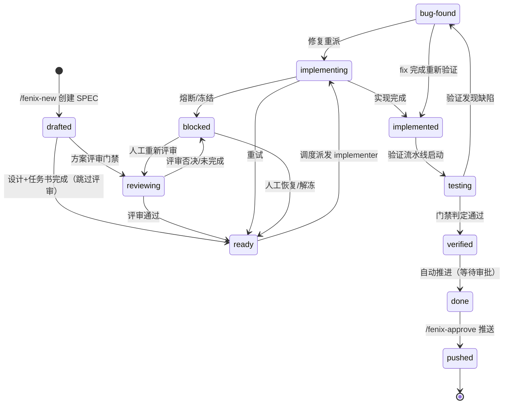

# SPEC 生命周期与状态机

Fenix 将 SPEC 从提出到发布的完整生命周期建模为**11 个状态**的有限状态机。本章覆盖全部状态、合法转移、打回与修复循环、冻结机制与门禁逃生门。

## 状态全景

## 各状态详解

### drafted（草稿）

`/fenix-new` 创建 SPEC 后即进入 `drafted`。此时 SPEC 还停留在设计阶段，proposal、design 与 tasks.md 正在生成或等待确认；一旦设计文档与任务书完成并经晋升链校验通过，SPEC 便转入 `ready` 或 `reviewing`（依评审门禁判定分流，见下一节）。

**框架自动生成的改进 SPEC**：当 `self_evolution` 自进化链路（仅自托管 daemon 启用，见[配置参考](09-config.md#self_evolution框架自进化)）判定某条目值得立项并经人工「同意」或开关打开后自动接受时，SPEC 统一使用 `evo-` 前缀（`evo-<slug>`，重名追加条目 id 短后缀）进入 `spec/changes/`，以 `drafted`（priority 5）注册 STATE——与人工 `/fenix-new` 生成的 SPEC **完全同源**：由既有 `gates.promote_mode`（本机 auto）自动晋升 → `ready` → 实现 → 验证 → `done`，终点 `pushed` 仍需人工审批（推送审批门 `gates.require_push_approval` 保持不变）。接受过程「先提交后注册」（仅 add 该 spec 目录并提交后再注册），失败时不产生「已提交未注册 / 已注册未提交」半成品，条目标 `accept_failed` 可重试（见[建议改进项面板](08-dashboard.md#设置页settings)）。

### reviewing（方案评审中）

`drafted` 经晋升链校验通过后进入 `reviewing`（当评审门禁未跳过时）。评审 Agent 阅读 SPEC 的 proposal.md、design.md、tasks.md，对方案的**目的适配性（goal-fit）**、**漏洞（hole）**、**回归风险（regression）** 三个维度做单轮只读评审。评审结论分三种：

- **approved**：方案可行 → `ready` → 实现调度
- **repaired**：方案可行且评审者已就地修补 → `ready` → 实现调度
- **rejected**：方案存在方向性风险 → `blocked` → 人工裁决

评审 run 未通过结果硬门或写入边界校验时，计为「未完成」，累计尝试上限 3 次（含首次），达上限后冻结转人工（`frozen: true`，error 内嵌 `spec-review-incomplete:` 标识供人工识别），与否决的 `frozen: true` + `spec-review-rejected:` 严格区分（判据详见[blocked 的两种语义](#blocked-的两种语义冻结-vs-阻塞)）。冻结评审 blocked 的恢复路径为解冻（`unfreeze` 解冻后恢复 `reviewing`，daemon 自动重派评审），`blocked → reviewing`（`re_review` 重新评审入口）仅对**未冻结**的历史评审 blocked 条目开放。

> **跳过白名单**：仅当四项**全部命中**时跳过评审直通 `ready`——`mode == fast-track` 且能力目录数 ≤ 1 且 Deliverables 声明条目数 ≤ 3 且名称**非 `evo-` 前缀**（`evo-` 为硬否决项）。`gates.spec_review_mode: never` 时完全关闭评审，所有 SPEC 走 `drafted → ready` 直通。

### ready（就绪）

设计完成后 SPEC 进入 `ready`，被熔断后经人工恢复也会回到这里。此状态的含义是「等待调度」：PM 引擎按优先级把它派发出去，SPEC 随之进入 `implementing`。

### implementing（实现中）

PM 派出 implementer 后 SPEC 进入 `implementing`，实现者此时正在 worktree 中编写代码。它有三种离开方式：实现完成转入 `implemented`；实现被工作流打回则回到 `ready` 重试；若达到 `impl_run_budget` 触发熔断、或被人工冻结，则进入 `blocked`。

**`branch` 字段语义**：`branch` 记录本轮实现分支（`fenix/<spec>-<timestamp>`），写入时机早于 merge-back——实现/repair run 终态成功后即落盘，使 daemon 重启恢复在「已实现未合并」窗口内可命中本轮分支。

**锚点回落链（daemon 重启恢复）**：恢复路径查找 `branch` 按三层回落：（1）STATE `branch`；（2）`find_worktree_by_spec` 在册 worktree（`git worktree list` 事实查询）；（3）`find_branches_by_spec` git 分支命名空间枚举（`refs/heads/fenix/<spec>-*`，候选经「完整 spec 名 + 分隔符边界」全等比较 + 「已含 main 合并」优先排序）。三层均无命中时走清空重建路径并打 WARNING 留痕。

### implemented（已实现）

实现完成后 SPEC 进入 `implemented`，此时代码已合并，等待验证流水线启动。流水线一旦启动，SPEC 即转入 `testing`。

### testing（验证中）

验证流水线启动后 SPEC 进入 `testing`，验证者正在构建、启动被测实例并执行场景。门禁判定通过则转入 `verified`，发现缺陷则转入 `bug-found`。

### verified（已验证）

planner-judge 门禁判定通过后 SPEC 进入 `verified`，随即自动推进到 `done`，无需任何人工操作。

> **门禁逃生门**：`verified → testing` 仅允许由门禁拦截触发的自动回退调用（`_on_spec_verified` 门禁发现应用不可达或证据不足时自动回退），人工路径无法直接执行该转移，无法绕过验证门禁。

### verified 滞留与回炉路径（task-gap）

`verified → done` 推进前会过任务完成度门禁（`_task_completion_blocker`）：若该 SPEC 的 `tasks.md` 存在**未勾选的数字任务**（且实现者没有 TaskUpdate 完成记录），门禁会以 `task-gap:` 前缀的错误把 SPEC 拦截在 `verified`——error 形如 `task-gap:未完成任务：4.5、5.1`。这是**结构性形态**而非故障：文档 / Dashboard UI / 补充测试类任务天然没有验证场景，验证 23/23 全绿与任务书 17 项未完成可以并存；实现者收工时刻的产物硬门（见[调度与治理规则](06-governance.md#实现者任务书完成度硬门)）已在源头拦截「没做完却报 success」，但存量/边界情况仍可能滞留 verified。

**人工回炉入口**（消除「改 STATE.md 手工作业」）：

1. **Dashboard 修改状态弹窗**：对状态为 `verified` 且 error 以 `task-gap:` 开头的 SPEC，「修改状态」弹窗渲染**回炉区块**，列出缺口任务 id 清单与后果说明；点击回炉并确认（明示「将重新派发实现」）后调用回炉 API，SPEC 复位为 `ready`、错误清空。
2. **CLI 命令**：`python3 bin/fenix_cli.py reflow <spec> [--project <path>]`（缺省当前目录）。成功输出复位提示并以退出码 0 结束；被拒绝（非 verified / error 非 task-gap 前缀 / 冻结态 / 幂等重复）时 stderr 输出明确拒绝原因并以非零退出码结束。CLI 与 API 共用同一实现点，判定与执行语义完全一致。

**回炉条件**（全部满足才允许）：SPEC 存在于 STATE.md ∧ `status == verified` ∧ `error` 以 `task-gap:` 开头 ∧ 未冻结。回炉执行 `status = "ready"` 与 `error = null` 原子写回，**不触碰**实现尝试预算计数、`frozen` / `frozen_until` / `start_after`，不绕过 daemon 的后续派发闸门；缺口任务仍为未完成状态，daemon 随后按既有逻辑重新派发实现者承接剩余任务（重跑成本由实现尝试预算如实记账）。每次回炉在 `.fenix/PROJECT_LOG.md` 追加可追溯记录（SPEC 名、原状态、缺口任务清单、动作来源）。

### bug-found（发现缺陷）

验证发现缺陷且验证报告闸门放行后，SPEC 进入 `bug-found`，开始修复循环：修复重派时回到 `implementing`（走 fix 分支）；fix 完成后则直接回到 `implemented` 重新验证。

### blocked（阻塞）

`blocked` 是唯一「等人工」态，承载两种语义不同的停摆：**冻结转人工**（`frozen: true` + 人工升级告警，需人在场决策）与**阻塞待 admin**（不写 frozen，admin 巡检介入）——分类判据与各消费者见[blocked 的两种语义：冻结 vs 阻塞](#blocked-的两种语义冻结-vs-阻塞)。进入此状态后自动链已停止，唯一出路是人工处置（解冻/复位），SPEC 回到冻结前状态或 `ready` 重新排队。

### done（完成）

`verified` 自动推进后 SPEC 进入 `done`，验证已通过，只差最后一道审批。`/fenix-approve` 审批推送（`approve_mode: auto` 时则自动推送）把它送入 `pushed`。

### pushed（已推送）

审批通过并推送远程仓库后 SPEC 进入 `pushed`。这是终态：交付物已发布，SPEC 生命周期到此结束。

## 完整合法转移表

| 当前状态 | 可转移目标 |
|---------|-----------|
| drafted | ready, reviewing |
| reviewing | ready, blocked |
| ready | implementing |
| implementing | implemented, ready（重试）, blocked（熔断） |
| implemented | testing |
| testing | verified, bug-found |
| bug-found | implementing（修复）, implemented（fix 后重验） |
| blocked | ready, reviewing |
| verified | done |
| done | pushed |
| pushed | （无，终态） |

## 打回与修复循环

验证失败后 SPEC 进入 `bug-found`，开始修复循环：

1. 验证报告说明缺陷根因
2. 派发 fix 分支（`fix-<name>` 后缀）给 implementer 修复
3. 修复完成 → `implemented` → 重新走验证流水线
4. 验证通过 → `verified` → `done`

> fix 族谱有深度/宽度上限（默认深度 3、宽度 2），防止无限派生。越界触发 `family_explosion` 困境信号转人工处置。

## 冻结与解冻

冻结通过 `/fenix-freeze` 或 Dashboard 冻结操作触发：状态写入 blocked，附带结构化 `frozen: true` 标记与规范前缀 error。冻结期间所有自动链路对状态的改写都会被剥离，唯一出路是解冻。解冻（`/fenix-unfreeze`）恢复冻结前的状态并清空 error；对未冻结的 SPEC 执行解冻是幂等 no-op，可以放心调用。

## 取消保持态（_cancelled_hold）

人工取消一个运行中的 run 后，SPEC 不是被立刻重新调度，而是进入**取消保持态**：STATE 记录 `_cancelled_hold` 标记，含义是「有人有意让它停下」（`core/state_machine.py`）。

- **有意等待，不是故障**：恢复链路（daemon 重启回退、孤儿清理、重派扫描）对保持态 SPEC 一律跳过——不复位、不重派、不递增重验计数；
- **与冻结并列**：`_cancelled_hold` 与 `_frozen_hold` 是两个互不读写的独立标记；对冻结中的 SPEC 执行终止时，会先清掉取消保持标记；
- **唯一出路是显式复位**：Dashboard SPEC 详情行的「恢复运行」动作（见 [Dashboard 使用指南](08-dashboard.md)）是保持态的正规出口——先判定能否保留实现分支：命中则保留分支续做（打 `_recovery_resume` 标记、清零相关计数）并即时唤醒派发；未命中则降级为普通重派。终态（done/pushed）、冻结或非保持态的 SPEC 调用它会被幂等拒绝。

## blocked 的两种语义：冻结 vs 阻塞

`blocked` 是唯一「等人工」态，但它承载着两种语义完全不同的停摆。每次写入 `status=blocked` 时，框架 MUST 将停摆显式归入下列两类之一，MUST NOT 产生「两者皆无」的裸 blocked：

| 分类 | 标记 | 判据（admin 是否有操作杠杆） | 消费者 |
|------|------|------------------------------|--------|
| **冻结转人工** | `frozen: true` + 人工升级告警 | 无杠杆：需人在场决策（改方案、撤案、判是否值得再跑、改配置） | `admin_monitor` 的 blocked_stuck **豁免**（`:387` 对 frozen 直接跳过，不唤起 Administrator）；Dashboard 渲染「冻结」标签；人工升级告警通知人 |
| **阻塞待 admin** | 不写 frozen | 有杠杆：admin 可自动修复（改环境、起草契约、清 git 状态） | `admin_monitor` 超时巡检**唤起** Administrator agent 介入；Dashboard 渲染「阻塞」标签 |

**判据是唯一的**：对某类停摆问一句「admin agent 对它有可操作杠杆吗？」——无 → 冻结转人工（`frozen=true` **且** 发人工升级告警，二者成对、不可分离）；有 → 阻塞待 admin（不写 frozen）。判据不依赖文案，只看杠杆归属。

**机械化写入口**：冻结转人工统一经 `StateMachine.freeze_for_human(...)` 单一入口（一次调用完成 `status=blocked` + `frozen=true` + error 文案 + 经注入回调发送人工升级告警）——frozen 与 alert 成对、不可分离，从结构上消除「打了 frozen 标记但无人被通知」的静默冻结（历史事故：重启重验超限曾只有 frozen 无告警）。阻塞类站点（merge-back 熔断、契约缺失、env 阻塞、交付物守卫终审）不写 frozen、保持由 admin 巡检介入。

**本轮归类清单**（新增 blocked 写入点按判据自行归类）：

- → **冻结转人工**：评审否决（`spec-review-rejected`）、评审尝试耗尽（`spec-review-incomplete`）、预算耗尽（`impl_budget_exhausted`）、内容缺失（`spec_content_missing`）、env 阻塞 ≥2 轮（`_escalate_env_blocked`）、重启重验超限（`verify_redo_exhausted`）。
- → **阻塞待 admin**：merge-back 熔断、契约缺失、env 单轮、交付物守卫终审。

### 评审类冻结的恢复：解冻而非 re_review

评审否决/耗尽冻结的 SPEC（error 内嵌「原状态 reviewing」）人工恢复路径为：**修订方案后解冻**——Dashboard/CLI 解冻经 `parse_orig_status` 解析「原状态 reviewing」→ `unfreeze_spec(status=reviewing)` → daemon 事件链（`reviewing → spec_reviewing` → `_on_spec_reviewing` → `dispatch_review`）自动重派评审，评审收口字段（`reviewer_run`/`_review_attempts`）已在冻结时清空，重派无残留。注意 **`re_review`（重新评审入口）对 frozen spec 保持拒绝**（既有冻结保护契约，见 `test_dashboard_api.py` 的 `test_re_review_frozen_rejected`）——评审类冻结的恢复走解冻而非 re_review；未冻结的历史评审 blocked（旧版裸 blocked 条目）仍可走 `re_review`。

> 告警的存放、分级与自动闭环见[保障机制](07-safeguards.md#告警系统自愈无法覆盖时升级人工)：冻结转人工的告警（severity major 及以上）进人工待处理队列，spec 解冻离开 blocked 即自动闭环。

## Daemon 重启中断恢复

SPEC 处于 `implementing`/`testing` 这类中断状态时，daemon 重启会自动把它回退到 `ready`，同时清空陈旧 run 字段并重置重试计数，重新进入调度池。这是设计行为而非数据丢失。

**保留续做 vs 清空重建**：`implementing` 中断时，若发现可保留的分支（相对 main 有未合并提交，经上述三层锚点回落链解析），则保留 `branch`/`implementer_run` 并打 `_recovery_resume` 标记，由 dispatch 层在保留分支的 worktree 内 `claude --resume` 续做而非从零重派；仅零提交/分支缺失/载体不可用才走清空重建（零留痕的静默早退是本框架治理重点，锚点缺失一律打 WARNING 附候选清单）。

**fast-track 车道的恢复续做**：`mode: fast-track` 的 spec 经 daemon 重启恢复时与 implementer 车道**同源消费** `_recovery_resume`——派发入口读标记与保留分支、经 `resolve_resume_site` 三态解析载体，在保留分支的 worktree 内续做（`pre_wt_path` 贯通 runner，不新建分支、不重做既有成果；日志打 `Resume dispatch ... on preserved branch ...`）；载体不可用时降级为普通全新派发并打 WARNING（`Resume site unavailable ...`）留痕。标记为一次性消费：派发后即清空，防后续扫描反复尝试续做；未命中续做时入口才清除旧锚点（日志 `新轮次派发清除旧锚点`），使「本轮是续做还是从零」在日志中可直接判读。恢复续做的 fast-track prompt 注入继承注记（「框架保留了你在分支上的已提交成果、从 tasks.md 第一个未勾选项继续、不重做不回滚」）——该注记仅对**恢复续做来源**（`mark_reused` 带 `recovery=True`）注入，普通打回重派/失败重派轮仍走既有「Worktree 继承（worktree-reuse）」注记，不误注「曾因 daemon 重启被中断」的归因。

**repair 待 re-merge-back 标记**：repair 通道运行期 `status` 保持 `implementing`，修复成功后会在 `merge_back_from_branch` 之前写入 `_repair_awaiting_remerge: true` 标记并落盘 `branch`——该标记使「repair 成功、仅剩重新合并进主树」成为 STATE 可观察的事实。daemon 重启恢复见到 `implementing + 该标记` 时，直接调用 `merge_back_from_branch` 完成合并并推进 `implemented`（不派发 implementer、不经过 `ready` 窗口）；re-merge 失败则清除标记后回落保留续做路径（`_recovery_resume`），由下一轮 run 的正常 merge-back 进入 repair/熔断通道。re-merge 成功后标记即清除，`implemented` 及之后状态上该标记恒为假。

## 门禁系统：两步判定

验证流水线结束后，门禁法官（planner-judge）进行两步判定：

1. **应用可达性门禁**：被测实例不可达且场景全失败时不判定 verified（防止测到陈旧产物）
2. **验证报告门禁**：报告缺失或缺失场景结果时阻止推进 bug-found（防止伪失败级联）

> 门禁无法在 CLI/Dashboard 直接绕过。`verified → testing` 逃生门仅门禁自身自动调用。

## STATE.md 与时间轴

每个 SPEC 的状态字段、优先级、创建/更新时间、run 引用、error 等都记录在项目的 `.fenix/STATE.md` 中，格式详见 [文件与数据地图](10-artifacts.md)。时间轴有两个观察入口：Dashboard「运维记录」页展示 Administrator 活动时间线，`/fenix-process <name>` 展示单个 SPEC 的时间线。

## 状态变化事件与 Hook

SPEC 每次状态转换（包括 Dashboard 处置、人工冻结这类不经状态机 `transition()` 的跨进程写入）都会在 ≤5 秒内发布一条状态变化事件，事件类型即目标状态（11 状态枚举，另含项目级伪事件 `all-done`——全部 SPEC 到达终态时发布的项目级事件）。你可以用 hook 订阅这些事件，在 SPEC 进入指定状态时自动执行动作：重启 daemon / dashboard、git 提交与推送、webhook 通知、任意 shell 命令。订阅分全局与 SPEC 级两级，配置存于 `.fenix/config.yaml` 的 `hooks` 段（30 秒热更新生效），完整配置参考见[配置参考](09-config.md#hooks)，Dashboard 操作入口见[Dashboard 使用指南](08-dashboard.md)，执行审计见[文件与数据地图](10-artifacts.md)。

> 不要在 hook 动作里修改 SPEC 状态，状态变化会再次发布事件形成自激循环；框架不对 hook 做熔断，只能靠审计与告警事后暴露。

## 相关文档

- [验证体系](05-verification.md) — 三步流水线与门禁判定细节
- [调度与治理规则](06-governance.md) — 预算、熔断、人工恢复
- [FAQ 与故障排查](12-faq.md) — SPEC 卡住怎么办
