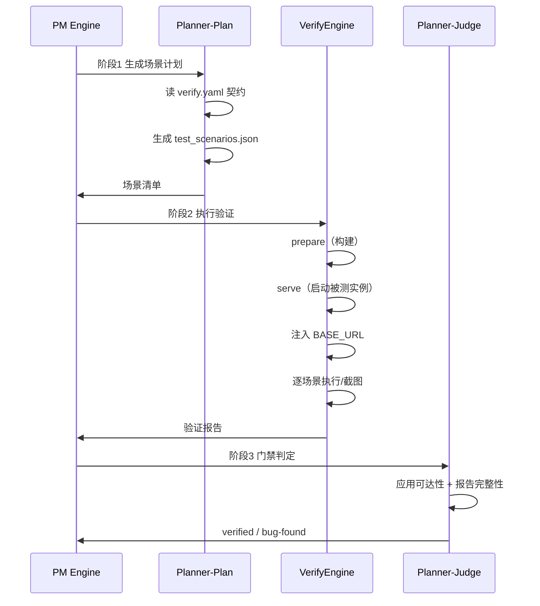

# 验证体系

Fenix 的验证不是「跑一遍测试」，而是一套三步流水线加门禁判定。理解这套体系，才能读懂验证报告、定位伪失败、避免修复循环空转。

## 三步流水线



## verify.yaml 契约

`<项目根>/.fenix/verify.yaml`（随仓库提交）把「如何构建、如何启动、何时算就绪」变成声明，验证流水线在每轮验证前依次执行：

```yaml
# 可选：构建步骤，保证被服务产物包含最新合并实现
prepare:
  - run: npm run build
    cwd: core/dashboard/static

# 可选：被测实例启动方式（缺省回退 config commands.start）
serve:
  kind: static                  # static=内置静态服务器；command=长驻服务命令
  root: core/dashboard/static

# 可选：就绪探针（缺省探根路径、期望 200、等待 60 秒）
ready:
  url: /#/overview
  expect: 200
  timeout: 60
```

**BASE_URL 铁律**：验证场景的 URL 由框架**全量改写**到本次被测实例地址。无论 planner 生成什么地址，场景一律打「新鲜构建的实例」，从根上杜绝「测到陈旧产物」。

- `static_scope: main`（默认）：在主树构建并起被测实例
- `static_scope: worktree`：在专用 serving worktree 内构建服务，隔离主树

## 场景冻结

验证场景（`test_scenarios.json`）在 `implemented → testing` 切换时生成并冻结。场景清单写入 `.fenix/verify-progress/<spec>/test_scenarios.json`，之后每轮修复重验复用同一批场景，保证「同一把尺子量到底」。

## verdict 四分类与证据链

门禁判定 `verified` 前的证据：

| 类别 | 含义 | 流向 |
|------|------|------|
| **pass** | 场景全部通过 | → verified → done |
| **fail + 报告完整** | 场景失败且验证报告有证据 | → bug-found（修复循环） |
| **blocked-env** | 环境不可达/构建失败（非产品缺陷） | → 不判 bug-found，回 testing 重派新 attempt |
| **inconclusive** | 证据不足（mock/SSE 环境疑云） | → 不产生 verdict 信号，人工检查 |

> 关键防伪机制：**构建失败/环境不可达绝不判 bug-found**，防止「验证没能发生」被当成「验证发现了缺陷」→ 派生伪 fix → 修复级联空烧 token。

## 验证报告与修复循环

`verify-progress/<spec>/report.json` 记录：
- `summary`：总场景数 / 通过 / 失败 / 警告 / 错误数
- `scenarios`：每个场景的判定、失败信息、截图
- `verification-report.md`：Markdown 形式的缺陷根因汇总

验证失败 → `bug-found` → 派生 fix 分支修复 → 重新验证。修复循环有三轮熔断：同一缺陷连续 3 轮验证失败自动 blocked 转人工。

## 伪失败防线

| 防线 | 说明 |
|------|------|
| 应用可达性门禁 | 应用不可达且场景全失败 → 不判 verified（防止陈旧产物骗过） |
| 报告完整性门禁 | 报告缺失/场景结果缺失 → 阻止推进 bug-found |
| blocked-env 不判 bug | 构建/环境问题不触发修复级联 |
| BASE_URL 重写 | 场景永远打新鲜实例 |
| 就绪探针 | 实例可用后才开始跑场景 |

## 验证结果在哪看

- **Dashboard**：SPEC 详情页的「验证报告」页签
- **CLI**：`/fenix-process <spec-name>` → 验证报告
- **文件**：`.fenix/verify-progress/<spec>/report.json`、`verification-report.md`、`screenshots/`（含失败截图）

## 相关文档

- [SPEC 生命周期与状态机](03-lifecycle.md) — verified/bug-found 转移与逃生门
- [调度与治理规则](06-governance.md) — 修复循环三轮流断
- [文件与数据地图](09-artifacts.md) — verify-progress 目录结构
- [FAQ 与故障排查](10-faq.md) — 验证反复失败怎么办