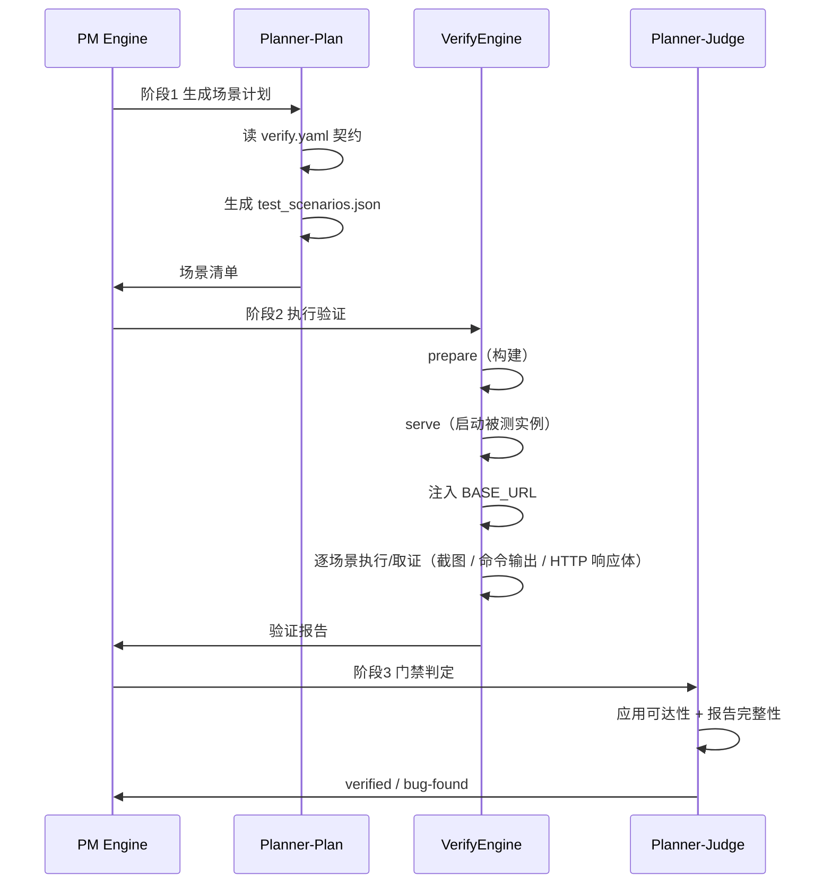

# 验证体系

Fenix 的验证不是「跑一遍测试」，而是一套三步流水线加门禁判定。理解这套体系，你才能读懂验证报告、定位伪失败、避免修复循环空转。

## 三步流水线



整条流水线由 PM Engine 编排三个阶段。阶段 1 由 planner-plan 读取 verify.yaml 契约，生成 test_scenarios.json 场景清单；阶段 2 由 VerifyEngine 依次执行 prepare（构建）、serve（启动被测实例）、注入 BASE_URL，再逐场景执行并截图，产出验证报告；阶段 3 由 planner-judge 做门禁判定，先核应用可达性与报告完整性，再给出 verified 或 bug-found 的结论。注意出题时机：spec 进入 `ready` 时框架即**并行触发** planner-plan 出题（与实现车道并行在飞，产物标记 `parallel_plan.json`），并非等 `implemented` 之后才串行出题——实现收工时场景计划往往已就绪。

## verify.yaml 契约

`<项目根>/.fenix/verify.yaml`（随仓库提交）把「如何构建、如何启动、何时算就绪」变成声明，验证流水线在每轮验证前依次执行：

```yaml
# 可选：构建步骤，保证被服务产物包含最新合并实现
# （先装依赖再构建：package.json 新增依赖时主树 node_modules 会落后一拍）
prepare:
  - run: npm install --no-audit --no-fund
    cwd: core/dashboard/static
  - run: npm run build
    cwd: core/dashboard/static

# 可选：被测实例启动方式（缺省回退 config commands.start）
serve:
  kind: static                  # static=内置静态服务器；command=长驻服务命令
  root: core/dashboard/static

# 可选：就绪探针（缺省探根路径、期望 200、等待 60 秒）
ready:
  url: /#/overview
  expect: 200
  timeout: 60
```

**BASE_URL 铁律**：验证场景的 URL 由框架**全量改写**到本次被测实例地址。无论 planner 生成什么地址，场景一律打「新鲜构建的实例」，从根上杜绝「测到陈旧产物」。

被测实例在哪里构建由 `static_scope` 决定：默认值 `main` 在主树构建并起被测实例；改为 `worktree` 则在专用 serving worktree 内构建服务，与主树完全隔离。

## 多形态验证（web / cli / api）

验证不只有浏览器一种形态。场景按交付物形态选择 `kind`（场景级字段，缺省 `web`），三套 runner 分工：

| kind | 适用交付物 | 场景步骤 | 断言形态 |
|------|------------|----------|----------|
| **web** | 页面 / 交互 / 视觉 | `navigate` / `click` / `type` 等 DOM 步骤 | 元素存在性、交互可用性、内容正确性、布局完整性（Playwright） |
| **cli** | 命令 / 脚本 / 落盘 | `run`（command/cwd/env/stdin/timeout） | `exit_code` / `file_exists` / `output_match` / `file_content` / `json_output` / `dir_contains` |
| **api** | HTTP 端点 | `http_request` / `sse_connect` | `status_code` / `json_path` / `response_header` / `body_contains` / `json_schema` / `latency_under` / `sse_event_*` |

**kind 选择**：页面/交互交付→`web`；HTTP 端点交付→`api`（**不要再用 web 场景 navigate 到端点 `text_contains` 断 JSON 文本凑合**）；命令/脚本交付→`cli`；混合交付按交付物拆分场景、各自 kind，跨 kind 数据先后用 `depends_on` 串接。单场景内不混排步骤类型；关联词表的权威源是 `core/verify_engine/scenarios.py` 的 per-kind 常量。

**分层语义跨 kind 统一**：第 1/3 层断言失败=一定是 Bug；第 4 层（如 `latency_under`）失败=warning 需结合上下文；CLI/API 无第 2 层（交互可用性是 DOM 概念）。

**CLI/API 特异规则**：
- cli **非零退出码不判步骤失败**（错误路径测试的正常预期），由 `exit_code` 断言仲裁；`run` 步骤自动注入 `FENIX_VERIFY_BASE_URL` / `FENIX_VERIFY_PORT`（框架值优先）。
- api 用 `as` 命名响应、断言 `response` 字段引用（缺省最近一次）；`http_request` / `sse_connect` 的 URL origin 由框架全量改写（路径保留）。
- 证据形态为命令输出 / HTTP 响应体（**无截图属合法形态**），同样 64KB 截断纪律；CLI/API 场景报告的 `screenshots` / `visual_results` 恒为空列表。

**纯 CLI 交付不需要 serve**：契约形态由场景集自动反推：纯 `cli` 场景集跳过 serve/ready（不回退 `commands.start`），含 web/api 场景则 serve（或 `commands.start` 兜底）必须有效，缺失时验收报错打回 plan。

## 场景冻结与跨轮复用

验证场景（`test_scenarios.json`）由 planner **只设计一次**，验收通过即冻结，写入 `.fenix/verify-progress/<spec>/test_scenarios.json`。**此后无论重入验证多少次（打回重验、修复轮、重试），都直接复用冻结场景，绝不重新出题**：planner 单轮设计成本在小时级/千万 token 级，只应支付一次；更重要的是「同一把尺子量到底」：修复是否有效，衡量的始终是同一组标准。

冻结集的变更只有三条通道：

1. **admin 裁决**：冻结文件损坏、或修复新增了可交互元素导致覆盖缺口时，框架不自动重排，而是升级「场景计划争议」呼叫 admin 处置（扩展场景 / 声明纯展示）；
2. **人工重置**：删除冻结文件即批准重新出题（下一轮验证走完整 planner 设计流程）；
3. **契约版本迁移（自动）**：冻结集条目带 `contract_version` 版本戳（当前 v2：web 场景必含 `navigate` 步骤）；低版本旧集加载时由框架自动迁移——以被测实例地址合成缺失的 `navigate` 步骤插入首位（迁移后写回盖新版本戳），无法合成时该场景转待重排、全部过时则回落重新出题，全程无需人工干预。

### 并行出题与 parallel_plan.json

出题也可以并行（多路 planner 同时设计）。并行进度与仲裁记录在 `.fenix/verify-progress/<spec>/parallel_plan.json`，条目状态机为 dispatched → completed / failed / cancelled / frozen，全部落定后收敛为 consumed（`core/pm_engine/engine.py`）。某一路失败时其半成品会被隔离：场景文件改名 `.parallel-discarded` 并打 discarded 标记，让位后续重试——残缺场景集不会被当成冻结集消费。

## verdict 四分类与证据链

门禁判定 `verified` 前的证据分四类：

| 类别 | 含义 | 流向 |
|------|------|------|
| **pass** | 场景全部通过 | → verified → done |
| **fail + 报告完整** | 场景失败且验证报告有证据 | → bug-found（修复循环） |
| **blocked-env** | 环境不可达/构建失败（非产品缺陷） | → 不判 bug-found，走两级豁免握手：级一判据（judge 前全批 blocked-env）判 inconclusive 进自动重验；级二判据（judge 后断言归因全 env）在 judge 采纳前拦截、不落 verified——豁免落 verified 须 admin DISPOSITION 放行 |
| **inconclusive** | 证据不足（全批 blocked-env 或断言归因全 env 的重验轮） | → 自动回 implemented 重派新 attempt，最多 `verify_engine.inconclusive_max_attempts`（缺省 3）轮；第 4 轮写 `inconclusive_loop` SIGNAL 呼 admin 后停等人工 |

> 关键防伪机制：**构建失败/环境不可达绝不判 bug-found**，防止「验证没能发生」被当成「验证发现了缺陷」→ 派生伪 fix → 修复级联空烧 token。

## env 豁免与 admin 握手

**你会看到什么**：验证连续多轮「没有产品缺陷却停在 testing」，SPEC 反复回到 implemented 重派新验证轮；或收到「inconclusive 循环」升级告警要求人工处置。

机制（`core/pm_engine/verification/escalation.py`）：环境类失败（blocked-env / 证据不足）有两级豁免防线——

- **级一（judge 前）**：整批场景全部 blocked-env 且无任何 fail/error 时，本轮不出 verdict、记为 inconclusive 并回 implemented 重派新验证 attempt。级一/级二共享同一计数 `_inconclusive_attempts`：前 3 次（`verify_engine.inconclusive_max_attempts`，缺省 3）静默重派；达到第 4 次（`verify_engine.inconclusive_escalate_attempts`）升级写入 inconclusive_loop 信号并暂停自动重验。
- **级二（judge 后）**：judge 结论采纳前做归因断言——无 product-bug / test-defect 归因、无 flaky / 未知归因、且至少一条 env 归因，才允许按环境问题豁免（否则结论照常生效）。

**admin DISPOSITION 放行守卫**：对 inconclusive 循环的人工放行处置须经握手校验——放行记录的创建时间必须晚于本轮 inconclusive_loop 信号，陈旧的放行不复用（`_handle_env_exemption_handshake`）。放行被采纳后，本轮 report.json 会写入 `admin_disposition_backlink` 回链（信号类型 / 处置 id / 动作摘要），供审计对账。

**排查指引**：「verified 卡在 implemented 反复重验」通常不是死循环——先查 `.fenix/verify-progress/<spec>/` 下的 inconclusive_loop 信号与对应 admin 处置记录；有效放行落地后，下一轮验证即正常推进。

## 验证报告与修复循环

验证产物集中在 `.fenix/verify-progress/<spec>/` 下。report.json 记录总体情况（summary：总场景数/通过/失败/警告/错误数）与逐场景明细（scenarios：每个场景的 kind/判定/失败信息/证据，web 为截图，CLI/API 为命令输出与 HTTP 响应体）；verification-report.md 则以 Markdown 形式汇总缺陷根因。

验证失败后 SPEC 进入 `bug-found`，派生 fix 分支修复再重新验证。修复循环有三轮熔断：同一缺陷连续 3 轮验证失败即自动 blocked 转人工，防止在修不好的缺陷上无限烧钱。

## fastlane 小缺陷轻量通道

**你会看到什么**：验证只挂了 1 个场景，修复却没走「整轮重验」，而是很快合并一个小修复、只重验少数场景——这是 fastlane 在起作用。

机制（`core/pm_engine/verification/fastlane.py`）：小缺陷允许 code-fix 在主树直接修复 + 子集重验，跳过完整流水线。准入三条件：

1. 失败场景数 = 1；
2. judge 归因影响面 ≤ 3 个文件（`FASTLANE_MAX_AFFECTED_FILES`；影响面清单不可读时保守回落整轮）；
3. 无争议 findings 标记（该检测 fail-open，宁宽勿误）。

重验范围 = 失败场景 ∪ 其 `depends_on` 前置链（递归）∪ 下游受影响链（递归）；未实跑的场景沿用上一轮结论并标注来源。fastlane 连续失败 2 次（`_fastlane_fail_streak`）即回落整轮验证，防止在小通道里反复打转。每次准入/回落判定记录在 `.fenix/verify-progress/<spec>/fastlane_decision.json`。注意：fastlane 只豁免整轮验证，**不豁免 code-review 与交付物门禁**，其失败同样计入验证失败轮数。

## judge 门禁治理与 verdict 缓存

**你会看到什么**：SPEC 弹出 `judge_rerun_cap` 人工升级，或被 blocked 并提示 judge 重裁决超限。

机制（`core/pm_engine/verification/judge_gate.py`、`core/pm_engine/verification/verdict_evidence.py`）：judge 重裁决受两层预算约束——

- **轮内**：一轮验证里真实派发 judge ≤ 2 次（`_JUDGE_ROUND_MAX_REAL_DISPATCHES`），超出即停派并升级人工；证据扩充每轮 ≤ 1 次且不计入真实派发；命中 fast-track 复用既有 verdict 的不重复计数。
- **spec 级**：整个 SPEC 生命周期 judge 重裁决最多 5 次（`_MAX_JUDGE_RERUNS`），超限 SPEC blocked 转人工；计数冻结后不因重启清零（`_judge_cap_frozen`）。

**verdict 缓存**：每次 judge 结论按指纹持久化到 `.fenix/verify-progress/<spec>/verdict_cache.json`；修复轮命中同一指纹时直接注入既有结论、裁剪重验范围（PASS 结论同样入缓存）；缓存写失败不影响流程（fail-open）。

## 伪失败防线

伪失败是验证链最大的 token 浪费源，Fenix 为此设了七道防线：

| 防线 | 说明 |
|------|------|
| 应用可达性门禁 | 应用不可达且场景全失败 → 不判 verified（防止陈旧产物骗过） |
| 报告完整性门禁 | 报告缺失/场景结果缺失 → 阻止推进 bug-found |
| blocked-env 不判 bug | 构建/环境问题不触发修复级联 |
| BASE_URL 重写 | 场景永远打新鲜实例 |
| 就绪探针 | 实例可用后才开始跑场景 |
| 迟到结果防御 | SPEC 已不在 testing 时收到的验证结果直接丢弃、不覆写终态（`core/pm_engine/verification/legacy.py` 单一收敛点，bug-found / verified / process-failure 三分支共用）；verified 收敛点同时摘除队列并取消在飞 verify run（`core/pm_engine/engine.py`，回收键含 epoch 防串代） |
| 逐测超时门 | pytest 全局单用例 10s signal 硬门（`pytest.ini`，机读判定「Timeout (>10.0s) from pytest-timeout」）；确需更长须登记 `tests/timeout-allowlist.yaml`（nodeid + timeout_seconds + reason 三字段，由 `tests/test_timeout_gate.py` 机械校验；全局阈值无放宽配置） |

## infra 失败预算豁免

**你会看到什么**：验证多轮因基础设施问题（构建环境、依赖安装、端口占用等）失败，但 SPEC 没有像产品缺陷那样被三轮熔断冻结，也未重复扣减 run 预算。

机制（`core/state_machine.py`）：判定为 infra 的验证失败轮不计入 `MAX_VERIFY_FAIL_ROUNDS` 的冻结判定，冻结计数只在验证 PASS 时归零；对应验证 run 的预算按幂等退款（`_infra_refunded_run_ids` 记账，同一 run 不重复退）。观测字段落在 STATE.md：`_infra_failure_count`（infra 失败次数，观测不归零）、`_verify_infra_rounds`（infra 轮数，不参与冻结）、`_infra_refunded_run_ids`（退款幂等清单）。预算口径详见 [调度与治理规则](06-governance.md) 的「三类预算」。

## 验证结果在哪看

- **Dashboard**：SPEC 详情页的「验证报告」页签
- **CLI**：`/fenix-process <spec-name>` → 验证报告
- **文件**：`.fenix/verify-progress/<spec>/report.json`、`verification-report.md`、`screenshots/`（web 失败截图；CLI/API 证据在报告断言明细）

## 相关文档

- [生命周期与状态机](03-lifecycle.md) — verified/bug-found 转移与逃生门
- [调度与治理规则](06-governance.md) — 修复循环三轮熔断
- [文件与数据地图](10-artifacts.md) — verify-progress 目录结构
- [FAQ 与故障排查](12-faq.md) — 验证反复失败怎么办
