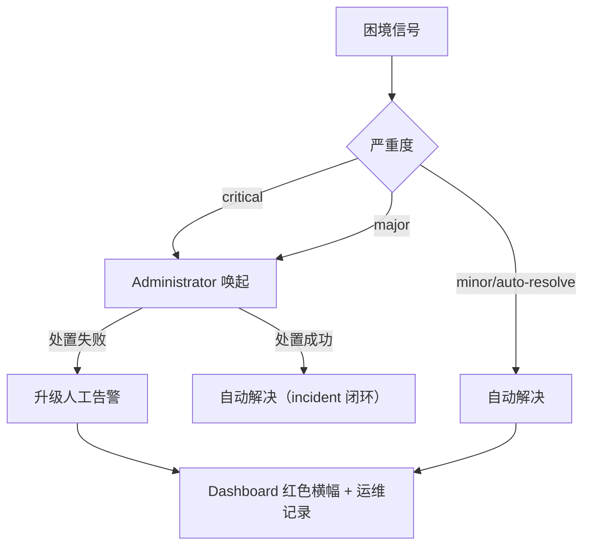

# 调度与治理规则

Fenix daemon 自动调度 SPEC 时受一组预算、重试与熔断规则约束，防止「无限烧钱 / 无限重试 / 状态空转」。理解这些规则，你就知道 SPEC 卡住时哪条规则在起作用。

## 优先级与并发

- **严格优先级并行**：高优先级（priority 数值小）先执行；同一优先级内的任务可并行至 `agents.max_concurrent` 上限；不同优先级不并行（低优先级等高优先级全部完成才启动）
- 优先级在 Dashboard/`/fenix-status` 中可见，可在 Dashboard SPEC 详情行设置

## 三类预算

| 预算 | 配置键 | 行为 | 耗尽后果 |
|------|--------|------|---------|
| **实现尝试预算** | `agents.impl_run_budget` | 每 spec 跨修复周期的实现 run 启动次数上限（含首次实现与每轮修复、含单次派发重试 attempt） | `blocked` + 人工告警，不再自动重派 |
| **Token 预算** | `agents.token_budget_millions` | 单 spec 累计 input token 预算（单位百万）；累计到 80% 发提醒告警、100% 发升级告警 | 不自动冻结，告警由人工决定处置 |
| **每日运行上限** | `agents.daily_run_limit` | 每日全部 Agent 运行总数上限（0=无限） | 当日停止派发 |

## 重试、退避与秒挂冷却

- **重试**：`agents.max_retries` 设定失败 Agent run 的最大重试次数
- **派发锁冲突退避**：`pm.dispatch_backoff_schedule`（默认 `[30, 120, 600]` 秒）——派发 implementer 遇 worktree already active 时递增退避，期间不消耗 attempt 配额；序列耗尽仍持锁 → `dispatch_stalled` 信号升级处置
- **秒挂冷却**：刚启动即失败的 run（秒挂）进入冷却期，冷却期内跳过 implementer/fast-track/repair 的再次派发，防抖防空转

## 超时活性监督

`agents.timeout_supervision`（默认启用）：

1. run 到达 `run_timeout_seconds` 不直接 kill，先按矩阵判定
2. 总墙钟 ≥ `absolute_max_seconds` → 无条件终止
3. 已续期 `max_extensions` 次 → 终止
4. `judge_window` 秒内零 run 事件 → 跳过 LLM 直接判停滞终止
5. LLM 判定 advancing → `deadline += extension_seconds` 续期；stagnant / judge 不可用 → 终止留证

**对用户意味着什么**：run 超过超时时间后可能还在续期运行，Dashboard 显示运行中不代表卡死；真正停滞会被终止并留证据。

## 自动恢复

daemon 重启时，`implementing`/`testing` 中断状态的 SPEC 自动回退 `ready`，清空陈旧 run 字段、重置重试计数，重新排队调度。

## merge 修复通道与熔断

- 合并失败按指数退避重试（`pm.push.retry_backoff_seconds` 默认 `[300, 900]`）
- 连续失败达 `merge_breaker_threshold`（复用 `agents.merge_breaker_threshold`，默认 2）→ 阻断自动 merge，转人工处置（`merge_streak` 困境信号，critical 级）

**对用户意味着什么**：同一 SPEC 连续 merge 失败多次会停止自动重试并红脸告警，提示需要检查 git 冲突根因。

## fix 族谱收敛

- `fix-` 前缀递归派生（fix-x → fix-fix-x → …）有深度/宽度上限（`pm.family.max_depth` 默认 3、`max_width` 默认 2）
- 越界 → 中止自动创建 + `family_explosion` 信号转人工

**对用户意味着什么**：防止「修不好的 fix 无限派生」，层层失败最终升级人工而非继续烧钱。

## 告警分级流向

困境信号（SIGNAL_SEVERITY）与前缀流向：

| 信号 | 严重度 | 含义 |
|------|--------|------|
| repeated_failures | major | 同一 SPEC 连续失败 |
| flapping | major | 状态机空转回路（ready↔implementing） |
| stuck | major | run 卡死停滞 |
| merge_streak | critical | 合并反复失败 |
| blocked_stuck | critical | blocked 滞留 |
| daemon_errors | critical | 守护进程异常 |
| family_explosion | major | SPEC fix 族爆炸 |
| dispatch_stalled | major | 派发停滞 |

唤起 Administrator 有冷却（`admin.escalation_cooldown_minutes` 默认 15 分钟），防止同一信号反复唤起烧钱。

## 重启协议

- daemon 由 supervisor 托管（`fenixd_supervisor.py`），异常退出自动拉起
- 重启后中断状态回退（见自动恢复）
- 项目通过 `/fenix-setup` 或 Dashboard 项目页启停；跨项目统一由 `/fenix-dashboard` 管理

## 相关文档

- [配置参考](08-config.md) — 上述全部键的默认值/范围/生效方式
- [Dashboard 使用指南](07-dashboard.md) — 告警横幅处置入口
- [文件与数据地图](09-artifacts.md) — admin_alerts.json 告警记录位置