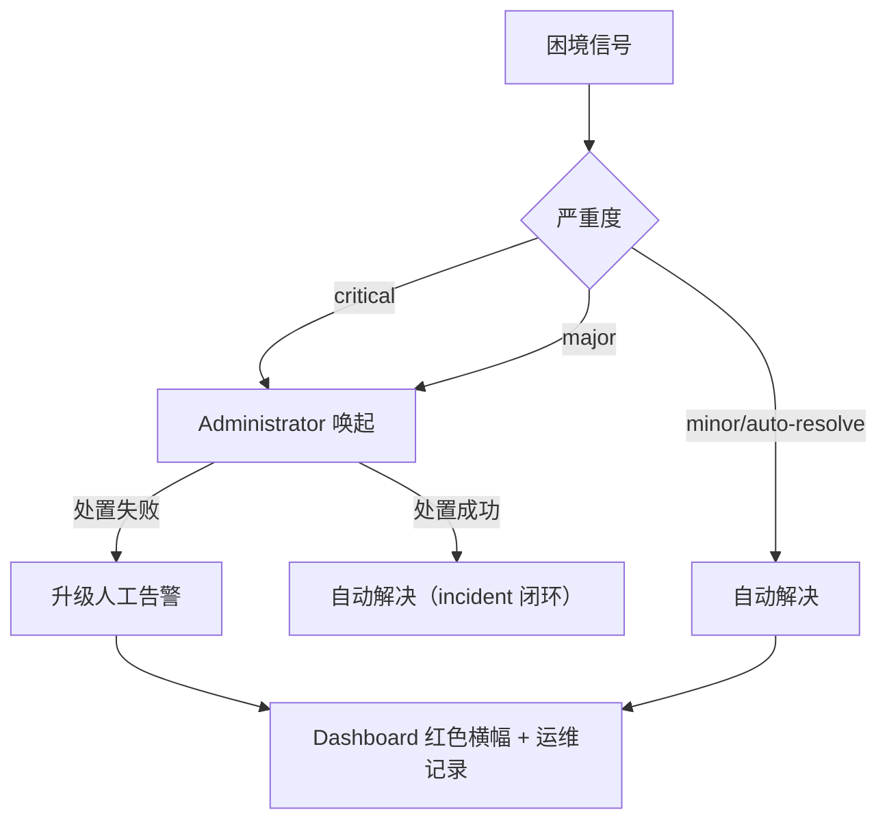

# 调度与治理规则

Fenix daemon 自动调度 SPEC 时受一组预算、重试与熔断规则约束，目的是防止三类失控：无限烧钱、无限重试、状态空转。理解这些规则之后，SPEC 卡住时你就能判断是哪条规则在起作用，以及该动哪个配置键。

本章承接[保障机制](07-safeguards.md)：上一章回答「框架靠什么机制保证不出事」（目的/原理/控制点），本章给出这些机制背后的数值口径：预算多少、退避几秒、告警几级流向谁。第一节先交代**调度节拍**——SPEC 靠哪些事件源被唤醒、兜底扫描为什么是 30 分钟——后面各节讨论的预算、退避与熔断，都作用在这套节拍之上。

## 调度节拍：SPEC 何时被唤醒

在讨论预算与退避之前，先回答一个更前置的问题：**一个 SPEC 什么时候会被唤醒去派发？** 答案不是单一轮询，而是「事件驱动为主 + 多层定时兜底」。

### 唤醒源全景

| 唤醒源 | 间隔 / 时机 | 做什么 |
|--------|------------|--------|
| **文件监听器** | 2 秒（比对 STATE.md 校验和） | 状态一变即为该 SPEC 产出事件并派发——**正常路径** |
| **定时拾取** | 60 秒 | 检查 `start_after` 已到期的 SPEC 并派发 |
| **恢复闭环复查** | 60 秒 | 复查到期的恢复观察项（见下方盲区） |
| **配置热更新** | 30 秒 | 配置文件 mtime 变更即原地重载 |
| **自动归档检查** | 300 秒 | 终态 SPEC 超阈值则归档 |
| **孤儿清理** | 600 秒 | 回收残留 worktree / autostash |
| **全量扫描 `full_scan`** | `schedule.poll_interval_minutes`（默认 30 分钟），另在 daemon 启动与 STATE.md 变化时触发 | **兜底**：捞监听器漏掉的事件与「没有事件源」的孤儿态 |

`full_scan` 依次做三件事：比对全部 SPEC 的状态变化并派发事件、逐条执行恢复动作（孤儿 ready 白名单重派、中断态回退）、跑阻塞检测（`check_blockers`，内含恢复闭环复查）；每轮开始前还会先跑一次悬空 run 清扫。

上表中前六项与最后一项性质不同：前六项是**精确定向**的（谁变了就处理谁），全量扫描是**无差别兜底**的——这也决定了它的间隔取值。

### 为什么兜底扫描是 30 分钟：不是成本问题

实测（192 个 SPEC 的仓库，137 次 `full_scan`）：**中位 26.7 毫秒**，其中 100 次低于 100 毫秒；仅有两次超过 5 秒，且都不是扫描自身开销——一次计时窗口内套了一次远端 `git push`（网络 IO），一次是 daemon 启动的冷路径。按 30 分钟一次计算，占空比约 **0.0015%**。

所以这个间隔**不是被成本压出来的**，而是在「兜底及时性」与「恢复动作的副作用放大半径」之间取的保守值：`full_scan` 的恢复段会重新评估每个 SPEC 并可能重新派发，一旦恢复判据有缺陷，缩短间隔会成比例放大后果（`add-spec-status-modal-budget` 曾有每小时重验 9 轮的实证）。

**结论：要缩短等待，应当补事件源，而不是提高扫描频率。**

### 已知盲区：两类 SPEC 没有「能唤醒自己」的事件源

上面所有唤醒源有一个共同前提——**变化发生在该 SPEC 自己身上**（自己的状态变了、自己的定时到了、自己的观察项到期了）。有两类等待不满足这个前提，只能等下一轮全量扫描（最坏一个扫描周期）：

1. **依赖满足型**：SPEC A 声明 `depends_on: B`，A 因依赖不满足被跳过并出队；之后 B 转入接受态（`done`/`pushed`/`implemented`/`verified`）——那是 **B** 的状态变化，不会为 A 产出任何事件。
2. **恢复观察项通过型**：观察项到期复查时，若判定「已恢复推进」则只关闭观察项、不派发；若判据把「登记时 implementing、窗口内回退 ready」误判为已推进，该 SPEC 就静默滞留 `ready`。

两类盲区在 2026-09-12 均实测到（分别空等 25 分钟与 6 分钟，期间并发槽位是空闲的）。该盲区由 `fix-dispatch-wakeup-gap` 处置（依赖定向唤醒 + 复查通过即派发）。**在它落地前，若观察到 SPEC 长时间停在 `ready` 而槽位空闲，先确认是否落在盲区，而不是误判为槽位或预算问题**——查 `.fenix/logs/fenixd.log` 中是否只有 `Skipping '<spec>': dependencies not satisfied` 或 `Recovery watch passed`、且此后长时间无该 SPEC 的派发记录。

### 相关参数

| 参数 | 默认值 | 作用 |
|------|--------|------|
| `schedule.poll_interval_minutes` | 30 | 兜底全量扫描间隔（热更新） |
| `pm.recovery.followup_check_minutes` | 15 | auto-recovery 后的闭环复查窗口 |
| `pm.recovery.ready_stall_threshold_minutes` | 20 | 假就绪滞留判定阈值 |
| `agents.max_concurrent` | 2 | 同一优先级的并发上限（见下节） |

文件监听 2 秒、定时拾取 / 恢复复查 60 秒、归档 300 秒、孤儿清理 600 秒均为代码常量，不可配置。

## 优先级与并发

调度采用严格优先级并行策略：priority 数值小的 SPEC 先执行，同一优先级内的任务可并行至 `agents.max_concurrent` 上限，不同优先级之间不并行，低优先级必须等所有高优先级 SPEC 完成后才会启动。优先级在 Dashboard 与 `/fenix-status` 中可见，也可以在 Dashboard 的 SPEC 详情行直接调整。

## 三类预算

| 预算 | 配置键 | 行为 | 耗尽后果 |
|------|--------|------|---------|
| **实现尝试预算** | `agents.impl_run_budget` | 每 spec 跨修复周期的实现 run 启动次数上限（含首次实现与每轮修复、含单次派发重试 attempt） | `blocked` + 人工告警，不再自动重派 |
| **Token 预算** | `agents.token_budget_millions` | 单 spec 累计 input token 预算（单位百万）；累计到 80% 发提醒告警、100% 发升级告警 | 不自动冻结，告警由人工决定处置 |
| **每日运行上限** | `agents.daily_run_limit` | 每日全部 Agent 运行总数上限（0=无限） | 当日停止派发 |

## 重试、退避与秒挂冷却

失败重试由 `agents.max_retries` 控制，设定失败 Agent run 的最大重试次数。

派发锁冲突按 `pm.dispatch_backoff_schedule`（默认 `[30, 120, 600]` 秒）递增退避：派发 implementer 遇到 worktree already active 时依次拉长等待间隔，期间不消耗 attempt 配额；若序列耗尽仍拿不到锁，触发 `dispatch_stalled` 信号升级处置。

秒挂冷却针对「刚启动即失败」的 run：这类 run 会进入冷却期，冷却期内 implementer/fast-track/repair 的再次派发一律跳过，防止失败—重派—再失败的反抖空转。

## 超时活性监督

`agents.timeout_supervision` 默认启用。run 到达 `run_timeout_seconds` 后并不直接 kill，而是先按一组规则判定：

1. 总墙钟 ≥ `absolute_max_seconds` → 无条件终止
2. 已续期 `max_extensions` 次 → 终止
3. `judge_window` 秒内零 run 事件 → 跳过 LLM 直接判停滞终止
4. LLM 判定 advancing → `deadline += extension_seconds` 续期；stagnant / judge 不可用 → 终止留证

对用户的实际含义是：run 超过超时时间后可能仍在续期运行，Dashboard 显示「运行中」不代表卡死；真正停滞的 run 会被终止并留下证据。

## 自动恢复

daemon 重启时，处于 `implementing`/`testing` 中断状态的 SPEC 自动回退 `ready`，同时清空陈旧 run 字段、重置重试计数，重新进入调度池。这是设计行为而非数据丢失。自愈链路的完整机制（boot recovery、恢复闭环复查、run sweeper、autostash 回收）见[保障机制](07-safeguards.md#自愈链路异常中断后的自动恢复)。

## 草稿人工放行

默认情况下，SPEC 注册为 drafted 后由 PM Engine 自动晋升 ready 并立即调度实现。对于重要改动，你可以把草稿晋升切为人工审批，让 SPEC 停留在草稿态供人工阅读，确认无误后再放行。

**配置开关**：`gates.promote_mode`（默认 `auto`，热更新生效，设置页「审批」页签可调；值语义与 `gates.approve_mode` 一致）
- `auto`（默认）：SPEC 注册后自动晋升 ready 并调度（现状不变）
- `manual`：SPEC 停留 drafted，不晋升、不派发、不写 error（设计行为而非故障）

**放行方式**：

1. **Dashboard 项目页**：对 drafted 状态的 SPEC，点击「晋升 ready」菜单项，确认后执行晋升（软化+lint+transition）
2. **CLI 命令**：`python3 bin/fenix_cli.py promote <spec> [--project <path>]`（缺省当前目录）
3. **/fenix-ready skill**：在 Claude Code 会话中执行 `/fenix-ready <spec>`，先阅读草稿再放行

**Lint 拦截**：晋升时仍执行完整 lint（声明形态+tasks 可解析性），违规时 SPEC 停留 drafted 并在 STATE 写入错误明细，可在 Dashboard 或 CLI 反馈中查看。修正后重新晋升。

**闸口切回后的存量处理**：把 `promote_mode` 从 `manual` 改回 `auto` 后，下一次 full_scan recovery 会自动晋升停留 drafted 的存量 SPEC，无需逐个手动操作。

## merge 修复通道与熔断

合并失败按指数退避重试（`pm.push.retry_backoff_seconds` 默认 `[300, 900]`）；连续失败达到 `merge_breaker_threshold`（复用 `agents.merge_breaker_threshold`，默认 2）后，自动 merge 被阻断并转人工处置，产生 critical 级的 `merge_streak` 困境信号。落到体感上：同一 SPEC 连续 merge 失败几次就会停止自动重试并发出红脸告警，提示你去检查 git 冲突根因，而不是让框架继续盲目重试。

## fix 族谱收敛

`fix-` 前缀的修复分支可以递归派生（fix-x → fix-fix-x → …），但受深度/宽度双重上限约束（`pm.family.max_depth` 默认 3、`max_width` 默认 2）。越界时自动创建被中止，并触发 `family_explosion` 信号转人工。这条规则防住「修不好的 fix 无限派生」：层层失败最终升级人工处置，而不是继续烧钱。

## 告警分级流向

困境信号（SIGNAL_SEVERITY）按严重度分流：critical 与 major 唤起 Administrator，minor/auto-resolve 走自动解决。各信号的严重度与含义如下：

| 信号 | 严重度 | 含义 |
|------|--------|------|
| repeated_failures | major | 同一 SPEC 连续失败 |
| flapping | major | 状态机空转回路（ready↔implementing） |
| stuck | major | run 卡死停滞 |
| merge_streak | critical | 合并反复失败 |
| blocked_stuck | critical | blocked 滞留 |
| daemon_errors | critical | 守护进程异常 |
| family_explosion | major | SPEC fix 族爆炸 |
| dispatch_stalled | major | 派发停滞 |

为防止同一信号反复唤起烧钱，Administrator 的唤起有冷却期（`admin.escalation_cooldown_minutes` 默认 60 分钟）。告警的检测逻辑、分级依据与生命周期闭环机制见[保障机制](07-safeguards.md#告警系统自愈无法覆盖时升级人工)。

## 重启协议

daemon 由 supervisor（`fenixd_supervisor.py`）托管，异常退出会被自动拉起，重启后中断状态按上文「自动恢复」回退。项目的启停通过 `/fenix-setup` 或 Dashboard 项目页操作，跨项目的统一管理则由 `/fenix-dashboard` 负责。

**唯一托管启动路径**：daemon 的唯一合法启动路径是经 supervisor 托管（`/fenix-setup` 第 7 步与 Dashboard 项目页「启动」均以 `fenixd_supervisor.py --project-root <根>` 拉起）；tmux 仅承担「脱离终端」，daemon 是 supervisor 的子进程。停止语义为「写 `.fenix/stop` → SIGTERM daemon → supervisor 收口退出」，不再直接杀 daemon。

**托管态三态**：daemon 运行状态分 `managed`（supervisor + daemon 均在）、`unmanaged`（有 daemon 进程但无 supervisor——裸 daemon，restart_request / 审批推送等文件信号无人消费）、`stopped`（两者皆无）。`unmanaged` 是存量项目（未经 `/fenix-setup` 托管）的典型状态，需经 Dashboard 项目页「安装托管」或 `/fenix-setup` 恢复托管；daemon 启动自检对托管缺失会落 `supervisor_missing` 告警并升级人工。

## 相关文档

- [配置参考](09-config.md) — 上述全部键的默认值/范围/生效方式
- [Dashboard 使用指南](08-dashboard.md) — 告警横幅处置入口
- [文件与数据地图](10-artifacts.md) — admin_alerts.json 告警记录位置
