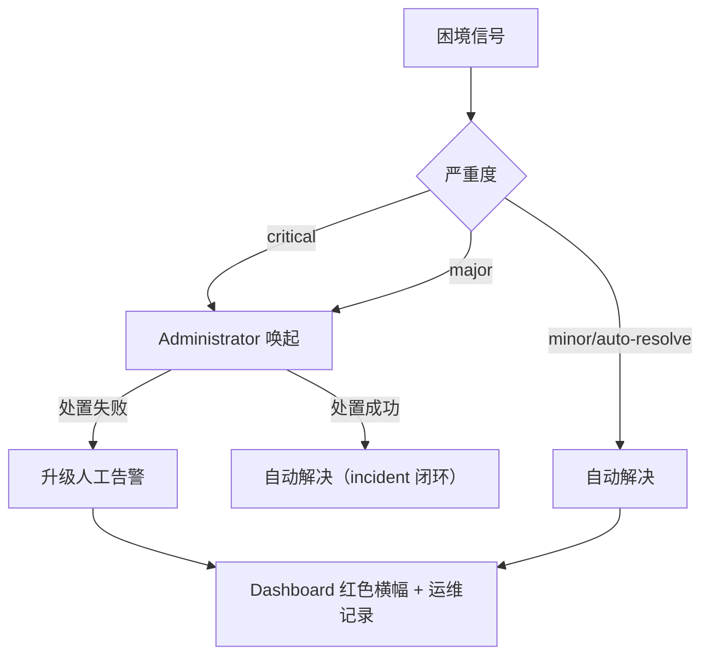

# 调度与治理规则

Fenix daemon 自动调度 SPEC 时受一组预算、重试与熔断规则约束，目的是防止三类失控：无限烧钱、无限重试、状态空转。理解这些规则之后，SPEC 卡住时你就能判断是哪条规则在起作用，以及该动哪个配置键。

本章承接[保障机制](07-safeguards.md)：上一章回答「框架靠什么机制保证不出事」（目的/原理/控制点），本章给出这些机制背后的数值口径：预算多少、退避几秒、告警几级流向谁。第一节先交代**调度节拍**——SPEC 靠哪些事件源被唤醒、兜底扫描为什么是 30 分钟——后面各节讨论的预算、退避与熔断，都作用在这套节拍之上。

## 实现者任务书完成度硬门

实现者（implementer）与快速通道（fast-track）的 run 在进程 exit 0 之外，还必须通过**结果产物硬门**（`_check_agent_result_artifact` 的 implementer/fast-track 分支）才会被标记 succeeded。校验对象是**本轮 run 的 worktree 根目录**下的 `.fenix-run-result.json`（不读主树拷回副本——主树共享文件跨 spec，读它会把上一轮/其它 spec 残留与本轮产物混为一谈）。

**硬门判据**（依次校验，任一不满足 → 抛 `AgentArtifactGateError`，run 不计 succeeded）：

1. **存在性**：文件存在、非空、合法 JSON、顶层为对象；
2. **status 白名单**：顶层 `status` ∈ `{"success", "error", "partial"}`（白名单外取值如 planner 词汇一律判失败）；
3. **success 完成度**：`tasks.md` 无未勾选数字任务（口径与 verified→done 门禁 `_task_completion_blocker` **同源**，`^- \[(x| )\] (\d+\.\d+)`），且结果文件顶层 `completed_tasks` 数组与已勾选 id 集合**完全相等**（缺项/多项/含非数字 id 判失败）；
4. **partial 申报一致性**：`completed_tasks` == 已勾选集合、`unfinished` == 未勾选集合、两集合互斥且并集 == 全部数字任务 id（防止 partial 成为绕过 success 判据的缺口）；
5. **能力探测下的 TaskUpdate 核对**（条件化）：仅当本轮 run 的 `init.tools` 含 `TaskCreate` 时，额外强制 `done_ids` 覆盖全部已勾选 id；不含（或 init 事件不可得）时**跳过**该项并写入 `impl-task-crosscheck-skipped` 审计事件——无条件强制会让硬门在 Task 家族工具不可用的派发路由上永远无法通过，形成「拒绝 → resume → 再拒绝」的预算烧穿循环。

`status == "error"` 时不施加任何完成度类判据（agent 自报失败即按失败处理）。

**失败处置 = 原地续做而非废轮**：硬门失败复用 `AgentArtifactGateError` 既有通道——保留 worktree 与 run 现场、按既有退避序列原地重试、以同一 worktree 与 `--resume` 会话续做，MUST NOT 清理 worktree、MUST NOT 把该轮判为「零成果需整轮重做」。续做轮 prompt 注入硬门归因（缺口任务 id 清单与失败类别），agent 无需重新推导剩余范围。连续失败由既有 provider-transient 退避与实现尝试预算机制收口（不新增独立重试计数）。

**partial 诚实上报语义**：实现者做不完时 MUST 以 `status: "partial"` 收工并如实登记 `unfinished` 数组，MUST NOT 用 success 掩盖未完成项。`partial` 是**非成功**终态：不进 `implemented`、走失败/重派通道并**消耗实现尝试预算**（不得走硬门失败的不消耗预算续做通道，否则形成「申报 partial → 无限续做」的预算绕行）；连续 partial 由既有预算上限收口并转 blocked 交人工。partial 轮之后 `verified → done` 门禁 fail-closed 拦截（不会带未完成任务推进 done）。

**残余风险（如实说明）**：`completed_tasks` 与 `tasks.md` 的集合相等校验只能保证「申报自洽」（agent 说做完了、勾选与申报一致、任务书已勾齐），**抓不住蓄意「先勾后做」**（先勾选再假收工）。在过程性工具（TaskUpdate）不可用的路由上，框架能观测到的只有「文件改了、提交了、自报做完了」。本硬门至少把**显式空跑**（agent 主动收工自报 success 却留 17 项未勾）从「可发生」变成「不可能」；真正的防线是验证场景覆盖任务面（另行评估）。

## 调度节拍：SPEC 何时被唤醒

在讨论预算与退避之前，先回答一个更前置的问题：**一个 SPEC 什么时候会被唤醒去派发？** 答案不是单一轮询，而是「事件驱动为主 + 多层定时兜底」。

### 唤醒源全景

| 唤醒源 | 间隔 / 时机 | 做什么 |
|--------|------------|--------|
| **文件监听器** | 2 秒（比对 STATE.md 校验和） | 状态一变即为该 SPEC 产出事件并派发——**正常路径** |
| **定时拾取** | 60 秒 | 检查 `start_after` 已到期的 SPEC 并派发（哨兵 `manual` 的 SPEC 永不参与到期检测） |
| **恢复闭环复查** | 60 秒 | 复查到期的恢复观察项（见下方盲区） |
| **配置热更新** | 30 秒 | 配置文件 mtime 变更即原地重载 |
| **自动归档检查** | 300 秒 | 终态 SPEC 超阈值则归档 |
| **孤儿清理** | 600 秒 | 回收残留 worktree / autostash |
| **全量扫描 `full_scan`** | `schedule.poll_interval_minutes`（默认 30 分钟），另在 daemon 启动与 STATE.md 变化时触发 | **兜底**：捞监听器漏掉的事件与「没有事件源」的孤儿态 |

`full_scan` 依次做三件事：比对全部 SPEC 的状态变化并派发事件、逐条执行恢复动作（孤儿 ready 白名单重派、中断态回退）、跑阻塞检测（`check_blockers`，内含恢复闭环复查）；每轮开始前还会先跑一次悬空 run 清扫。

上表中前六项与最后一项性质不同：前六项是**精确定向**的（谁变了就处理谁），全量扫描是**无差别兜底**的——这也决定了它的间隔取值。

### 为什么兜底扫描是 30 分钟：不是成本问题

实测（192 个 SPEC 的仓库，137 次 `full_scan`）：**中位 26.7 毫秒**，其中 100 次低于 100 毫秒；仅有两次超过 5 秒，且都不是扫描自身开销——一次计时窗口内套了一次远端 `git push`（网络 IO），一次是 daemon 启动的冷路径。按 30 分钟一次计算，占空比约 **0.0015%**。

所以这个间隔**不是被成本压出来的**，而是在「兜底及时性」与「恢复动作的副作用放大半径」之间取的保守值：`full_scan` 的恢复段会重新评估每个 SPEC 并可能重新派发，一旦恢复判据有缺陷，缩短间隔会成比例放大后果（`add-spec-status-modal-budget` 曾有每小时重验 9 轮的实证）。

**结论：要缩短等待，应当补事件源，而不是提高扫描频率。**

### 已知盲区：两类 SPEC 没有「能唤醒自己」的事件源

上面所有唤醒源有一个共同前提——**变化发生在该 SPEC 自己身上**（自己的状态变了、自己的定时到了、自己的观察项到期了）。有两类等待不满足这个前提，只能等下一轮全量扫描（最坏一个扫描周期）：

1. **依赖满足型**：SPEC A 声明 `depends_on: B`，A 因依赖不满足被跳过并出队；之后 B 转入接受态（`done`/`pushed`/`implemented`/`verified`）——那是 **B** 的状态变化，不会为 A 产出任何事件。
2. **恢复观察项通过型**：观察项到期复查时，若判定「已恢复推进」则只关闭观察项、不派发；若判据把「登记时 implementing、窗口内回退 ready」误判为已推进，该 SPEC 就静默滞留 `ready`。

两类盲区在 2026-09-12 均实测到（分别空等 25 分钟与 6 分钟，期间并发槽位是空闲的）。该盲区由 `fix-dispatch-wakeup-gap` 处置（依赖定向唤醒 + 复查通过即派发）。**在它落地前，若观察到 SPEC 长时间停在 `ready` 而槽位空闲，先确认是否落在盲区，而不是误判为槽位或预算问题**——查 `.fenix/logs/fenixd.log` 中是否只有 `Skipping '<spec>': dependencies not satisfied` 或 `Recovery watch passed`、且此后长时间无该 SPEC 的派发记录。

### 相关参数

| 参数 | 默认值 | 作用 |
|------|--------|------|
| `schedule.poll_interval_minutes` | 30 | 兜底全量扫描间隔（热更新） |
| `pm.recovery.followup_check_minutes` | 15 | auto-recovery 后的闭环复查窗口 |
| `pm.recovery.ready_stall_threshold_minutes` | 20 | 假就绪滞留判定阈值 |
| `agents.max_concurrent` | 5 | 同时在飞的 Agent run 并发上限（见下节） |

文件监听 2 秒、定时拾取 / 恢复复查 60 秒、归档 300 秒、孤儿清理 600 秒均为代码常量，不可配置。

## 优先级与并发

调度采用**宽松优先级并行**策略：任务 X 可派发当且仅当没有比 X 更重要的活动任务（即 `min(active_priorities) >= X`）。同一优先级内的任务可并行至 `agents.max_concurrent` 上限；不同优先级也可并发——只要有空闲槽位且没有更重要的活动任务，低优先级 SPEC 无须等所有高优先级 SPEC 完成。已在运行的任务不会被新到的高优先级抢占（不抢占）。

派发队列支持老化：条目等待越久，参与比较的优先级档位（effective 档位 = base − 老化收益）逐步放宽，给被高优任务持续占用挡住的低优任务打开派发窗口。活动任务不参与老化——派发后活动集合记录 base 原值；同级（effective 相等）条目保持先入队先派发的队首顺序（FCFS）；老化仅内存态，daemon 重启重建队列即从零计时。

优先级在 Dashboard 与 `/fenix-status` 中可见，也可以在 Dashboard 的 SPEC 详情行直接调整。

## 三类预算

| 预算 | 配置键 | 行为 | 耗尽后果 |
|------|--------|------|---------|
| **实现尝试预算** | `agents.impl_run_budget` | 每 spec 跨修复周期的实现 run 启动次数上限（含首次实现与每轮修复、含单次派发重试 attempt） | `blocked` + 人工告警，不再自动重派 |
| **Token 预算** | `agents.token_budget_millions` | 单 spec 累计 input token 预算（单位百万）；累计到 80% 发提醒告警、100% 发升级告警 | 不自动冻结，告警由人工决定处置 |
| **每日运行上限** | `agents.daily_run_limit` | 每日全部 Agent 运行总数上限（0=无限） | 当日停止派发 |

> 另有一类**不消耗预算的豁免**：判定为基础设施（infra）问题的验证失败轮不计入验证失败冻结判定，对应验证 run 的预算幂等退款——详见[验证体系](05-verification.md)的「infra 失败预算豁免」。

## 重试、退避与秒挂冷却

失败重试由 `agents.max_retries` 控制，设定失败 Agent run 的最大重试次数。

派发锁冲突按 `pm.dispatch_backoff_schedule`（默认 `[30, 120, 600]` 秒）递增退避：派发 implementer 遇到 worktree already active 时依次拉长等待间隔，期间不消耗 attempt 配额；若序列耗尽仍拿不到锁，触发 `dispatch_stalled` 信号升级处置。

秒挂冷却针对「刚启动即失败」的 run：这类 run 会进入冷却期，冷却期内 implementer/fast-track/repair 的再次派发一律跳过，防止失败—重派—再失败的反抖空转。

**信号死法冷却**：同一 SPEC 连续 3 次以「信号死亡」收场（进程被 Exit 143 / 负信号杀死，且非人工关停、非框架主动终止）时，进入 600 秒冷却——期间全部 agent 类型的重派一律跳过、不消耗任何预算，到期自动恢复，并落 major 告警（15 分钟节流，`core/agent_runner/provider_circuit.py`、`core/pm_engine/dispatch/queue.py`）。与秒挂冷却同时命中时取更晚到期者。

## 瞬断熔断与解封渐进恢复

provider（LLM 路由）持续报错会触发熔断；熔断的解除不是瞬间完成的，而是一套渐进恢复态序（`core/agent_runner/provider_circuit.py`）：

**冻结 > post-unseal hold > 探针观察窗 > 错峰放行 > open**

1. **post-unseal hold**：解封后先按 `agents.transient_unseal_backoff_base_seconds`（缺省 60 秒）× 解封次数退避等待，封顶 `agents.transient_unseal_backoff_max_seconds`（缺省 600 秒）；
2. **探针观察窗**：只放一条最高优先级探针，窗口 `agents.transient_unseal_probe_window_seconds`（缺省 120 秒）内同指纹新故障记账即判探针失败；
3. **错峰放行**：探针通过后按 `agents.transient_unseal_release_stagger_seconds`（缺省 30 秒）节拍逐个放行积压派发，避免惊群；
4. **open**：稳定窗 `agents.transient_unseal_stable_window_seconds`（缺省 1800 秒）内无新故障，解封次数随之衰减。

`backoff_base_seconds` / `release_stagger_seconds` 置 0 可整体禁用该机制。重新熔断时上述中间态全部作废、从头再来。

**排查入口**：SPEC 停在 `ready` 却迟迟不派发、并发槽位空闲时，先查 `.fenix/logs/fenixd.log` 的解封保持日志（特征串 `Transient unseal ... active — N queued dispatch(es) held`）——你遇到的可能不是调度或预算问题，而是某条 provider 车道还在 hold / 观察窗 / 错峰放行中。

## 超时活性监督

`agents.timeout_supervision` 默认启用。run 到达 `run_timeout_seconds` 后并不直接 kill，而是先按一组规则判定：

1. 总墙钟 ≥ `absolute_max_seconds` → 无条件终止
2. 已续期 `max_extensions` 次 → 终止
3. `judge_window` 秒内零 run 事件 → 跳过 LLM 直接判停滞终止
4. LLM 判定 advancing → `deadline += extension_seconds` 续期；stagnant / judge 不可用 → 终止留证

对用户的实际含义是：run 超过超时时间后可能仍在续期运行，Dashboard 显示「运行中」不代表卡死；真正停滞的 run 会被终止并留下证据。

## run 止损（run-stall budget）

超时活性监督回答「run 超时后要不要续期」；run 止损补上另一面：**没到超时、但持续低效空转的 run 要不要提前止损**。三件套语义（`core/agent_runner/runner.py`、`core/config.py`）：

1. **取消旗标跨 attempt 生效**：run 被取消后，同一槽位的原地重试不会把它复活——未在飞的 run 登记取消同样生效；
2. **原地重试让位**：并行出题的半成品已被隔离（discarded 标记）时，重试 run 检测到即主动让位退出（日志特征 `[retry-yielded]`），不覆盖新一轮产物；
3. **停滞复合判停**（任一命中）：观测窗内连续多次出现 ≥120 秒的慢往返（`RUN_STALL_ROUND_SECONDS=120`，最少 2 次采样、占比过半触发）；或停滞占比过半且超过窗口分钟数无产物文件 mtime 进展。命中即：写 WIP checkpoint → 终止 run → error 终态带 `[run-stall-budget]` 前缀。

| 配置键 | 默认值 | 作用 |
|--------|--------|------|
| `agents.run_stall_budget_enabled` | `false` | 总开关（缺省关闭，热更新生效） |
| `agents.run_stall_budget_stalls` | `5` | 观测窗内允许的停滞次数 |
| `agents.run_stall_budget_window_minutes` | `10` | 观测窗长度（分钟） |

与超时活性监督的关系：监督是「到期审、LLM 判 advancing 可续期」；止损开启后，停滞 run 在观测窗内即被主动终止，而不是靠续期无限拖延。

## 自动恢复

daemon 重启时，处于 `implementing`/`testing` 中断状态的 SPEC 自动回退 `ready`，同时清空陈旧 run 字段、重置重试计数，重新进入调度池。这是设计行为而非数据丢失。自愈链路的完整机制（boot recovery、恢复闭环复查、run sweeper、autostash 回收）见[保障机制](07-safeguards.md#自愈链路异常中断后的自动恢复)。

## 草稿人工放行

默认情况下，SPEC 注册为 drafted 后由 PM Engine 自动晋升 ready 并立即调度实现。对于重要改动，你可以把草稿晋升切为人工审批，让 SPEC 停留在草稿态供人工阅读，确认无误后再放行。

**配置开关**：`gates.promote_mode`（默认 `auto`，热更新生效，设置页「审批」页签可调；值语义与 `gates.approve_mode` 一致）
- `auto`（默认）：SPEC 注册后自动晋升 ready 并调度（现状不变）
- `manual`：SPEC 停留 drafted，不晋升、不派发、不写 error（设计行为而非故障）

**放行方式**：

1. **Dashboard 项目页**：对 drafted 状态的 SPEC，点击「晋升 ready」菜单项，确认后执行晋升（软化+lint+transition）
2. **CLI 命令**：`python3 bin/fenix_cli.py promote <spec> [--project <path>]`（缺省当前目录）
3. **/fenix-ready skill**：在 Claude Code 会话中执行 `/fenix-ready <spec>`，先阅读草稿再放行

**Lint 拦截**：晋升时仍执行完整 lint（声明形态+tasks 可解析性），违规时 SPEC 停留 drafted 并在 STATE 写入错误明细，可在 Dashboard 或 CLI 反馈中查看。修正后重新晋升。

**闸口切回后的存量处理**：把 `promote_mode` 从 `manual` 改回 `auto` 后，下一次 full_scan recovery 会自动晋升停留 drafted 的存量 SPEC，无需逐个手动操作。

## SPEC 手工激活（待激活）

定时拾取（`start_after` ISO8601）能表达「某个绝对时间点之后拾取」，但缺少「永不到期、等人发话才拾取」这一档。`start_after` 取值域扩展出第三个哨兵值 `manual`（add-spec-manual-activation）：

- **语义**：`start_after: manual` 的 SPEC **永不到期**，不会被调度器拾取，须人工激活后方可进入调度。它与定时拾取、冻结同属「有意等待」语义——不写 error、不翻状态、不触发告警巡检。
- **拦不拦晋升取决于 `gates.start_after_scope`**：手工激活的「拦截」以**实现派发口**为界恒成立；晋升/评审入口是否同样被按住由 `gates.start_after_scope` 决定（见[配置参考](09-config.md#gates)）：
  - `dispatch`（默认）：只拦实现派发——`manual` 哨兵照常晋升（含 `promote_mode` 语义）并（按评审判定）起评审，评审通过后停在 `ready`，不派发实现直到人工激活；
  - `full`：同时按住晋升与评审——`manual` 哨兵停留 `drafted`，晋升与评审一并等到人工激活。
  - 两种档位下**哨兵「不自动实现」的保证恒成立**：实现派发口的 `start_after` 门无条件，`ready + manual` 恒不派发。
- **与非目标区分**：`depends_on` 的调度语义不变（仅列表展示依赖标记）。

**激活入口清单**：

| 入口 | 操作 |
|------|------|
| Dashboard「修改状态」弹窗 | 调度小节「激活（立即调度）」按钮（双向：亦可「设为待激活」） |
| CLI | `python3 bin/fenix_cli.py activate <spec> [--project <path>]` |
| `/fenix-new` | §1.6 执行时机第三档「手工激活」（注册时写 `start_after: "manual"`） |
| evo 同意立项 | 「同意立项」弹窗执行时刻三档中的「手工激活」 |
| `/fenix-ready` | 放行时可选手工激活（仓库外 `~/.claude/skills/fenix-ready`，人工同步，见下） |

**人工步骤（仓库外，非本仓库交付物）**：`/fenix-ready` skill 位于 `~/.claude/skills/fenix-ready/`（仓库外独立目录），其「放行后立即调度 / 设为待激活」选项须由人工在主树手工补做（改动要点：放行确认处增一问「放行后立即调度，还是设为待激活？」；选待激活时把 SPEC 的 `start_after` 写为 `manual`）。

激活动作 = 把 `start_after` 由 `manual` 置为 `null` 并即时唤醒派发（复用 scheduling kick 文件信号），daemon 主循环 1s 粒度拾取即派发。

**信号载体（fix-scheduling-kick-single-slot）**：scheduling kick 信号载体为**每 SPEC 一文件**的目录形态 `.fenix/scheduling_kick/<spec>.json`（内容 `{"spec", "action": "clear-start-after", "created"}`）。同一 SPEC 重复清空幂等覆盖自身文件；**不同 SPEC 互不阻塞**——不再存在单槽位冲突导致第二个唤醒信号被静默丢弃。旧单文件路径 `.fenix/scheduling_kick_request.json` 由消费侧只读兼容（存量项目一次性迁移，消费后删除，新写入一律走目录）。

**诚实回报语义**：清空定时 / 激活动作的成功响应（API 200 / CLI exit 0）只代表 `start_after` 已成功置 null；若即时唤醒信号写出失败，响应携带 `warning`（「已清除定时/已激活，但即时唤醒信号写入失败，将由下次扫描（缺省 ≤30 分钟，即 `schedule.poll_interval_minutes`）派发」），前端与 CLI 依此分支文案，MUST NOT 无条件宣称「立即恢复调度」。

**陈旧信号回收（代码常量 1 小时，不可配置）**：daemon 启动清扫与周期计时段（600s 孤儿清扫节拍）对信号目录对账——`created` 在回收阈值内的条目先消费再删（唤醒幂等）；早于阈值 / `created` 缺失 / 损坏的条目仅删除不唤起（防 daemon 长期停机后残留信号在恢复时引发一轮病态集中派发）。旧单文件路径同受该阈值约束。该阈值与文件监听 2 秒、定时拾取 / 恢复复查 60 秒等均为代码常量，不可配置。

## SPEC 方案评审门禁

在草稿晋升链（软化 + lint）之后、进入 `ready` 之前，还有一道**方案级评审**：由一个独立的 `spec-review` Agent 阅读 SPEC 的 proposal.md、design.md 与 tasks.md，对方案的**目的适配性（goal-fit）**、**漏洞（hole）**、**回归风险（regression）** 三个维度做单轮只读判断，把方向性风险挡在实现之前。机械 lint 只管「声明路径长什么样」，方案评审管「这条路走不走得通」。

**评审触发条件**：默认（`gates.spec_review_mode: auto`）全部 SPEC 在草稿晋升时进入评审；仅当**四项全部命中**时才跳过评审直通 `ready`：

1. `mode == fast-track`（.spec.yaml 执行模式）
2. 能力目录数 ≤ 1
3. 交付物声明条目数 ≤ 3
4. **名称非 `evo-` 前缀**

`evo-` 前缀是**硬否决项**：自进化批量产出的 SPEC 即使同时满足前三项也必须评审（无人工方案背书，是本特性最主要的目标受众）。字段缺失（无 `mode`、无声明段）时保守取「不跳过」——判据判错时偏向多评审而非漏审。`gates.spec_review_mode: never` 时跳过全部评审（整体逃生门，见[配置参考](09-config.md#gates))。

`start_after` 未到期的 SPEC 是否进入评审由 `gates.start_after_scope` 决定：`dispatch`（默认）档下定时/待激活 SPEC 照常进入评审（提前拿到评审结论，实现等到期）；`full` 档下停留 `drafted`，到期/激活才晋升并评审（见[配置参考](09-config.md#gates)）。

**三种评审结论**：

- `approved`（方案可行且无改动）→ `ready`
- `repaired`（方案可行且评审者已就地修补可修补漏洞）→ `ready`（改动留在 git 工作区，可经 `git diff` 审计）
- `rejected`（存在方向性风险/致命漏洞）→ 冻结转人工（`frozen: true` + 人工升级告警），error 内嵌 `spec-review-rejected:` 标识（完整文案 `用户指令冻结：原状态 reviewing · spec-review-rejected: …`，见[生命周期](03-lifecycle.md#blocked-的两种语义冻结-vs-阻塞)）

**故障与否决严格区分**：评审 run 未通过结果硬门或写入边界校验（非零退出 / 结果文件缺失或空 / JSON 非法 / status 越白名单 / mtime 陈旧 / repairs 路径越界 / SPEC 目录外越界写入 / status 与改动不一致）**不计入否决**，重试（累计上限 3 次：首次 + 最多 2 次重试），耗尽后冻结转人工（`frozen: true` + 告警），error 内嵌 `spec-review-incomplete:` 标识。两类冻结在 Dashboard 上一眼可分：`rejected` 需要人工读方案并裁决，`incomplete` 需要人工看评审器为什么没跑成。

**人工恢复双路径**（评审相关冻结）：

- **解冻**（冻结评审 blocked 的唯一恢复路径）：Dashboard/CLI 解冻经 `parse_orig_status` 解析「原状态 reviewing」→ 恢复 `reviewing` → daemon 自动重派评审（评审收口字段已在冻结时清空）。
- **`blocked → reviewing`（重新评审）**：仅对 error 前缀为 `spec-review-*` **且未冻结**（无 `frozen: true`）的历史 blocked 条目开放；入口在 Dashboard 项目页「重新评审」菜单项与 CLI `review` 命令。冻结条目在此路径被拒（`SPEC 已冻结`，见[生命周期](03-lifecycle.md#评审类冻结的恢复解冻而非-re_review)）。其余 blocked（熔断/合并失败/人工冻结）不开放，以免一次误操作把因熔断停下的 SPEC 重新推入自动链。
- **`blocked → ready`（担责放行）**：保留既有语义，人工裁决后直接放行进入调度。

评审期间 SPEC 处于 `reviewing` 中断态，daemon 重启自动回退 `drafted` 重走晋升链（软化与 lint 幂等，分流重判；评审者已修补的内容会被基于改进后的方案再评一次）。

## merge 修复通道与熔断

合并失败按指数退避重试（`pm.push.retry_backoff_seconds` 默认 `[300, 900]`）；连续失败达到 `merge_breaker_threshold`（复用 `agents.merge_breaker_threshold`，默认 2）后，自动 merge 被阻断并转人工处置，产生 critical 级的 `merge_streak` 困境信号。落到体感上：同一 SPEC 连续 merge 失败几次就会停止自动重试并发出红脸告警，提示你去检查 git 冲突根因，而不是让框架继续盲目重试。

## SPEC 并发在飞守卫

方案评审与实现两条车道交叉时，框架用一组守卫防止互相踩踏（`core/pm_engine/spec_review.py`、`core/pm_engine/dispatch/queue.py`）：

- **评审收尾不打回实现中 SPEC**：评审结论落地时若 SPEC 已被推进到 `implementing` / `implemented` / `testing`，跳过回退动作——评审结果落侧车文件、STATE 登记 `_review_skipped_result`（格式 `<status>@result-path=<路径>`），只清评审 run 字段；
- **实现派发前查在飞评审**：派发实现前依次探测进程表 → 评审流文件 → 活跃评审注册表的 queued 条目（陈旧锚点与探测异常一律 fail-open 放行）；命中则该条目保留队列、不消耗派发 attempt，等评审先收尾；
- **实现合并收尾补记转移**：实现合并收尾发现 SPEC 仍停在 `ready`（评审收尾晚了半步的窗口）时，先补记 `ready → implementing` 转移再推 `implemented`，保证状态轨迹完整可审计。

## fix 族谱收敛

`fix-` 前缀的修复分支可以递归派生（fix-x → fix-fix-x → …），但受深度/宽度双重上限约束（`pm.family.max_depth` 默认 3、`max_width` 默认 2）。越界时自动创建被中止，并触发 `family_explosion` 信号转人工。这条规则防住「修不好的 fix 无限派生」：层层失败最终升级人工处置，而不是继续烧钱。

## 告警分级流向

困境信号（SIGNAL_SEVERITY）按严重度分流：critical 与 major 唤起 Administrator，minor/auto-resolve 走自动解决。各信号的严重度与含义如下：

| 信号 | 严重度 | 含义 |
|------|--------|------|
| repeated_failures | major | 同一 SPEC 连续失败 |
| flapping | major | 状态机空转回路（ready↔implementing） |
| stuck | major | run 卡死停滞 |
| merge_streak | critical | 合并反复失败 |
| blocked_stuck | critical | blocked 滞留 |
| daemon_errors | critical | 守护进程异常 |
| family_explosion | major | SPEC fix 族爆炸 |
| dispatch_stalled | major | 派发停滞 |

为防止同一信号反复唤起烧钱，Administrator 的唤起有冷却期（`admin.escalation_cooldown_minutes` 默认 60 分钟）。告警的检测逻辑、分级依据与生命周期闭环机制见[保障机制](07-safeguards.md#告警系统自愈无法覆盖时升级人工)。

## 重启协议

daemon 由 supervisor（`fenixd_supervisor.py`）托管，异常退出会被自动拉起，重启后中断状态按上文「自动恢复」回退。项目的启停通过 `/fenix-setup` 或 Dashboard 项目页操作，跨项目的统一管理则由 `/fenix-dashboard` 负责。

**唯一托管启动路径**：daemon 的唯一合法启动路径是经 supervisor 托管（`/fenix-setup` 第 7 步与 Dashboard 项目页「启动」均以 `fenixd_supervisor.py --project-root <根>` 拉起）；tmux 仅承担「脱离终端」，daemon 是 supervisor 的子进程。停止语义为「写 `.fenix/stop` → SIGTERM daemon → supervisor 收口退出」，不再直接杀 daemon。

**托管态三态**：daemon 运行状态分 `managed`（supervisor + daemon 均在）、`unmanaged`（有 daemon 进程但无 supervisor——裸 daemon，restart_request / 审批推送等文件信号无人消费）、`stopped`（两者皆无）。`unmanaged` 是存量项目（未经 `/fenix-setup` 托管）的典型状态，需经 Dashboard 项目页「安装托管」或 `/fenix-setup` 恢复托管；daemon 启动自检对托管缺失会落 `supervisor_missing` 告警并升级人工。

## 相关文档

- [配置参考](09-config.md) — 上述全部键的默认值/范围/生效方式
- [Dashboard 使用指南](08-dashboard.md) — 告警横幅处置入口
- [文件与数据地图](10-artifacts.md) — admin_alerts.json 告警记录位置
