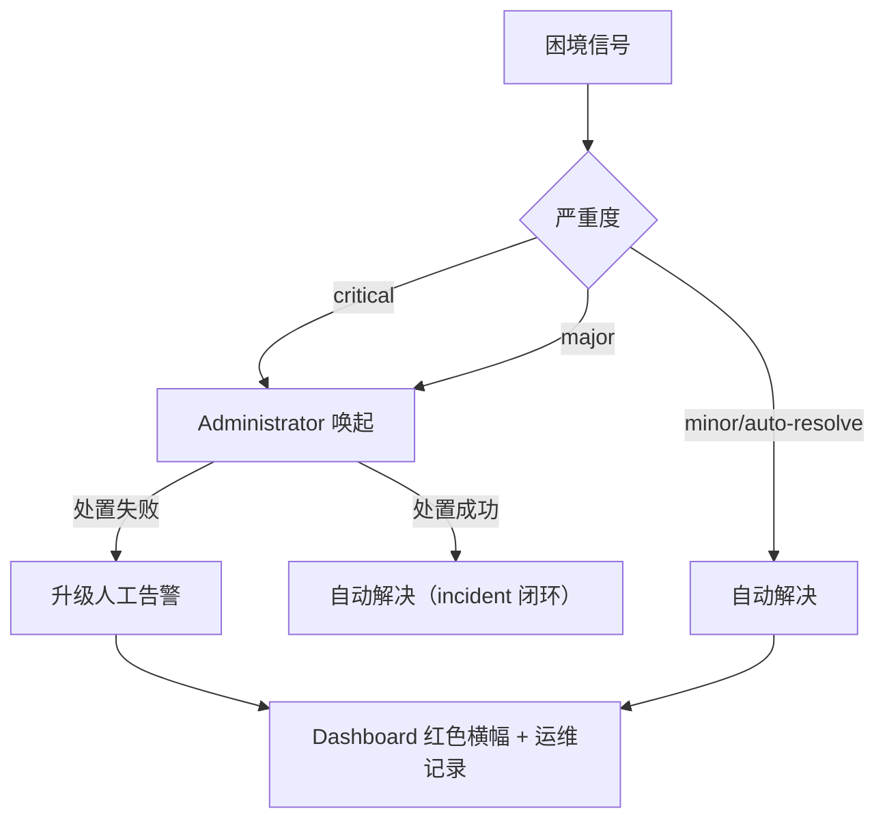

# 调度与治理规则

Fenix daemon 自动调度 SPEC 时受一组预算、重试与熔断规则约束，目的是防止三类失控：无限烧钱、无限重试、状态空转。理解这些规则之后，SPEC 卡住时你就能判断是哪条规则在起作用，以及该动哪个配置键。

本章承接[保障机制](07-safeguards.md)：上一章回答「框架靠什么机制保证不出事」（目的/原理/控制点），本章给出这些机制背后的数值口径——预算多少、退避几秒、告警几级流向谁。

## 优先级与并发

调度采用严格优先级并行策略：priority 数值小的 SPEC 先执行，同一优先级内的任务可并行至 `agents.max_concurrent` 上限，不同优先级之间不并行——低优先级必须等所有高优先级 SPEC 完成后才会启动。优先级在 Dashboard 与 `/fenix-status` 中可见，也可以在 Dashboard 的 SPEC 详情行直接调整。

## 三类预算

| 预算 | 配置键 | 行为 | 耗尽后果 |
|------|--------|------|---------|
| **实现尝试预算** | `agents.impl_run_budget` | 每 spec 跨修复周期的实现 run 启动次数上限（含首次实现与每轮修复、含单次派发重试 attempt） | `blocked` + 人工告警，不再自动重派 |
| **Token 预算** | `agents.token_budget_millions` | 单 spec 累计 input token 预算（单位百万）；累计到 80% 发提醒告警、100% 发升级告警 | 不自动冻结，告警由人工决定处置 |
| **每日运行上限** | `agents.daily_run_limit` | 每日全部 Agent 运行总数上限（0=无限） | 当日停止派发 |

## 重试、退避与秒挂冷却

失败重试由 `agents.max_retries` 控制，设定失败 Agent run 的最大重试次数。

派发锁冲突按 `pm.dispatch_backoff_schedule`（默认 `[30, 120, 600]` 秒）递增退避：派发 implementer 遇到 worktree already active 时依次拉长等待间隔，期间不消耗 attempt 配额；若序列耗尽仍拿不到锁，触发 `dispatch_stalled` 信号升级处置。

秒挂冷却针对「刚启动即失败」的 run：这类 run 会进入冷却期，冷却期内 implementer/fast-track/repair 的再次派发一律跳过，防止失败—重派—再失败的反抖空转。

## 超时活性监督

`agents.timeout_supervision` 默认启用。run 到达 `run_timeout_seconds` 后并不直接 kill，而是先按一组规则判定：

1. 总墙钟 ≥ `absolute_max_seconds` → 无条件终止
2. 已续期 `max_extensions` 次 → 终止
3. `judge_window` 秒内零 run 事件 → 跳过 LLM 直接判停滞终止
4. LLM 判定 advancing → `deadline += extension_seconds` 续期；stagnant / judge 不可用 → 终止留证

对用户的实际含义是：run 超过超时时间后可能仍在续期运行，Dashboard 显示「运行中」不代表卡死；真正停滞的 run 会被终止并留下证据。

## 自动恢复

daemon 重启时，处于 `implementing`/`testing` 中断状态的 SPEC 自动回退 `ready`，同时清空陈旧 run 字段、重置重试计数，重新进入调度池。这是设计行为而非数据丢失。自愈链路的完整机制（boot recovery、恢复闭环复查、run sweeper、autostash 回收）见[保障机制](07-safeguards.md#自愈链路异常中断后的自动恢复)。

## 草稿人工放行

默认情况下，SPEC 注册为 drafted 后由 PM Engine 自动晋升 ready 并立即调度实现。对于重要改动，你可以把草稿晋升切为人工审批，让 SPEC 停留在草稿态供人工阅读，确认无误后再放行。

**配置开关**：`gates.promote_mode`（默认 `auto`，热更新生效，设置页「审批」页签可调；值语义与 `gates.approve_mode` 一致）
- `auto`（默认）：SPEC 注册后自动晋升 ready 并调度（现状不变）
- `manual`：SPEC 停留 drafted，不晋升、不派发、不写 error（设计行为而非故障）

**放行方式**：

1. **Dashboard 项目页**：对 drafted 状态的 SPEC，点击「晋升 ready」菜单项，确认后执行晋升（软化+lint+transition）
2. **CLI 命令**：`python3 bin/fenix_cli.py promote <spec> [--project <path>]`（缺省当前目录）
3. **/fenix-ready skill**：在 Claude Code 会话中执行 `/fenix-ready <spec>`，先阅读草稿再放行

**Lint 拦截**：晋升时仍执行完整 lint（声明形态+tasks 可解析性），违规时 SPEC 停留 drafted 并在 STATE 写入错误明细，可在 Dashboard 或 CLI 反馈中查看。修正后重新晋升。

**闸口切回后的存量处理**：把 `promote_mode` 从 `manual` 改回 `auto` 后，下一次 full_scan recovery 会自动晋升停留 drafted 的存量 SPEC，无需逐个手动操作。

## merge 修复通道与熔断

合并失败按指数退避重试（`pm.push.retry_backoff_seconds` 默认 `[300, 900]`）；连续失败达到 `merge_breaker_threshold`（复用 `agents.merge_breaker_threshold`，默认 2）后，自动 merge 被阻断并转人工处置，产生 critical 级的 `merge_streak` 困境信号。落到体感上：同一 SPEC 连续 merge 失败几次就会停止自动重试并发出红脸告警，提示你去检查 git 冲突根因，而不是让框架继续盲目重试。

## fix 族谱收敛

`fix-` 前缀的修复分支可以递归派生（fix-x → fix-fix-x → …），但受深度/宽度双重上限约束（`pm.family.max_depth` 默认 3、`max_width` 默认 2）。越界时自动创建被中止，并触发 `family_explosion` 信号转人工。这条规则防住「修不好的 fix 无限派生」——层层失败最终升级人工处置，而不是继续烧钱。

## 告警分级流向

困境信号（SIGNAL_SEVERITY）按严重度分流：critical 与 major 唤起 Administrator，minor/auto-resolve 走自动解决。各信号的严重度与含义如下：

| 信号 | 严重度 | 含义 |
|------|--------|------|
| repeated_failures | major | 同一 SPEC 连续失败 |
| flapping | major | 状态机空转回路（ready↔implementing） |
| stuck | major | run 卡死停滞 |
| merge_streak | critical | 合并反复失败 |
| blocked_stuck | critical | blocked 滞留 |
| daemon_errors | critical | 守护进程异常 |
| family_explosion | major | SPEC fix 族爆炸 |
| dispatch_stalled | major | 派发停滞 |

为防止同一信号反复唤起烧钱，Administrator 的唤起有冷却期（`admin.escalation_cooldown_minutes` 默认 60 分钟）。告警的检测逻辑、分级依据与生命周期闭环机制见[保障机制](07-safeguards.md#告警系统自愈无法覆盖时升级人工)。

## 重启协议

daemon 由 supervisor（`fenixd_supervisor.py`）托管，异常退出会被自动拉起，重启后中断状态按上文「自动恢复」回退。项目的启停通过 `/fenix-setup` 或 Dashboard 项目页操作，跨项目的统一管理则由 `/fenix-dashboard` 负责。

## 相关文档

- [配置参考](09-config.md) — 上述全部键的默认值/范围/生效方式
- [Dashboard 使用指南](08-dashboard.md) — 告警横幅处置入口
- [文件与数据地图](10-artifacts.md) — admin_alerts.json 告警记录位置
