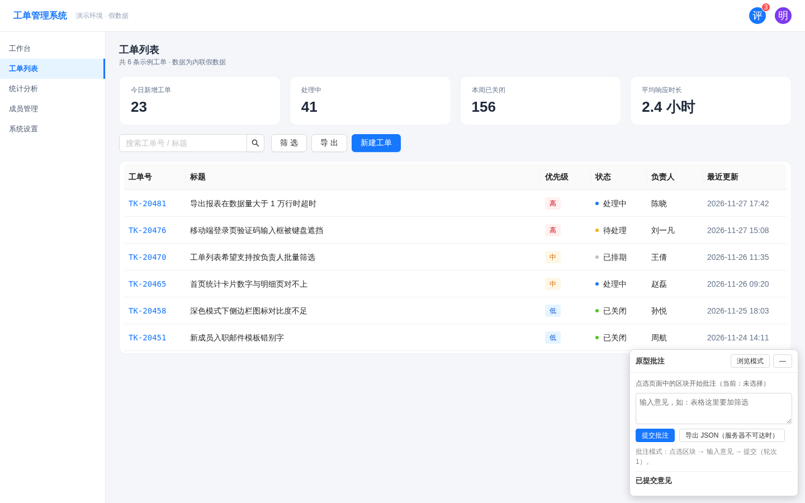
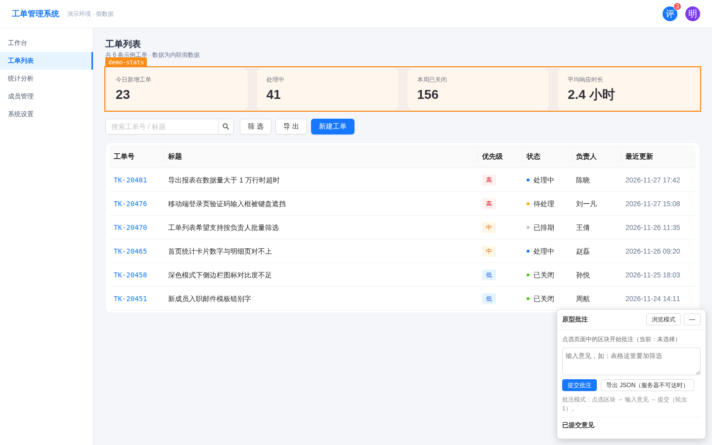
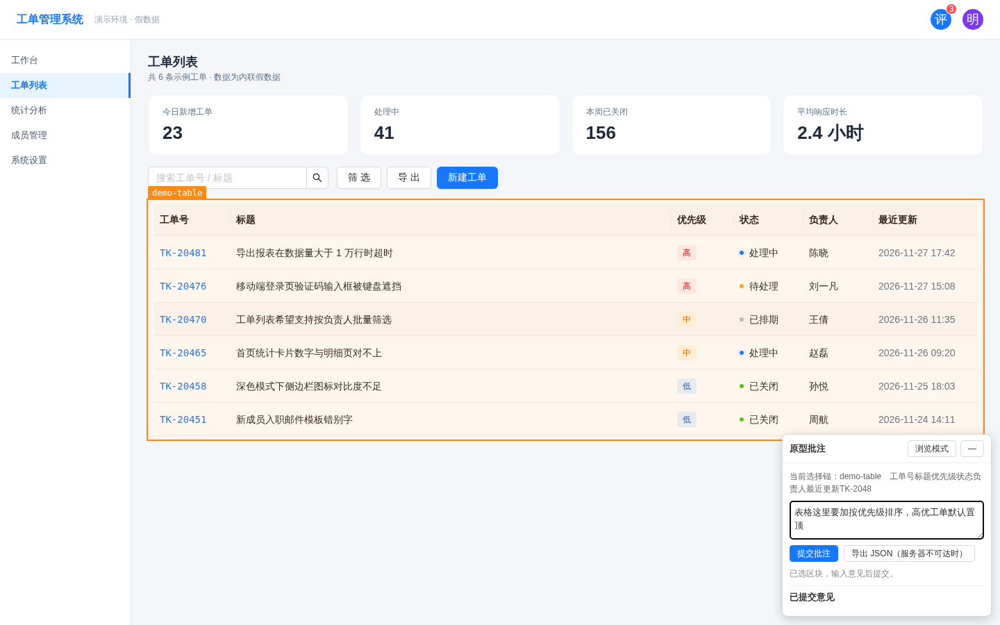
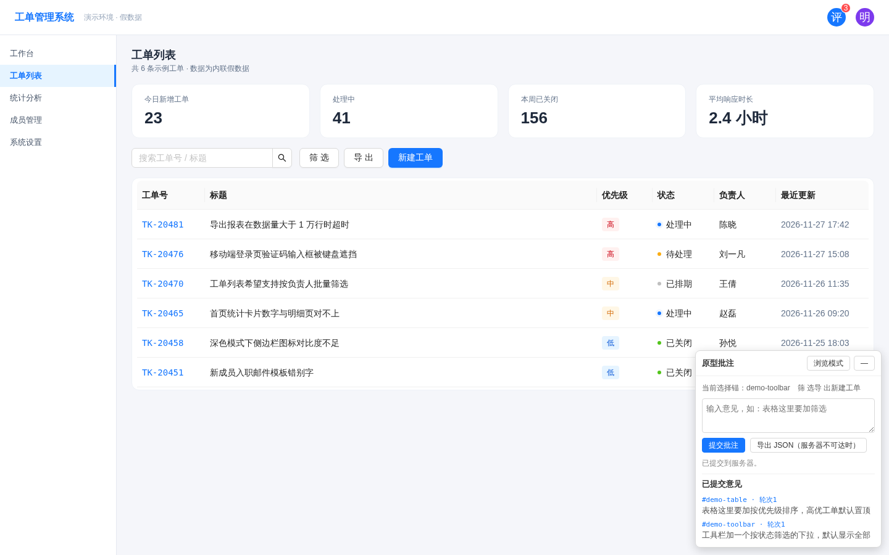
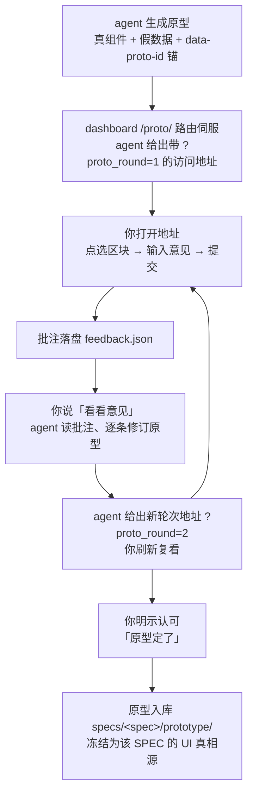
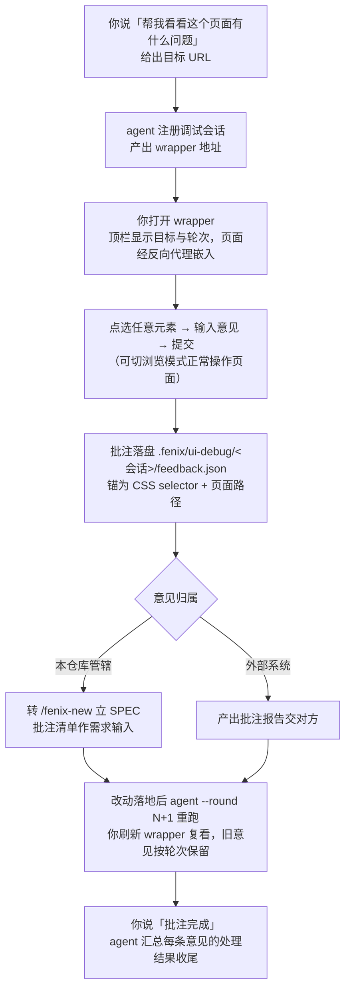
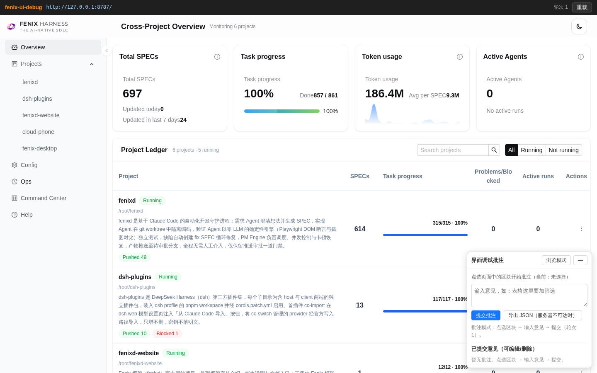
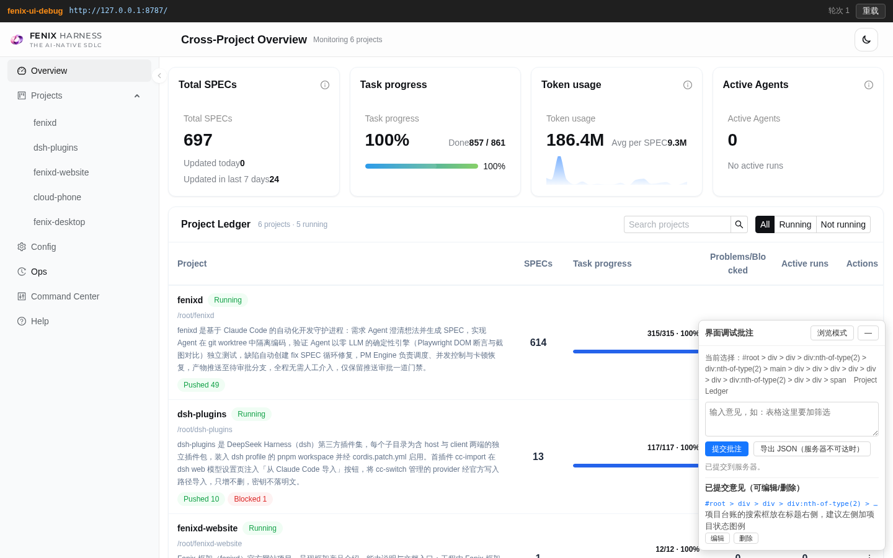

# 界面批注：原型确认与页面调试

Fenix 提供两条「浏览器点选批注」通道，把你对界面的意见变成结构化数据直接回流给 agent：**fenix-prototype**（原型批注）用于 SPEC 起草阶段确认尚未实现的界面——agent 生成一张「真组件、假数据」的高保真 HTML 原型，你在浏览器里对区块点选提意见，迭代到满意后原型入库成为该 SPEC 的 UI 真相源；**fenix-ui-debug**（界面调试批注）用于对**任何已在运行的真实页面**（任意 http/https URL）提修改意见或新功能建议——目标页经 dashboard 反向代理搬到同源下注入批注器，你点哪批哪，无需页面预置任何锚点。两条通道共用同一个批注面板：悬停高亮、点选区块、输入意见、提交落盘，全程不依赖截图和文字描述，意见自带精确锚点。

## 两条通道怎么选

| | fenix-prototype（原型批注） | fenix-ui-debug（界面调试批注） |
|---|---|---|
| 批注对象 | 框架生成的原型页（尚未实现的界面） | 任意已在运行的真实页面 |
| 页面地址形态 | `/proto/<项目>/<spec>/?proto_round=N` | `/uidebug/<项目>/<会话>?proto_round=N`（wrapper 套壳） |
| 锚的形态 | 生成时打好的 `data-proto-id` 语义锚（如 `order-list-table`），只能点选带锚区块 | 运行时即时生成的 CSS selector，任意元素可点选 |
| 典型时机 | /fenix-new 立项时界面改动大，agent 提议先出原型 | 系统上线后发现界面问题、想对新页面提需求 |
| 意见落盘位置 | `.fenix/prototypes/<spec>/feedback.json` | `.fenix/ui-debug/<会话>/feedback.json` |
| 意见的去向 | agent 修订原型，迭代到批准后入库为 SPEC 的 UI 真相源 | 整理为问题清单：属本仓库的转 /fenix-new 立 SPEC，属外部系统的出批注报告 |

两条通道都不需要你安装任何东西：dashboard（默认 `127.0.0.1:8787`，systemd 常驻，详见 [Dashboard 操作手册](08-dashboard.md)）单点承载页面伺服与批注落盘，你只需要一个浏览器。远程使用时 agent 会把地址中的主机换成对外入口（本项目约定为 `http://home.icyfenix.cn:8787`，frp 隧道透传，**纯 HTTP 无 TLS，不要改成 https**），路径与轮次参数不变。

## 批注面板：两条通道共用

打开 agent 给的批注地址，页面右下角就是批注面板。面板悬浮在页面之上（样式经 Shadow DOM 隔离，不受页面自身配色影响），从上到下依次是：标题栏（含模式切换与折叠按钮）、当前选择行、意见输入框、操作按钮行、状态行与「已提交意见」列表。



### 悬停高亮：先看锚再点选

批注模式下移动鼠标，可选区块会被橙色边框高亮，左上角的橙色标签显示该区块的锚名——原型通道显示 `data-proto-id` 锚名（下图的 `demo-stats`），界面调试通道显示 `标签名#id`。锚名是意见与页面区块之间的绑定键，agent 回流意见时靠它精确定位你指的是哪块。



### 点选 → 输入 → 提交

点选目标区块后，面板的当前选择行显示锚名与区块文本快照；在输入框写下意见（说得越具体，agent 修得越准），点「提交批注」。提交成功后输入框自动清空、状态行显示「已提交到服务器。」，意见实时落盘到服务器端的 `feedback.json`，**不需要**点完再点「导出」——导出按钮只在批注通道不可用时作为兜底（见下文「提交失败时会发生什么」）。



同一页面可以连续提多条意见：每条都是「点选 → 输入 → 提交」一轮，「已提交意见」列表实时追加，每条自带锚名与轮次号。



### 批注模式与浏览模式

面板默认处于**批注模式**：所有点击都被批注器拦截用于选区块，页面自身的按钮、链接、表单都点不动。要正常操作页面（比如展开一个菜单看里面的内容），点面板标题栏的「浏览模式」按钮切换——页面恢复可点击，再点一次（按钮变为「批注模式」）回到批注状态。面板可用标题栏的「—」折叠成一条，不挡视线。

### 界面调试通道专属：编辑与删除已提交意见

fenix-ui-debug 通道的面板列表标题为「已提交意见（可编辑/删除）」，每条意见带「编辑」「删除」按钮：**编辑**只改意见文本（锚与轮次不动，列表条目标「已编辑」）；**删除**经确认后即删，服务器同步。列表是服务器全量真相源——包含历史轮次与你在其他页面提交的条目。原型通道的列表则是本会话内存态，不带编辑删除——对同一区块重新提交一条新意见即可覆盖表述；此前提交失败未送达的条目，重试成功后会自动移除。

## 原型批注环（fenix-prototype）

### 流程全景



### 你要做什么

1. **打开地址**：agent 生成原型后会给出形如 `http://home.icyfenix.cn:8787/proto/<项目>/<spec>/?proto_round=1` 的访问地址（多页原型换页时是 `.../<spec>/<页面名>.html?proto_round=1`）。
2. **批注**：按上面的面板用法点选提意见。原型页全部是内联假数据（人名、单号、金额一眼可辨为示例），随便点不会影响真实系统。
3. **触发修订**：对 agent 说「看看意见」「按批注改一版」即可。agent 会逐条消化批注修订原型——未被波及的区块锚名保持不变，所以你之前提的意见不会因改版失效。
4. **刷新复看**：agent 给出 `?proto_round=2` 的新地址（或直接刷新原地址后注意轮次号），继续提新意见或确认。每条新批注自动带上当前轮次号，agent 按轮次区分新旧意见。
5. **批准**：你明示认可（如「原型定了」「就按这个出 SPEC」）后，agent 把原型连同整页截图入库到 `specs/<spec>/prototype/`，原型就此**冻结**。

### 批准之后：原型即 UI 真相源

入库的原型对该 SPEC 的界面实现有实际约束力：SPEC 正文会声明「界面原型（UI 真相源）：specs/<spec>/prototype/index.html」，相关场景显式声明「界面以 prototype/ 为准」——后续实现与评审与原型冲突时须升级由你裁决，不允许实现者凭感觉偏离。冻结后再想改原型，属于新一轮原型确认：原型复制回草稿目录重新迭代、重新批准、重新入库（覆盖前 agent 会向你确认），不会静默改动已入库文件。

**约束力分级**：原型使用的组件库资源按可用环境三级降级——`vendor`（本地预打包）与 `cdn` 层用的都是真实组件库，原型具约束力；环境全不可用时降级为 `plain` 纯 HTML/CSS 仿样，页面顶部会出现醒目的**「仿样原型 · 视觉参照、无约束力」**横幅，此类原型只作视觉参照，不进入 UI 真相源绑定。agent 汇报生成结果时会说明所用层级，见到仿样横幅即知该原型不具约束力。

### 原型伺服的几个特性

- **改了即时生效**：原型目录由 dashboard 恒 no-cache 伺服，agent 改完原型你刷新即可，没有缓存烦恼。
- **零生命周期管理**：没有「服务器起没起」「要不要回收」的概念，dashboard 常驻，原型目录存在即可访问。
- **批注数据不会被静态读走**：`feedback.json` 及其派生文件在静态通道一律 403，只能经 agent 读取。

## 界面调试批注环（fenix-ui-debug）

### 流程全景



### wrapper：顶栏与内嵌页面

你拿到的不是目标页原始地址，而是一个 wrapper 页：深色顶栏左侧是橙色的 `fenix-ui-debug` 标识与目标地址（下图中的 `http://127.0.0.1:8787/`），右侧是轮次号与**「重载」按钮**（点击重新加载内嵌页面，改动落地后复看用）。顶栏下方以 iframe 内嵌经反向代理改写后的目标页——批注器活在 iframe 内，所以你在内嵌页面里的点选批注与原型通道完全一致。



wrapper 与代理都对轮次参数透明：agent 重跑注册脚本带 `--round N+1` 后，你刷新同一个 wrapper 地址，顶栏轮次号更新，新提的意见落新轮次，旧意见按轮次保留不丢失。

### 与原型通道的差异

- **任意元素可点选**：锚是点选瞬间生成的 CSS selector（唯一 id 祖先截断的 nth-of-type 链），不要求页面预置任何标记；面板当前选择行显示的就是这串 selector。
- **意见记录所在页面**：每条批注额外携带 `page` 字段（代理内路径）——SPA 页内路由跳转后批注仍能定位到具体视图，agent 按 `page` 分组整理意见。
- **写操作不可用属预期**：代理只透传 GET/HEAD（读只浏览），内嵌页面里的提交类操作（表单 POST 等）会收到 405——批注环只需要「看 + 批」，需要验证写操作时请到原始地址操作。
- **上游挂了不用重跑**：目标服务不可达时内嵌页面显示 502，但会话文件已落盘，目标恢复后刷新 wrapper 即可，无需让 agent 重新注册。

### 一条完整的批注

下图是对真实页面（本项目 dashboard 自身）提的一条意见：当前选择行显示生成的 selector 链与元素文本快照「Project Ledger」，提交后「已提交意见（可编辑/删除）」列表实时出现该条，带「编辑」「删除」按钮。此刻它已落盘为 `.fenix/ui-debug/<会话>/feedback.json` 中的一条完整记录。



## 批注数据的形态与回流

### 单条批注长什么样

两条通道的单条批注结构一致，界面调试通道多两个字段：

```json
{
  "anchor": "demo-table",
  "text": "表格这里要加按优先级排序，高优工单默认置顶",
  "timestamp": "2026-11-28T08:36:10.187Z",
  "round": 1,
  "element": { "tag": "div", "text": "工单号标题优先级…" }
}
```

| 字段 | 含义 |
|---|---|
| `anchor` | 锚：原型通道为 `data-proto-id` 值；界面调试通道为 CSS selector（`element.text` 文本快照用于 selector 漂移时人工确认） |
| `text` | 你的意见原文 |
| `round` | 轮次，来自 URL 的 `?proto_round=N` 参数 |
| `timestamp` | 提交时刻（ISO 8601） |
| `element` | 点选元素的标签名与文本快照（截前 80 字符） |
| `page`（仅界面调试） | 批注所在页面的代理内路径 |
| `id`（仅界面调试） | 服务端补发的寻址键，编辑/删除按它定位 |

### 提交失败时会发生什么

提交按钮有 8 秒超时窗口（在飞期间防重复提交），失败原因会如实区分并在状态行提示：

- **服务器明确拒绝（HTTP 4xx）**：提示「服务器拒绝了该批注，请修正后再提交」，不会生成导出文件（重试同样必败，避免误导你去 找不存在的导出文件）。
- **超时 / 网络不可达 / 服务器故障**：自动把未送达的批注导出为本地 `feedback.json` 下载，状态行提示「已导出未送达批注」。把下载的文件交给 agent，放到原型目录（或会话目录）同名位置，意见即可回流。
- **file:// 直接打开页面**（如本地双击打开原型 HTML）：批注通道天然不可达，点「导出 JSON（服务器不可达时）」手动导出后交 agent 即可。
- 失败的条目在「已提交意见」列表里会标注「未送达」；同样的意见重试成功后，旧的未送达条目自动移除，不会出现重复。已确认送达服务器的批注不会再被重复导出。

### agent 侧如何消费

你说「看看意见」后，agent 读取对应目录的 `feedback.json`：原型通道按锚名定位区块修订原型（重生成时跑锚保持检查，未波及区块的锚名必须全部保留）；界面调试通道按 `page` 分组、按轮次区分新旧，selector 可在代理页上重放定位验证，歧义意见（如「这里样式不对」无具体指向）会先列出来向你澄清而不是猜。收尾时（你明示「批注完成」）每条意见的处理结果（已修 / 转 SPEC / 不处理+原因）都会汇总呈现，不会静默丢弃。

## 常见问题

**点了没反应，提示「该区域没有 data-proto-id 锚」？**
原型通道只能点选带锚的关键区块（页头、侧边栏、表格、工具栏、弹窗等生成时都打了锚）。装饰性空隙、留白区域不可选。切到想批注的区块上，看到橙色高亮再点。

**面板自己点不了 / 页面点不动？**
分两种：批注模式下页面点击被拦截是设计行为（选区块优先），切「浏览模式」可正常操作页面；面板自身的按钮永远可点——如果连面板都无响应，刷新页面重进（批注已落盘的不受影响）。

**提交一直失败？**
按状态行提示对症处理：HTTP 4xx 多为地址形态不对（比如把 file:// 直开的页面当成了伺服地址，批注器推导不出正确的提交端点），用 agent 给的完整地址重新打开；超时/网络不可达则依赖自动导出兜底，把导出文件交 agent。

**原型改版后我之前的意见还在吗？**
在。意见落盘在 `feedback.json` 里与页面版本无关；agent 修订时遵守锚保持纪律，未被你意见波及的区块锚名不变。若某区块因重构换了锚名，agent 每轮修订后会报告哪些锚保留、哪些换锚。

**轮次号有什么用？**
区分「哪轮提的意见」。agent 每轮修订后给新轮次地址，你复看时新提的意见自动带新轮次号；agent 按轮次判断意见是针对旧版还是新版，避免把已修完的旧意见再修一遍。手动改 URL 里的 `proto_round` 数字即可换轮次（非数字会被忽略，回退轮次 1）。

**原型页控制台有 React 「数组 key」警告？**
非缺陷。原型用 vendor 开发构建渲染真实组件库，该警告是其已知噪音，生产构建不存在；排查页面问题前先与已入库旧版原型的控制台对照，不要据该警告返工。

**已入库的原型想改？**
属于新一轮原型确认：直接对 agent 说要改哪里，agent 会把原型复制回草稿目录重新走「批注 → 修订 → 你认可 → 重新入库」，不会静默改动已冻结文件。

## 相关文档

- [快速上手](01-quick-start.md)——原型确认环在整个流程中的位置（/fenix-new 立项阶段）
- [Dashboard 操作手册](08-dashboard.md)——dashboard 启动与页面总览（批注通道的承载者）
- [文件与数据地图](10-artifacts.md)——`.fenix/` 运行时目录全景（批注落盘位置）
- [FAQ 与故障排查](12-faq.md)——批注之外的其他故障现象定位
