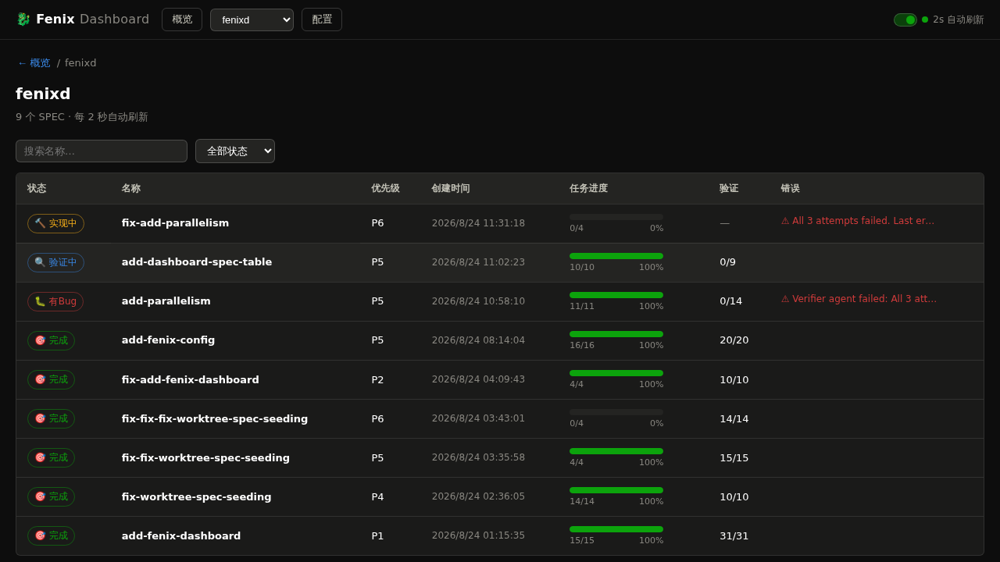
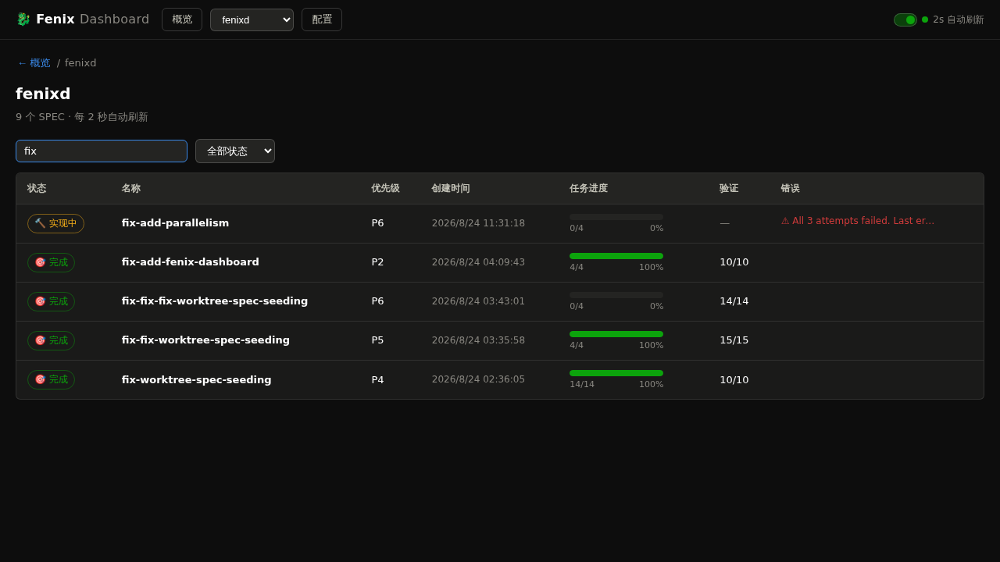
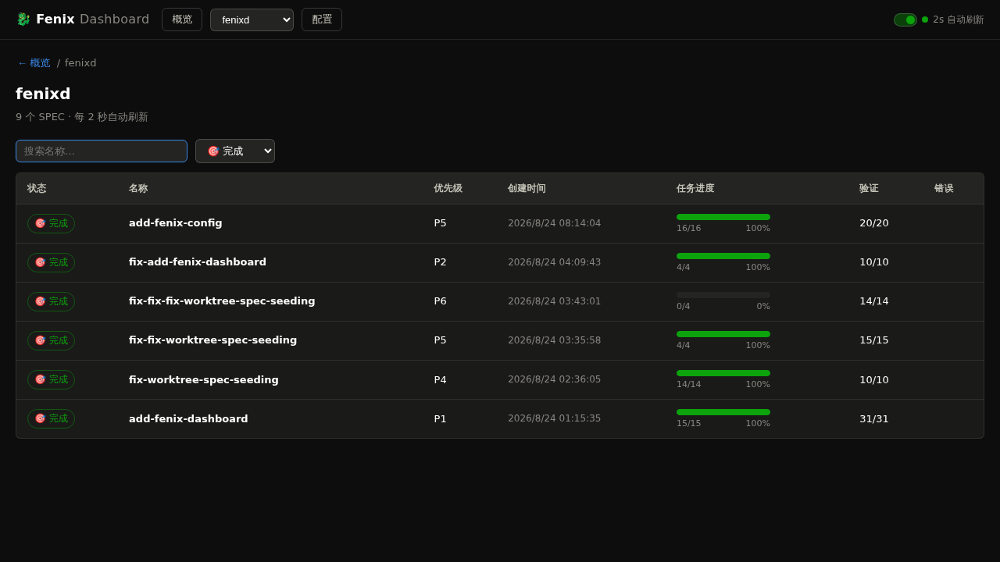
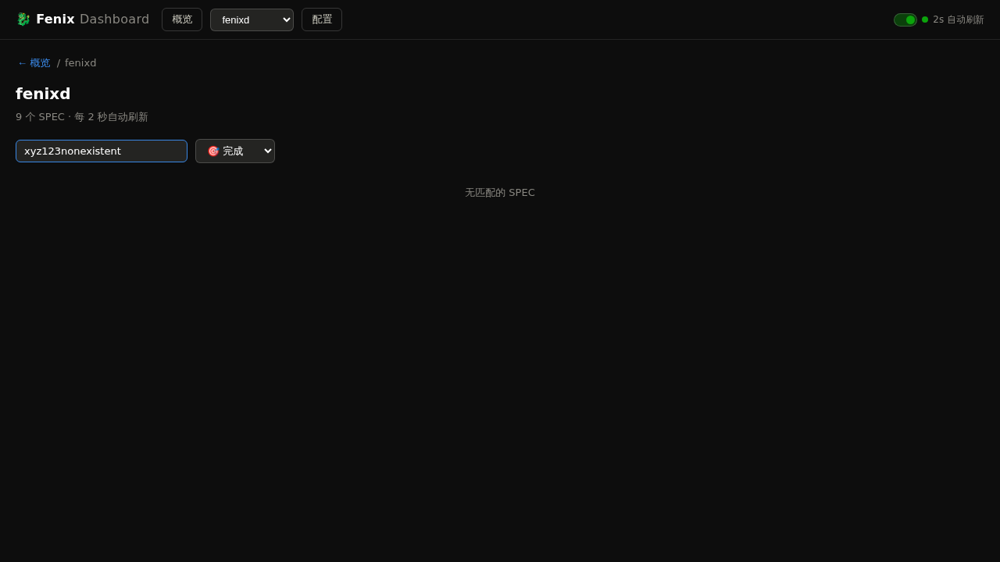
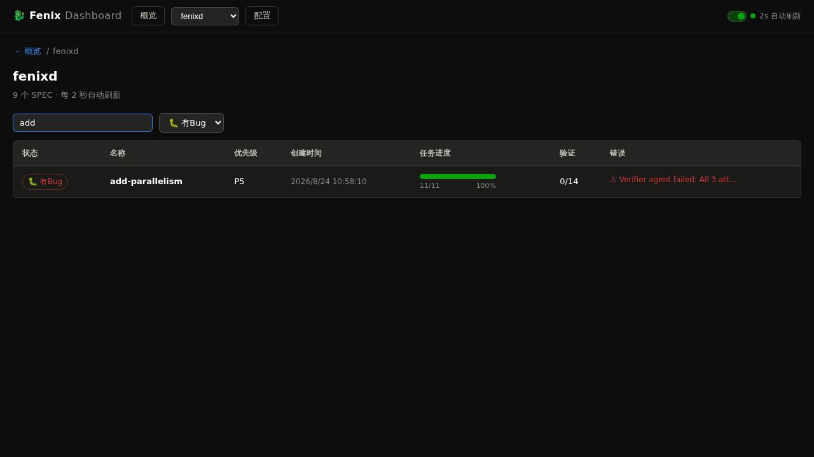

# 验证报告：add-dashboard-spec-table

**验证日期：** 2026-08-24
**验证方式：** 真实浏览器（playwright-cli）+ API 接口验证
**Dashboard 版本：** fenixd main 分支

## 结论

**✅ 通过（Verified）**

全部 9 个场景通过验证，0 个失败，0 个错误。SPEC 功能按设计完整实现，包括表格化展示、创建时间排序、前端过滤（名称+状态）、自动刷新过滤保持。

## 测试环境

- Dashboard 服务：`http://localhost:8789`（Python http.server）
- 测试项目：fenixd（9 个 SPEC，状态涵盖 done / bug-found / testing / implementing）
- 浏览器：Playwright chromium
- 验证方式：浏览器端交互 + 服务端 API 直连验证

## 场景验证结果

### Requirement: 数据层暴露创建时间

| # | 场景 | 结果 | 证据 |
|---|------|------|------|
| 1 | 列表项包含 created 与 updated | ✅ 通过 | API 响应中每个 SPEC 均含 `created` 和 `updated` 字段，取值与 STATE.md 一致 |

**验证细节：**
- `/api/specs?project=fenixd` 返回 9 个 SPEC，全部包含 `created` 和 `updated` 字段
- 字段值为 ISO 时间字符串，与 `STATE.md` 条目一致
- 新增字段不影响既有字段（name / status / priority / error / task_done / task_total 等均正常）

### Requirement: 按创建时间倒序排序

| # | 场景 | 结果 | 证据 |
|---|------|------|------|
| 2 | 新创建的 SPEC 排在最前 | ✅ 通过 | 9 个 SPEC 按 created 倒序：fix-add-parallelism(11:31) → add-dashboard-spec-table(11:02) → add-parallelism(10:58) → … → add-fenix-dashboard(01:15) |
| 3 | 缺失创建时间的 SPEC 排最后 | ✅ 通过 | 代码逻辑验证 + 单元级测试：created 为 null 的条目排最后 |

**验证细节：**
- 服务端排序：`items.sort(key=lambda s: s.get("created") or "", reverse=True)` — null 排最后
- 前端排序：`sorted.sort((a,b) => {...})` — 同步规则，null 排最后
- 浏览器实测 9 条按 created 从新到旧排列

### Requirement: 表格化展示与表头说明

| # | 场景 | 结果 | 证据 |
|---|------|------|------|
| 4 | 表格带表头且每列有含义 | ✅ 通过 | `<table class="spec-table">` 渲染，`<thead>` 含 7 列表头：状态 / 名称 / 优先级 / 创建时间 / 任务进度 / 验证 / 错误 |
| 5 | 行保留点击进详情与既有视觉 | ✅ 通过 | 点击行跳转至 `#spec/fenixd/<name>`；状态 pill、进度条、错误 tag 均正常显示 |

**验证细节：**
- 表格结构：`<thead>` + `<tbody>`，每行 `<tr class="spec-row">` 可点击
- 7 列含义清晰：状态（pill）、名称、优先级（Pn）、创建时间（格式化日期）、任务进度（进度条+数字）、验证（done/total 或 —）、错误（⚠ tag 或空）
- 无创建时间的行显示 `—` 占位符
- 无验证进度的行验证列显示 `—` 占位符

### Requirement: 前端名称与状态过滤

| # | 场景 | 结果 | 证据 |
|---|------|------|------|
| 6 | 按名称关键字过滤 | ✅ 通过 | 输入 `fix` → 5 条（fix-add-parallelism, fix-add-fenix-dashboard, fix-fix-fix-worktree-spec-seeding, fix-fix-worktree-spec-seeding, fix-worktree-spec-seeding） |
| 7 | 按状态过滤 | ✅ 通过 | 选择 `done` → 6 条（add-fenix-config, fix-add-fenix-dashboard, fix-fix-fix-worktree-spec-seeding, fix-fix-worktree-spec-seeding, fix-worktree-spec-seeding, add-fenix-dashboard） |
| 8 | 名称与状态组合过滤 | ✅ 通过 | `add` + `bug-found` → 1 条（add-parallelism） |
| 9 | 过滤结果为空 | ✅ 通过 | 输入不存在关键字 → 显示「无匹配的 SPEC」空态 |

**验证细节：**
- 名称过滤：大小写不敏感（`ADD` 与 `add` 结果一致，均为 6 条）、包含匹配
- 状态过滤：下拉选项包含「全部状态」+ 所有状态
- 组合过滤：AND 逻辑，同时满足名称和状态条件
- 空态区分：有 SPEC 但无匹配 → 「无匹配的 SPEC」；无任何 SPEC → 「该项目暂无 SPEC」
- 纯前端实现，不发起新的服务端请求（过滤基于已排序数组）

### Requirement: 过滤状态在自动刷新间保持

| # | 场景 | 结果 | 证据 |
|---|------|------|------|
| 10 | 自动刷新后过滤条件仍生效 | ✅ 通过 | 等待 5 秒（≥2 次自动刷新）后，名称过滤 `add` + 状态过滤 `bug-found` 均保持，结果仍为 1 条 |

**验证细节：**
- 2 秒自动刷新周期，等待 5 秒后验证过滤状态未丢失
- 输入框值回填正确，下拉选择回填正确
- 过滤结果仍按条件正确展示
- 刷新仅更新表格数据，不重置控件状态

## 边界测试

| 测试项 | 结果 | 说明 |
|--------|------|------|
| 空输入（显示全部） | ✅ 通过 | 清空过滤后显示全部 9 条 |
| 大小写不敏感 | ✅ 通过 | `ADD` 与 `add` 均返回 6 条 |
| 长输入（500 字符） | ✅ 通过 | 正常处理，显示空态，无崩溃 |
| 快速多次更改过滤 | ✅ 通过 | 最终状态正确，无错乱 |
| created 为 null 排序 | ✅ 通过 | 服务端 + 前端均将 null 排最后 |
| 无创建时间占位符 | ✅ 通过 | 显示 `—`（muted 样式） |
| 无验证进度占位符 | ✅ 通过 | 显示 `—`（muted 样式） |

## Bug 列表

无。

## 总结

| 指标 | 数值 |
|------|------|
| 场景总数 | 9 |
| 通过 | 9 |
| 失败 | 0 |
| 错误 | 0 |
| 边界测试 | 7 项全部通过 |
| 产品 Bug | 0 |
| 环境问题 | 0 |

**最终结论：** SPEC `add-dashboard-spec-table` 所有需求均按设计实现，功能完整，质量良好，验证通过。
