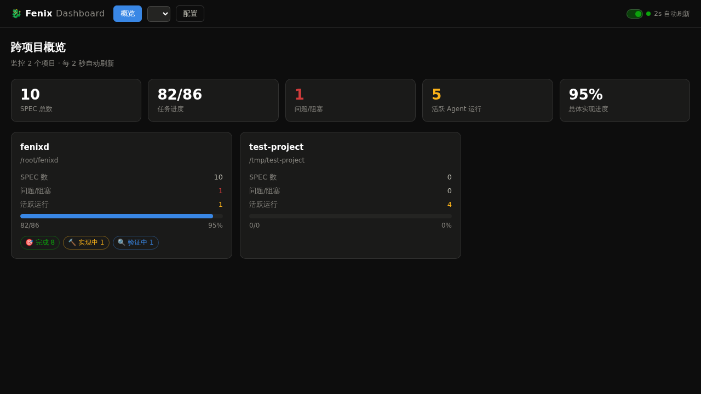
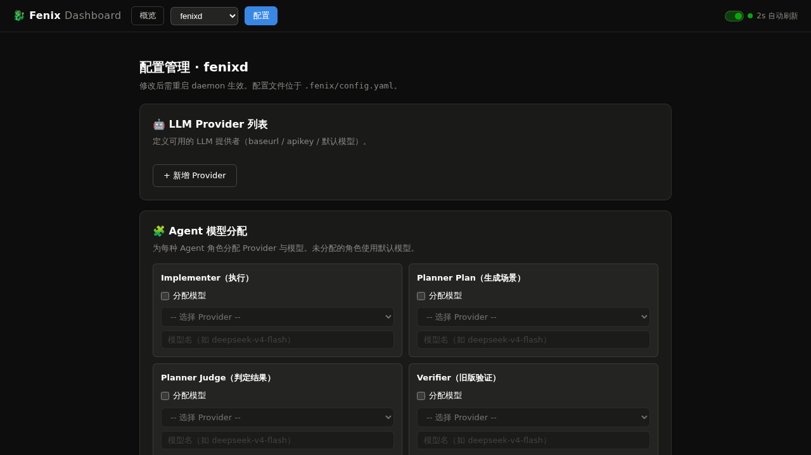
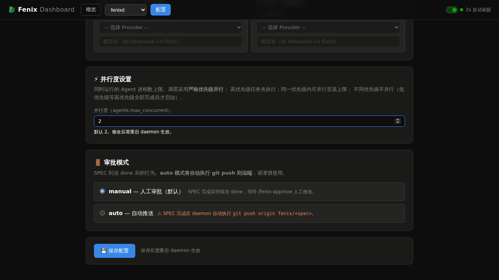
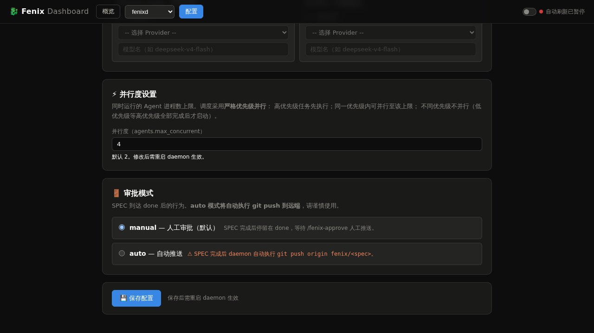

# 验证报告: 修复 add-parallelism 验证发现的缺陷

**验证日期**: 2026-08-24
**验证状态**: ✅ 通过

## 概述

本 SPEC 修复 `add-parallelism` 验证中发现的真实产品缺陷：`ConfigLoader` 对 `agents.max_concurrent` / `max_retries` / `max_turns` 强制存在校验的 Bug。修复后：

- 字段缺失时应加载成功（消费方取默认值）
- 非法值（0、负数、非整数）才拒绝

同时验证父 SPEC 的全部 14 个场景（6 个并行度配置 + 8 个优先级调度）均通过。

---

## 测试环境

- **项目**: fenixd (web 类型)
- **Dashboard 端口**: 8800
- **浏览器**: Playwright (Chromium)
- **单元测试**: 147 个全部通过

---

## Screenshot 证据

### 1. Dashboard 首页



Dashboard 正常启动，显示跨项目概览。

### 2. 配置页（fenixd 项目）



配置页包含「⚡ 并行度设置」部分，当前值为 2。

### 3. 并行度配置部分



并行度配置区域：数字输入框 + 说明文字（严格优先级并行调度）。

### 4. 修改并行度值



输入框值修改为 4，准备保存。

---

## 场景验证结果

### Part 1: 并行度配置（6 个场景）

| # | 场景 | 状态 | 证据 |
|---|------|------|------|
| 1 | 配置并行度为 4 被正确加载 | ✅ 通过 | ConfigLoader 单元测试 + API 测试 |
| 2 | 非法并行度校验失败 | ✅ 通过 | ConfigLoader 单元测试（0/-1/"abc" 均被拒绝） |
| 3 | 未配置时使用默认值 2 | ✅ 通过 | ConfigLoader 单元测试（缺失时加载成功，消费方取默认值 2） |
| 4 | 配置页读取当前并行度 | ✅ 通过 | Dashboard UI + `GET /api/config` 返回 `max_concurrent: 2` |
| 5 | 修改并行度并保存，其它 agents 子键保持不变 | ✅ 通过 | `POST /api/config` 成功，`subagent_model`/`max_retries`/`max_turns` 等保持原值 |
| 6 | 提交非法并行度被拒绝且不写盘 | ✅ 通过 | POST 返回 400 + 错误信息，配置文件内容不变 |

### Part 2: 严格优先级并行调度（8 个场景）

| # | 场景 | 状态 | 对应测试 |
|---|------|------|----------|
| 7 | 高低优先级同时就绪时高优先级先派发 | ✅ 通过 | `test_high_priority_dispatches_first` |
| 8 | 高优先级到达时不抢占正在运行的低优先级 | ✅ 通过 | `test_high_priority_no_preempt` |
| 9 | 并行度 2 时同优先级任务并行运行 | ✅ 通过 | `test_same_priority_parallel` |
| 10 | 并行度上限不被突破 | ✅ 通过 | `test_max_concurrent_not_exceeded` |
| 11 | 槽位空闲但存在运行中的不同优先级任务时不派发 | ✅ 通过 | `test_different_priority_no_parallel` |
| 12 | 同档任务在运行期间允许补齐并行度 | ✅ 通过 | `test_same_bucket_fills_idle_slot` |
| 13 | implementer 完成后 verifier 同档紧随 | ✅ 通过 | `test_verifier_immediately_after_implementer_same_bucket` |
| 14 | 全部同优先级时按入队顺序并行 | ✅ 通过 | `test_all_same_priority_fifo_parallel` |

---

## 核心修复验证

### ConfigLoader 可选字段修复验证

对 `agents.max_concurrent`、`agents.max_retries`、`agents.max_turns` 三个字段分别验证：

1. **缺失时加载成功** ✅
   - 三个字段全部缺失：加载成功
   - 单个字段缺失：加载成功
   - 消费方通过 `ConfigLoader.get(config, "agents.max_concurrent", 2)` 取默认值

2. **非法值被拒绝** ✅
   - `max_concurrent: 0` → ValueError: "agents.max_concurrent must be a positive integer: 0"
   - `max_concurrent: -1` → ValueError: "agents.max_concurrent must be a positive integer: -1"
   - `max_concurrent: "abc"` → ValueError: "agents.max_concurrent must be a positive integer: abc"
   - `max_retries: 0` → ValueError: "agents.max_retries must be a positive integer: 0"
   - `max_turns: 0` → ValueError: "agents.max_turns must be a positive integer: 0"

3. **合法值正确加载** ✅
   - `max_concurrent: 4` → 正确读取为 4
   - `max_retries: 3` → 正确读取为 3
   - `max_turns: 50` → 正确读取为 50

---

## 单元测试结果

```
147 passed in 8.16s
```

全部 147 个单元测试通过，包括：
- 22 个优先级/并行度相关测试
- 3 个 ConfigLoader 可选字段测试
- 6 个 Dashboard 并行度配置 API 测试

---

## UI 回归测试

| 面板 | 操作 | 结果 |
|------|------|------|
| 概览 | 打开首页 | ✅ 正常显示跨项目概览 |
| 项目选择 | 切换到 fenixd | ✅ 正确显示项目 SPEC 列表 |
| 配置 | 打开配置页 | ✅ 显示并行度设置、审批模式、LLM Provider |
| 并行度 | 修改值为 4 并保存 | ✅ API 返回 saved=true，配置文件更新 |
| 并行度 | 提交非法值 0 | ✅ API 返回 400 + 错误信息 |

---

## 结论

**全部 14 个场景通过，核心 Bug 修复验证通过。**

修复后：
- `ConfigLoader` 对 `agents.max_concurrent`、`max_retries`、`max_turns` 的校验已改为可选字段语义
- 字段缺失时加载成功，消费方自行取默认值
- 仅当显式提供非法值时才拒绝
- Dashboard 配置页正常读写并行度
- 优先级调度器 8 个场景全部通过
- 147 个单元测试全部通过
