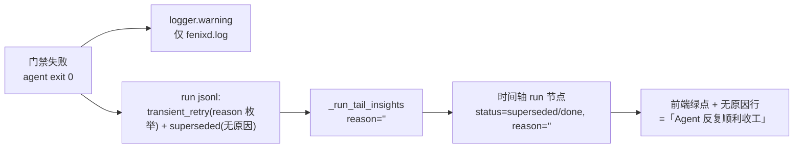

## Context

### 事实（2026-09-21 双路独立取证）

**写侧**（`core/agent_runner/runner.py`）：

- `_handle_artifact_gate_retry`（`:2653`）在门禁失败时：
  - `self.logger.warning("agent_runner", f"Artifact gate failed for …: {error}")`（`:2669-2673`）→ 仅 daemon log；
  - 落盘 `transient_retry`（字段：`type/spec/provider/backoff_seconds/retry_number/reason="artifact_gate"/timestamp`，
    `:2709-2721`）与 `superseded`（字段：`type/spec/provider/timestamp`，`:2724-2732`）——**均无 error 文案**。
- provider 瞬断路径 `_maybe_in_place_retry`（`:2555`）字段与门禁路径对称，同样不含 error。
- 预算耗尽后 attempt 层失败（`:2704-2706` → `break`）走 `_finalize_failure_keep`（`:3037`），**只打日志**
  （`:` 3054-3058，`error` 仅作日志 `context`）；`_exhausted_result` 同样只 `_log_run_metrics`。
  → 每个 attempt 文件末行仍是 `_run_claude` finally 写的 CLI `result` 事件。
- `append_run_error`（`core/agent_runner/run_files.py:74-76`）是 `error` 事件的**唯一**写函数，调用点全在
  `_run_claude` 内（子进程级失败），门禁（exit 0 后的框架侧判定）不经过它。

**读侧**：

- `_run_tail_insights`（`core/dashboard/data/runs.py:598-601`）：`elif t in _RUN_TERMINAL_STATUS_MAP and
  t != "result": reason = e.get("error") or e.get("reason")`；
  `_RUN_TERMINAL_STATUS_MAP`（`:131-138`）含 `superseded` 但不含 `transient_retry`。
- `classify_run`（`:148-161`）只看末行 → attempt 中间件 `superseded`、末件 `done`。
- `get_spec_timeline`（`core/dashboard/data/timeline.py:266-279`）run 节点 `reason` 取 `insights["reason"]`。

**前端**（`core/dashboard/static/src/pages/projects/detail.tsx`）：

- `:1009-1018` status→色：`error` 红 / `interrupted|cancelled` 橙 / `stale` 灰 / `running|empty` 蓝 /
  **其余（含 `done`、`superseded`）绿**；
- `:1071-1078` `reason` 非空才渲染（`error` → 「失败原因：」，否则「中止原因：」）；
- `superseded` 无专属分支（全仓 `grep superseded static/src/` 零命中）。



### 约束

- 该 SPEC 改前端 `detail.tsx` 后 MUST 同步执行 `npm run build`（改前端必须重新构建，见项目记忆
  `fenixd-session-panel-viewport-height`）。`dist/` 为 gitignored 构建产物，任务书按先例
  （`add-test-regression-tab` tasks.md:110）处理后，另由框架 merge 后自动重建主树产物。

## Goals / Non-Goals

**Goals**
- 门禁失败的归因在 run 产物里可读（写侧带 error 文案）。
- 时间轴 run 节点上直接可见门禁拒绝，不再绿点误导。
- 门禁失败产生的 run 记录不被读侧误判为成功、不让实现预算绕过。

**Non-Goals**
- 不改门禁判据、不新增配置项。
- 不把原地门禁重试次数并入 `_retry_count`（该计数语义是 spec 级重派，另见 D5）。
- 不改 `/api/events` 通路（其无前端消费者）。

## Decisions

### D1 写侧：门禁失败的事件带 `error` 字段

- `transient_retry`（门禁路径）增 `"error": error`（已带 `[artifact-structural]` 等归因标签的全文）；
- `superseded`（门禁路径）增 `"error": error`。
- 归因文案可能超 `append_run_line` 的 8 KiB 缓冲（`run_files.py:56-71` 注释明示超缓冲大行有并发交错
  风险），故 MUST 先截断再落两个事件——留可判归因（gate 名 + 路径）即够，不外溢风险。
- **截断单位（MUST NOT 歧义）**：`error[:1024]` 是**字符（code point）切片**，不是字节切片。UTF-8 下
  1024 字符最坏 ≤4 KiB，仍低于 8 KiB 单行缓冲阈值，字符口径即满足「不外溢」；反过来说 MUST NOT 把
  该上限当字节读并按字节截断（会与实现的切片口径不一致，用例断言与实现互斥）。用例断言口径统一为
  「字符数 ≤1024 且 UTF-8 编码后 ≤4096 字节」。

**取舍**：不改 provider 瞬断路径（`_maybe_in_place_retry`）的字段——本 SPEC 聚焦门禁可见性，瞬断
已有既有告警链路；保持改动面收敛。

### D2 写侧：新增终态事件 `gate-blocked`

门禁路径**终止当前 attempt 文件**时，向该 attempt 文件追加：

```json
{"type": "gate-blocked", "spec": …, "provider": …,
 "reason": "<按分支取值：artifact_gate | task_gate>",
 "error": "<门禁归因全文，≤1024 字符>",
 "timestamp": "…"}
```

**分支与 `reason` 取值（穷举，MUST NOT 用同一个值糊过去）**：

| 分支 | 位置（`core/agent_runner/runner.py`） | 是否写 `gate-blocked` | `reason` |
|---|---|---|---|
| 结构类原地预算耗尽（返回 `do_break`） | `:2704-2706` | MUST | `artifact_gate` |
| 任务完成度类 `is_task_gate`（返回 `do_break`） | `:2702-2703` | MUST | `task_gate` |
| 退避后让位（spec 已被接管，返回 yielded result） | `:2751-2775` | MUST NOT | 不适用 |

**让位分支为何 MUST NOT 写**：该分支的弃置原因是「spec 已被人工/其它链路接管」，不是门禁判定本身；
其终态已由 D1 补齐为 `superseded` + `error`（`:2724`），时间轴节点仍带门禁归因，不需要（也不应）再
追加一个红节点——否则会把「被接管」误标成「门禁拒绝」，且同一次失败在时间轴上出现两个失败节点。
让位分支写 `gate-blocked` 属**误标**，本 SPEC 明令排除。

**位置不变量**：MUST 写在该 attempt 文件**末行**（`append_run_line` 追加即满足），维持框架既有
「终态后置」不变量（该文件此后无任何写入者：attempt 终止，重试在新文件继续）。

**理由**：现状「预算耗尽 → 末行仍是 CLI 的 `result`（`is_error:false`）」正是 `classify_run` 判 `done`
的直接原因；没有新终态事件，读侧无从区分「真收工」与「门禁拒绝后放弃」。

### D3 读侧：终态映射 + 原因提取

- `_RUN_TERMINAL_STATUS_MAP`（`runs.py:131-138`）增 `"gate-blocked": "gate-blocked"`。
- `_run_tail_insights` 既有逻辑 `e.get("error") or e.get("reason")` 对 `gate-blocked` / `superseded`
  自动生效（两者此刻均已带 `error` 字段）——**无需新增字段**，只需确认 `superseded` 在映射内、
  `gate-blocked` 已登记。
- 时间轴 run 节点（`timeline.py:266-279`）沿用 `insights["reason"]`，零改动。

### D4 新终态的下游一致性（必查清单）

`_RUN_TERMINAL_STATUS_MAP` 的消费点必须逐处复核，避免新终态半接入：

| 消费点 | 位置 | 期望行为 |
|---|---|---|
| 归档判定 | `runs.py:736` `_RETENTION_ARCHIVABLE_STATUSES = frozenset(_RUN_TERMINAL_STATUS_MAP.values()) \| {"stale"}` | **自动纳入**（集合由映射派生），无需改代码，但 MUST 有用例锁定 |
| 活跃计数 | `runs.py:526` `active_run_count`（`running`/`empty` 才算活跃） | `gate-blocked` 不计活跃（自动正确） |
| 预算计数 | `core/pm_engine/budget.py:417` `_run_file_died`（末行 `type == "error"` 才算死亡） | `gate-blocked` **不**算死亡 → 计入已耗预算（正确：门禁失败已烧一轮预算，MUST NOT 被豁免）。该判据只认 `type == "error"`，与终态集合登记互不影响 |
| 在跑判定（删除/归档保护） | `core/dashboard/data/admin_actions.py:152` `running_run_ids_for_spec` + `core/dashboard/data/spec_archive.py:24` `soft_delete_spec`（末行 `type` ∈ `liveness.RUN_TERMINAL_EVENT_TYPES` 才算已终结，否则判在跑） | `gate-blocked` **MUST** 被认作已终结——否则刚被门禁拦下的 SPEC 会被判「有进行中的运行」：`stop_callback` 为 None 时直接 409 拒绝删除，非 None 时无进程可停 → 有界等待超时后删除失败（`add-freeze-stop-inflight-agents` 同款事故形态）。**故 MUST 同步登记进 `RUN_TERMINAL_EVENT_TYPES`**（见下方两侧同步义务） |
| code-review 进度 | `core/code_review.py:713` `_terminal_status_map()`（`read_progress` 的 running 判定） | 自动生效（延迟解析读侧映射）：门禁终止的 review run 不再判 running——期望语义 |
| 存活探测 | `core/agent_runner/liveness.py:390` `_stream_recent` → `has_live_attempt`（mtime 新鲜 **且** 末行非终态 = 有生命） | 随两侧同步生效：`gate-blocked` 文件不再作为存活依据（该文件已无写入者）。与 `superseded` 的**故意排除**（`:170-180`）不同：superseded 写在退避 sleep 之前、窗口内没有别的文件代表该 run，排除正是为了防退避窗口双派发；两者差异 MUST 写进代码注释，避免后人「统一口径」时踩雷 |

**两侧同步义务（MUST，有框架先例）**：`liveness.py:75-80` 已就 `frozen-terminated` 立下规则——
「写侧权威的终态类型 MUST 同时登记进 `_RUN_TERMINAL_STATUS_MAP`」。本 SPEC 新增的 `gate-blocked`
是写侧终态事件类型，MUST 同时登记两侧：

1. 读侧映射 `_RUN_TERMINAL_STATUS_MAP`（D3）——缺它时间轴永远把该 run 判 `running`；
2. 写侧终态集合 `RUN_TERMINAL_EVENT_TYPES`（`core/agent_runner/liveness.py:81-90`）——缺它末行
   `gate-blocked` 的文件在**在跑判定**里永生为「在跑」（删除/归档被误拦）。

两处 MUST 各有用例锁定（tasks 4.2 / 4.4）。

### D5 前端：门禁拒绝专属渲染

`detail.tsx` run 节点：

- 新增 `isGateBlocked = st === 'gate-blocked'`：圆点与 Tag 红色（同 `error` 语义——门禁拒绝是失败），
  Tag 文案「门禁拒绝」；
- `reason` 行：`isErr || isGateBlocked` 时用 `danger` 色、前缀「门禁拒绝：」；
- `superseded`：有 `reason` 时用中性色（`secondary`）+ 前缀「原地重试：」，无 `reason` 时维持现状；
  MUST NOT 再让带原因的重试节点落成「无原因绿点」。

**注**：`superseded` 的圆点/ Tag 颜色维持绿色（它是**被弃置的中间产物**，本身不是失败终态；失败归因
由紧随其后的 `gate-blocked` 节点承担），避免同一次失败在时间轴上出现两个红色节点。

### D6 布局与构建

- 前端改动后 MUST `cd core/dashboard/static && npm run build`；`dist/` 产物 `kind: reference`
  （先例 `add-test-regression-tab` tasks.md:110）。
- 新增前端测试（若可行）：`core/dashboard/static/tests/` 为 `node --test` 纯逻辑测试目录，
  `detail.tsx` 是 React 组件不经该链路——故前端以**构建通过 + 后端数据字段用例**保证，不在本 SPEC
  引入组件测试基建（避免范围蔓延）。

## Risks / Trade-offs

- **风险**：新终态枚举影响预算对账（`gate-blocked` 非 `error` 末行 → 计入预算）。**缓解**：这正是
  期望语义（门禁失败烧掉的预算不该豁免）；D4 表逐处锁定，并加用例断言。
- **风险**：`error` 截断到 1024B 可能切掉路径尾部。**缓解**：门禁归因的关键判据（gate 名）在前部，
  路径在 `:1024` 内足以定位；完整文案仍在 daemon log 与 STATE.md。
- **风险**：前端改动面扩大。**缓解**：只动 `detail.tsx` 一处，构建产物 reference 化，测试走数据层。
